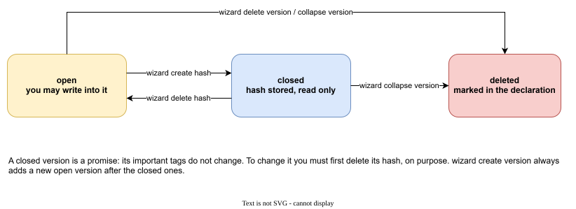
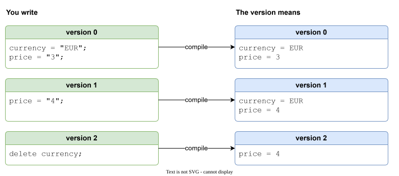
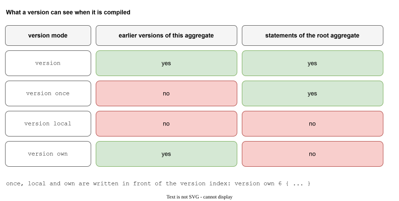
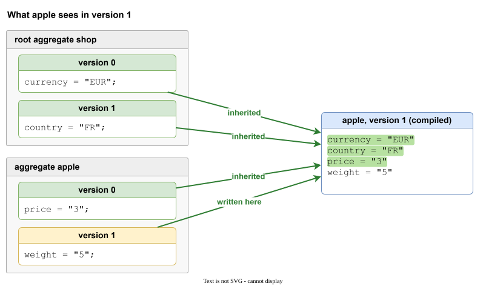
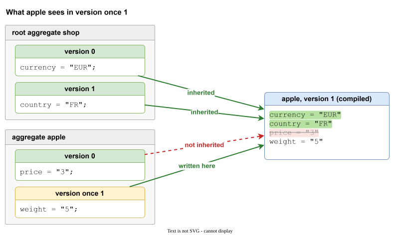
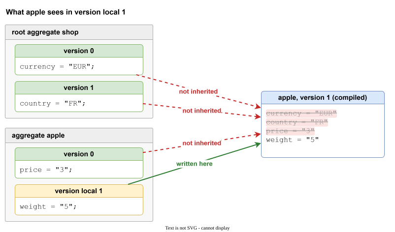
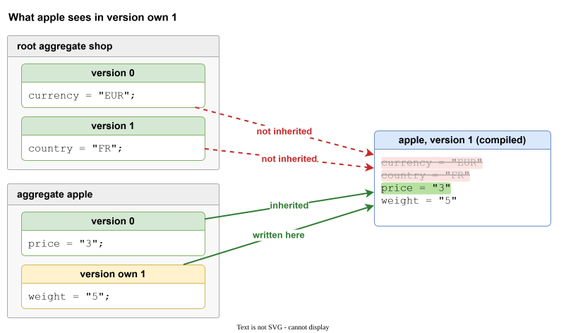
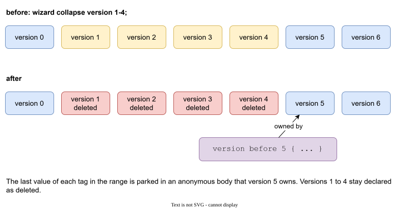

# Aggregates and versions

## The version list

The root aggregate declares which versions exist. Every aggregate repeats the same list, so an aggregate can never be "at version 3" while the rest of the project is at 2.

```
root aggregate shop
{
    versions
    {
        0 = { hash = '27025d7a...' };
        1 = deleted;
        2 = { comment = "spring prices" };
        3;
    }
}
```

| Declaration | Meaning |
|---|---|
| `3;` | version 3 exists and is open |
| `0 = { hash = '...' };` | version 0 is **closed**: a hash fixes its important values |
| `1 = deleted;` | version 1 was removed. The index stays reserved. |
| `{ comment = "..." }` | a note for people. It does not affect the data. |

The indexes run from 0 without gaps. Galimatron checks this on every run and tells you which aggregate breaks the rule.



A version is **open** (you may write into it), **closed** (a hash is stored, read only) or **deleted**. See [Hashes and closed versions](hashes.md) for the closed state.

## What a version sees

Writing a full copy of every aggregate in every version is the problem you want to avoid. A version states only its **changes**. What the aggregate "means" in a version is the merge of that version with everything before it.



- A tag written in version 0 is still there in version 1, until version 1 writes the tag again (the new value wins).
- `delete name;` removes a tag from that version on.
- A later version can bring the tag back by writing it.

The same rule works across aggregates: the root's tags flow into every aggregate.

```
root aggregate shop { versions { 0; 1; } }

version 0 { currency = { "EUR" }; }
version 1 { }
```

```
aggregate apple { versions { 0; 1; } }

version 0 { price = { "3" }; }
version 1 { price = { "4" }; }
```

| Compiled | currency | price |
|---|---|---|
| apple, version 0 | EUR | 3 |
| apple, version 1 | EUR | 4 |

You wrote the currency once. A new currency in the root, in version 2, changes every aggregate in version 2 and later.

## Version modes

Sometimes an aggregate must not take everything. A dictionary of terms may need no settings of the root. An item that was reborn may need to forget its old fields. A **version mode** is written before the index.

```
version own 6 { ... }
```



| Mode | Earlier versions of this aggregate | Statements of the root |
|---|---|---|
| (none) | yes | yes |
| `once` | no | yes |
| `local` | no | no |
| `own` | yes | no |

### The four modes, one by one

The pictures below use the same data, so you can compare them. The root `shop` has `currency` in version 0 and `country` in version 1. The aggregate `apple` has `price` in version 0 and `weight` in version 1. Only the mode written before version 1 of `apple` changes. Each picture shows what `apple` ends up with in that version: green lines were inherited, struck-out lines were not.

**No mode.** The default. The version takes everything: the earlier versions of `apple` and the root's tags. Nothing is lost, and this is what you want almost always.



**`once`.** The version forgets what `apple` itself wrote before (here, `price` is gone), but it still receives the root's tags. Use it to start an item over while it keeps following the root.



**`local`.** The version stands alone. It has nothing from the earlier versions of `apple` and nothing from the root, only what it writes itself. Use it for a body that must not depend on anything else.



**`own`.** The version keeps what `apple` wrote before, and cuts itself off from the root. The root's `currency` and `country` do not reach it. Use it for an aggregate that has its own life, like a dictionary of terms that needs no settings of the root.



`local` and `own` are only for aggregates. On the root they are errors.

`wizard create version once|local|own` and `wizard create aggregate once|local|own` set the mode for you. A plain `wizard create version` keeps the mode that the previous version had: after `local`, the new body is a copy of the previous version's ordinary tags, so the aggregate stays self-contained. After `own`, the new version sees the earlier one on its own.

## Deleting an aggregate

An aggregate that is no longer needed is not erased. A `delete;` in a version ends it from that version on:

```
version 4
{
    delete;
}
```

- The file stays. Older versions still describe it, and your XSLT can still generate the old shapes (the [example with messages](example-messages.md) uses this to keep the conversion from old messages).
- The compiled view of version 4 and later does not have it.
- `wizard delete aggregate name` writes this `delete;` for you. It refuses when the aggregate is part of a closed version, because that would change a published version. With `physically` the file goes away, and the name can be used again. See [The Wizard](wizard.md).

## Collapsing history

A project that lives for years collects versions. Version 0 to version 40 may all be closed, and the new generator only needs the last one. Remove them from the file without losing the current meaning:

```
wizard collapse version 1-4;
```



- Versions 1 to 4 are marked deleted. Their hashes and bodies go.
- The **last value of each tag** in that range moves into an anonymous body that the next version owns: `version before 5 { ... }`.
- If the range ends on the last version, a new version is created for the body.

After the collapse, version 5 still sees the same data. What is gone is the ability to ask "what was version 2". Collapse is the way to say that nobody does any more.

`version before N` is written by the Wizard. You do not write it by hand, but you may read it in a file.

!!! note
    Collapse accepts a closed range: it is the way to retire history that was published once. The [Example: messages that grow](example-messages.md) ends with such a collapse (step 12).

## Where each statement is written

| Statement | Where | Flows to |
|---|---|---|
| tag in the root version | root file | every aggregate in the same and later versions |
| tag in an aggregate version | aggregate file | that aggregate, later versions |
| label | any version | later versions, and every aggregate when it is written in the root, see [Labels](labels.md) |
| ordering | root file only | every compile, see [Ordering](ordering.md) |

Tag modes (`once`, `local`) restrict the flow of one tag. See [Tags](tags.md). How a tag mode and a version mode work together is in [Tag modes and version modes together](tags.md#tag-modes-and-version-modes-together).
