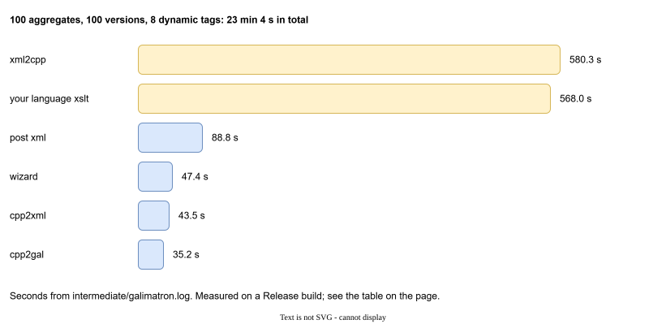

# Benchmark

`examples/benchmark` is a synthetic project that answers one question: *how big can a project get?* It builds a description of many aggregates and many versions, runs the Wizard and an XSLT over it, and measures every step.

## How big is a real project?

Read the numbers below against two facts about real projects.

- **Many aggregates are normal.** A description with 500 aggregates (one for each message, record or data type) is an ordinary size, so the benchmark goes up to 500.
- **Many live versions are not.** Having 100 versions in use at the same time is extremely rare. A typical project keeps about 5, maybe 10. The benchmark goes to 100 to find the limit, not because a project needs it.

Versions are the expensive part (see "How it grows" below), and that is a reason to retire them. When a version goes out of service, run a [collapse](aggregates-and-versions.md#collapsing-history): the old versions fold into one, and the time and the memory fall back. A project that keeps its live versions to a handful stays in the cheap corner of every table on this page.

!!! important "The case to look at first: 500 aggregates, 10 versions"
    This is the size most projects will actually have, so read its numbers before the rest. Here are the rows of the [static tags](#static-tags) and [no XSLT](#without-xslt) tables for it:

    | 500 aggregates, 10 versions | with your language XSLT | without any XSLT |
    |---|---:|---:|
    | 1 tag in each aggregate | 76.6 s, 444 MB | 44.5 s, 185 MB |
    | 100 tags in each aggregate | 9 min 45 s, 2.9 GB | 2 min 37 s, 1.1 GB |

    The Wizard stays near 22 seconds in all of these rows. What grows with the tags is your XSLT and the reading of its result back: with 100 tags they are about two thirds of the run.

## What it does

One run has a source of `A` aggregates (the root file, `console.gal`, and one file for each aggregate), each with version 0 only. Version 0 has a bit of everything: a dynamic label, a static label with `tag-name-from`, an important tag, a dynamic tag, a long string, an unnamed tag, a template, and the payload tags.

Then the run:

1. The Wizard batch in `console.gal` creates versions 1 to `V-1`. Each new version rewrites the ordering of the root, deletes and creates one tag in every aggregate, and adds a new tag. `create hash 0` closes version 0.
2. `xslt/suffix.xsl` appends the version index to every tag string. It writes the result to `intermediate/suffix-fresh.xml`.
3. The seal keeps the hashed version 0 text and moves those string changes into version 1.
4. Galimatron compiles everything and writes the post XML.

This exercises every part of the language and the run: Wizard, XSLT, seal, compilation. You can read the result in `actual_gal/` and the time of each step in `intermediate/galimatron.log`.

The machine: Intel Core i7-3770K at 3.5 GHz (4 cores, 8 threads), 32 GB of RAM, MSVC 19.51, x64, **Release** build with `/O2`. The times are in seconds. *State* is how much the private memory of the process grew during the run.

## Dynamic tags

The tag types matter. A tag with a **dynamic** label is copied into every new version, so `T` dynamic tags and `V` versions make `T * V` copies. The table is the measured run; `tags` is the number of dynamic payload tags.

| aggregates | versions | tags | total | Wizard | cpp2xml | xslt | xml2cpp | cpp2gal | post xml | state |
|---:|---:|---:|---:|---:|---:|---:|---:|---:|---:|---:|
| 50 | 10 | 2 | 6.9 | 0.2 | 1.0 | 1.2 | 1.4 | 1.0 | 1.0 | 152 MB |
| 50 | 10 | 8 | 14.1 | 0.2 | 2.0 | 3.4 | 3.6 | 2.0 | 1.6 | 201 MB |
| 50 | 50 | 2 | 50.4 | 3.5 | 4.9 | 11.3 | 12.9 | 4.2 | 11.1 | 447 MB |
| 50 | 50 | 8 | 128.5 | 3.5 | 10.0 | 42.7 | 45.7 | 9.1 | 13.8 | 799 MB |
| 50 | 100 | 2 | 151.8 | 11.2 | 10.2 | 36.9 | 41.2 | 8.3 | 37.5 | 1.1 GB |
| 50 | 100 | 8 | 419.4 | 12.9 | 22.5 | 152.8 | 160.4 | 18.3 | 43.3 | 1.6 GB |
| 100 | 10 | 2 | 14.8 | 0.8 | 1.9 | 3.0 | 3.5 | 1.9 | 2.1 | 262 MB |
| 100 | 10 | 8 | 32.7 | 0.8 | 3.8 | 8.9 | 10.0 | 4.0 | 3.1 | 277 MB |
| 100 | 50 | 2 | 134.1 | 12.3 | 9.5 | 37.0 | 39.9 | 8.5 | 21.5 | 808 MB |
| 100 | 50 | 8 | 393.3 | 12.6 | 20.3 | 150.9 | 157.1 | 17.6 | 27.1 | 1.3 GB |
| 100 | 100 | 2 | 436.4 | 45.0 | 20.2 | 130.6 | 137.6 | 16.2 | 73.4 | 2.1 GB |
| 100 | 100 | 8 | 1383.9 | 47.4 | 43.5 | 568.0 | 580.3 | 35.2 | 88.8 | 2.9 GB |

The biggest run has 100 aggregates, 100 versions and 8 dynamic tags. It takes **23 minutes 4 seconds** and grows the state by 2.9 GB. Nearly all of it is the two steps that walk the data with your XSLT: `xslt` (568 s, your language XSLT) and `xml2cpp` (580 s, reading its result back).

### How it grows

`A` is the number of aggregates, `V` the number of versions, `T` the number of tags.

- **Versions dominate**, about `O(V^1.5)`. Ten times the versions (10 to 100) makes the run 22 to 42 times longer. The copied dynamic tags and the XSLT walk grow with every version.
- **Tags** are about `O(T^0.5)` on a 10-version run. Four times the tags (2 to 8) doubles the time. With 100 versions it triples it, toward `O(T)`.
- **Aggregates** are about `O(A)` to `O(A^1.5)`. Twice the aggregates makes the run 2 to 3 times longer.
- **State** follows the versions, about `O(V)`. At 10 versions, 100 aggregates stay near 260 MB for both tag counts.

## Static tags

The same project with tags that have a **static** label. A new version does not copy them. `V` is fixed at 10.

| aggregates | tags | total | Wizard | xslt | xml2cpp | state |
|---:|---:|---:|---:|---:|---:|---:|
| 10 | 1 | 0.8 | 0.0 | 0.1 | 0.1 | 73 MB |
| 10 | 100 | 4.9 | 0.0 | 0.5 | 0.6 | 135 MB |
| 50 | 1 | 3.9 | 0.2 | 0.5 | 0.6 | 115 MB |
| 50 | 100 | 26.2 | 0.2 | 3.7 | 4.4 | 431 MB |
| 500 | 1 | 76.6 | 22.0 | 11.2 | 13.6 | 444 MB |
| 500 | 50 | 271.0 | 24.0 | 70.9 | 75.1 | 1.6 GB |
| 500 | 100 | 584.9 | 21.3 | 187.1 | 195.5 | 2.9 GB |

500 aggregates, 10 versions and 100 static tags takes 9 min 45 s. Time is about `O(A * T^0.5)`: from 1 tag to 100 tags the run grows 6 to 8 times, and fifty times the aggregates (10 to 500) makes a 1-tag run about 96 times longer. At 500 aggregates the **Wizard stays near 22 seconds**, whatever the number of tags.

## Without XSLT

Not every project needs an XSLT between the Wizard and the end. `gal-static-no-xslt.cfg` is the same static grid without any user XSLT. Then `cpp2xml`, `suffix.xsl` and `xml2cpp` are not in the run, and **Saxon is not created**. The log has no *xslt processor* line.

| aggregates | tags | total | Wizard | cpp2gal | post xml | state |
|---:|---:|---:|---:|---:|---:|---:|
| 10 | 1 | 0.4 | 0.0 | 0.1 | 0.2 | 5 MB |
| 10 | 100 | 3.1 | 0.0 | 0.5 | 2.0 | 30 MB |
| 50 | 100 | 14.7 | 0.2 | 2.6 | 9.3 | 126 MB |
| 500 | 1 | 44.5 | 23.4 | 6.7 | 8.9 | 185 MB |
| 500 | 100 | 156.6 | 21.0 | 24.8 | 86.4 | 1.1 GB |

The big case (500 aggregates, 100 static tags) drops from 9 min 45 s to **2 min 37 s**, and from 2.9 GB to 1.1 GB. The slow step is now `post xml` (86 s), the compiled XML.

## What it means for your project

| If | Then |
|---|---|
| The project has 10 to 50 aggregates and 10 versions. | A run is a few seconds. Do not worry. |
| The project has many versions (more than the usual 5 to 10 in use). | Time and memory follow the number of versions. [Collapse](aggregates-and-versions.md#collapsing-history) old ones when they go out of service. |
| You have many tags that change every version. | Each dynamic tag is copied into every version. Use a **static** label for what does not need to change in each version. |
| A tag must be new in every version (an id). | Keep it dynamic, but keep the number of such tags small. |
| You use a language XSLT. | It is the largest cost on a big project: the step and the read back. Do in the *post* XSLT what does not have to change the data. |
| You have no data changes to make. | List no language XSLT. Saxon is not even created for a run with no XSLT at all. |
| The Wizard is slow. | It is `O(1)` in tags and grows with aggregates. 500 aggregates cost about 22 s. |

The time of each step is always in `intermediate/galimatron.log`: use the same lines to measure your own project. See [Logs and diagnostics](diagnostics.md).

## Run it yourself

The benchmark is a set of CMake targets in `examples/benchmark`:

| Target | Runs |
|---|---|
| `benchmark` | one run (500 aggregates, 10 versions, 2 dynamic tags) |
| `benchmark_matrix` | the dynamic grid |
| `benchmark_matrix_static` | the static grid |
| `benchmark_matrix_static_no_xslt` | the static grid without XSLT |

The results are saved in `examples/benchmark/matrix/`. A Release build is needed for numbers like the ones above.
