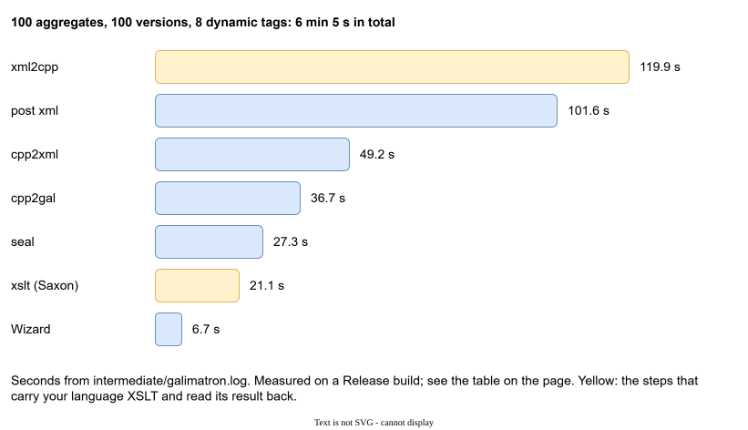

# Benchmark

`examples/benchmark` is a synthetic project that answers one question: *how big can a project get?* It builds a description of many aggregates and many versions, runs the Wizard and an XSLT over it, and measures every step.

## How big is a real project?

Read the numbers below against two facts about real projects.

- **Many aggregates are normal.** A description with 500 aggregates (one for each message, record or data type) is an ordinary size, so the benchmark goes up to 500.
- **Many live versions are not.** Having 100 versions in use at the same time is extremely rare. A typical project keeps about 5, maybe 10. The benchmark goes to 100 to find the limit, not because a project needs it.

Versions are the expensive part (see "How it grows" below), and that is a reason to retire them. When a version goes out of service, run a [collapse](aggregates-and-versions.md#collapsing-history): the old versions fold into one, and the time and the memory fall back. A project that keeps its live versions to a handful stays in the cheap corner of every table on this page.

!!! important "The case to look at first: 500 aggregates, 10 versions"
    This is the size most projects will actually have, so read its numbers before the rest. Here are the rows of the [static tags](#static-tags) and [no XSLT](#without-xslt) tables for it:

    | 500 aggregates, 10 versions | with your language XSLT | without any XSLT |
    |---|---:|---:|
    | 1 tag in each aggregate | 48.3 s, 352 MB | 20.4 s, 185 MB |
    | 100 tags in each aggregate | 4 min 34 s, 1.7 GB | 2 min 26 s, 1.1 GB |

    The Wizard stays under a second in all of these rows. What grows with the tags is the XML: with 100 tags and your XSLT, the compiled XML (`post xml`) takes 89 s, reading the result of your XSLT back (`xml2cpp`) 64 s, and writing the `.gal` files (`cpp2gal`) 40 s. Together they are about two thirds of the run.

## What it does

One run has a source of `A` aggregates (the root file, `console.gal`, and one file for each aggregate), each with version 0 only. Version 0 has a bit of everything: a dynamic label, a static label with `tag-name-from`, an important tag, a dynamic tag, a long string, an unnamed tag, a template, and the payload tags.

Then the run:

1. The Wizard batch in `console.gal` creates versions 1 to `V-1`. Each new version rewrites the ordering of the root, deletes and creates one tag in every aggregate, and adds a new tag. `create hash 0` closes version 0.
2. `xslt/suffix.xsl` appends the version index to every tag string. It writes the result to `intermediate/suffix-fresh.xml`.
3. The seal keeps the hashed version 0 text and moves those string changes into version 1.
4. Galimatron compiles everything and writes the post XML.

This exercises every part of the language and the run: Wizard, XSLT, seal, compilation. You can read the result in `actual_gal/` and the time of each step in `intermediate/galimatron.log`.

The machine: Intel Core i7-3770K at 3.5 GHz (4 cores, 8 threads), 32 GB of RAM, MSVC 19.51, x64, **Release** build with `/O2`. The times are in seconds. *State* is how much the private memory of the process grew during the run.

## Dynamic tags

The tag types matter. A tag with a **dynamic** label is copied into every new version, so `T` dynamic tags and `V` versions make `T * V` copies. The table is the measured run; `tags` is the number of dynamic payload tags.

| aggregates | versions | tags | total | Wizard | cpp2xml | xslt | xml2cpp | seal | cpp2gal | post xml | state |
|---:|---:|---:|---:|---:|---:|---:|---:|---:|---:|---:|---:|
| 50 | 10 | 2 | 8.1 | 0.0 | 1.0 | 0.4 | 3.5 | 0.3 | 1.0 | 1.1 | 130 MB |
| 50 | 10 | 8 | 14.6 | 0.0 | 2.1 | 1.0 | 6.0 | 0.7 | 2.0 | 1.8 | 191 MB |
| 50 | 50 | 2 | 42.1 | 0.5 | 5.2 | 2.0 | 13.8 | 2.7 | 4.2 | 12.9 | 330 MB |
| 50 | 50 | 8 | 77.1 | 0.9 | 11.8 | 4.5 | 29.1 | 3.9 | 10.2 | 15.7 | 508 MB |
| 50 | 100 | 2 | 109.5 | 1.6 | 11.2 | 4.5 | 28.3 | 7.6 | 9.1 | 46.1 | 651 MB |
| 50 | 100 | 8 | 184.4 | 3.6 | 24.3 | 10.6 | 63.3 | 11.2 | 19.2 | 50.6 | 1.0 GB |
| 100 | 10 | 2 | 14.9 | 0.1 | 2.0 | 0.9 | 5.7 | 0.7 | 2.0 | 2.1 | 179 MB |
| 100 | 10 | 8 | 28.4 | 0.1 | 4.3 | 1.9 | 12.0 | 1.2 | 3.9 | 3.5 | 263 MB |
| 100 | 50 | 2 | 84.4 | 1.0 | 10.5 | 4.0 | 27.9 | 5.5 | 8.6 | 25.4 | 538 MB |
| 100 | 50 | 8 | 157.0 | 2.0 | 23.0 | 9.1 | 59.6 | 8.6 | 18.3 | 34.7 | 942 MB |
| 100 | 100 | 2 | 217.0 | 3.6 | 23.3 | 8.4 | 57.7 | 15.8 | 17.2 | 89.0 | 1.2 GB |
| 100 | 100 | 8 | 365.3 | 6.7 | 49.2 | 21.1 | 119.9 | 27.3 | 36.7 | 101.6 | 1.9 GB |

The columns are the steps of the run. `xslt` is Saxon at work: it takes the document and runs your XSLT. `xml2cpp` reads the result back, and `seal` moves the changes out of the closed versions. The full grid (aggregates 10, 20, 50 and 100, versions 10, 20, 50 and 100) is in `examples/benchmark/matrix/times.md`.

The biggest run has 100 aggregates, 100 versions and 8 dynamic tags. It takes **6 minutes 5 seconds** and grows the state by 1.9 GB. The slowest steps are `xml2cpp` (120 s, reading the result of your XSLT back) and `post xml` (102 s, the compiled XML). Saxon itself, with your XSLT, takes 21 s.

### How it grows

`A` is the number of aggregates, `V` the number of versions, `T` the number of tags.

- **Versions dominate**, about `O(V^1.1)`. Ten times the versions (10 to 100) makes the run 13 to 15 times longer. The copied dynamic tags grow with every version.
- **Tags** are about `O(T^0.4)`. Four times the tags (2 to 8) makes the run 1.7 to 1.9 times longer.
- **Aggregates** are about `O(A)`. Twice the aggregates makes the run about twice as long.
- **State** follows the versions, a little slower than `O(V)`: ten times the versions needs 6 to 7 times the memory. At 10 versions, 100 aggregates take 179 MB with 2 tags and 263 MB with 8 tags.

## Static tags

The same project with tags that have a **static** label. A new version does not copy them. `V` is fixed at 10.

| aggregates | tags | total | Wizard | cpp2xml | xslt | xml2cpp | seal | cpp2gal | post xml | state |
|---:|---:|---:|---:|---:|---:|---:|---:|---:|---:|---:|
| 10 | 1 | 1.1 | 0.0 | 0.0 | 0.1 | 0.2 | 0.0 | 0.1 | 0.1 | 59 MB |
| 10 | 100 | 5.7 | 0.0 | 0.5 | 0.2 | 1.3 | 0.3 | 0.7 | 1.9 | 114 MB |
| 50 | 1 | 4.3 | 0.0 | 0.4 | 0.2 | 1.3 | 0.2 | 0.5 | 0.9 | 100 MB |
| 50 | 100 | 26.7 | 0.0 | 2.4 | 0.9 | 6.4 | 1.4 | 4.0 | 8.8 | 259 MB |
| 500 | 1 | 48.3 | 0.4 | 5.8 | 2.0 | 14.2 | 5.2 | 5.8 | 8.9 | 352 MB |
| 500 | 50 | 159.3 | 0.5 | 15.4 | 5.3 | 38.8 | 11.6 | 22.6 | 49.0 | 987 MB |
| 500 | 100 | 273.6 | 0.9 | 25.7 | 9.0 | 64.1 | 19.4 | 39.5 | 89.3 | 1.7 GB |

500 aggregates, 10 versions and 100 static tags takes 4 min 34 s. Time is about `O(A * T^0.4)`: from 1 tag to 100 tags the run grows 5 to 6 times, and fifty times the aggregates (10 to 500) makes a 1-tag run about 44 times longer. At 500 aggregates the **Wizard stays under a second**, whatever the number of tags.

## Without XSLT

Not every project needs an XSLT between the Wizard and the end. `gal-static-no-xslt.cfg` is the same static grid without any user XSLT. Then `cpp2xml`, `suffix.xsl`, `xml2cpp` and the seal are not in the run, and **Saxon is not created**. The log has no *xslt processor* line.

| aggregates | tags | total | Wizard | cpp2gal | post xml | state |
|---:|---:|---:|---:|---:|---:|---:|
| 10 | 1 | 0.5 | 0.0 | 0.1 | 0.2 | 5 MB |
| 10 | 100 | 3.0 | 0.0 | 0.5 | 1.9 | 30 MB |
| 50 | 100 | 15.3 | 0.0 | 2.5 | 10.3 | 125 MB |
| 500 | 1 | 20.4 | 0.4 | 7.0 | 9.1 | 185 MB |
| 500 | 100 | 145.6 | 0.7 | 27.0 | 93.1 | 1.1 GB |

The big case (500 aggregates, 100 static tags) drops from 4 min 34 s to **2 min 26 s**, and from 1.7 GB to 1.1 GB. The slow step is now `post xml` (93 s), the compiled XML.

## What it means for your project

| If | Then |
|---|---|
| The project has 10 to 50 aggregates and 10 versions. | A run takes from a second to about half a minute. Do not worry. |
| The project has many versions (more than the usual 5 to 10 in use). | Time and memory follow the number of versions. [Collapse](aggregates-and-versions.md#collapsing-history) old ones when they go out of service. |
| You have many tags that change every version. | Each dynamic tag is copied into every version. Use a **static** label for what does not need to change in each version. |
| A tag must be new in every version (an id). | Keep it dynamic, but keep the number of such tags small. |
| You use a language XSLT. | It adds the steps around it: the XML for Saxon, the read back and the seal. With 500 aggregates and 100 tags that is about two minutes on top of two and a half. Do in the *post* XSLT what does not have to change the data. |
| You have no data changes to make. | List no language XSLT. Saxon is not even created for a run with no XSLT at all. |
| The Wizard is slow. | It is `O(1)` in tags. 500 aggregates with 10 versions cost under a second, and 100 aggregates with 100 versions about 4 to 7 s. |

The time of each step is always in `intermediate/galimatron.log`: use the same lines to measure your own project. See [Logs and diagnostics](diagnostics.md).

## Run it yourself

The benchmark is a set of CMake targets in `examples/benchmark`:

| Target | Runs |
|---|---|
| `benchmark` | one run (500 aggregates, 10 versions, 2 dynamic tags) |
| `benchmark_matrix` | the dynamic grid |
| `benchmark_matrix_static` | the static grid |
| `benchmark_matrix_static_no_xslt` | the static grid without XSLT |

The results are saved in `examples/benchmark/matrix/`. A Release build is needed for numbers like the ones above.
