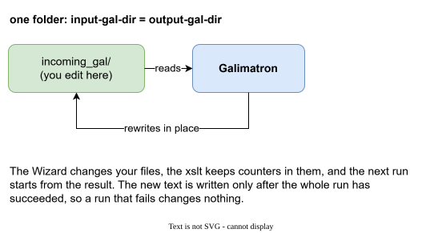
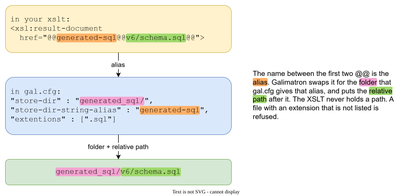

# Configuration (gal.cfg)

`gal.cfg` says what a run does: which folders it reads and writes, and which of your XSLT it runs. It is JSON, and it allows `//` comments. It is passed to Galimatron on the command line:

```
galimatron --gal-config-file gal.cfg --log-config-file log.cfg
```

Paths in `gal.cfg` are absolute, or relative to the folder of `gal.cfg`. This makes a project movable: copy the folder and it still runs. (Two exceptions are noted below: the XSLT file and the principal XML file have their own base folders.)

## The whole file

```json
{
    "galimatron" : {
        "input-gal-dir" : "incoming_gal/",
        "output-gal-dir" : "incoming_gal/",
        "intermediate-xml-dir" : "intermediate/",
        "intermediate-log-dir" : "intermediate/",
        "intermediate-summary-dir" : "intermediate/",
        "committed-report" : true
    },
    "saxon-processor" : {
        "working-dir" : "xslt/",
        "config-file" : "config.xml"
    },
    "transforms" : {
        "language-transforms" : {
            "buildin-transforms" : { },
            "user-transforms" : { "transforms" : [ ... ] }
        },
        "post-language-transforms" : {
            "user-transforms" : { "transforms" : [ ... ] }
        }
    }
}
```

## galimatron: folders

| Key | Meaning |
|---|---|
| `input-gal-dir` | Where the `.gal` files are read from, with all subfolders. |
| `output-gal-dir` | Where the `.gal` files are written back. Make it the same folder as `input-gal-dir`. |
| `intermediate-xml-dir` | The XML dumps (`lang-*.xml`, `post-compiled.xml`). |
| `intermediate-log-dir` | Where logs go. |
| `intermediate-summary-dir` | Where `galimatron_summary.xml` goes. |
| `committed-report` | `true` makes the summary, the log and error messages spell paths **relative to the `gal.cfg` folder**, and drops the memory size and the run time. |

### Your files are rewritten in place



Give `input-gal-dir` and `output-gal-dir` the same folder. This is how Galimatron is meant to be run: your `.gal` files are the memory of the project, so a run reads them and puts the result back into the same files. The Wizard changes them, your XSLT keep counters in them, and the next run starts from what the last one left.

The new text is held in memory and written only if the whole run succeeds, and only into the files whose text changed. A run that fails leaves your `.gal` files exactly as they were.

!!! note "Two different folders"
    The two keys may name different folders. Galimatron then reads the first, empties the second of `.gal` files at the start of every run, and writes each result file there at once. This exists for Galimatron's own tests, which compare the output with an expected folder. A project does not need it, and you should never point `output-gal-dir` at a folder that holds something you want.

### committed-report: output that you can commit

A log with `D:\work\project\...` in it differs on every machine. With `committed-report: true` the summary, the info log and the exception texts use paths relative to `gal.cfg`, and omit the run time and the memory. The files then only change when the result changes, which is what you want when you keep them under version control, or compare them in a test.

## saxon-processor

Saxon is the XSLT processor that is built into Galimatron and runs your XSLT. This section tells it where your XSLT live.

| Key | Meaning |
|---|---|
| `working-dir` | The folder of your XSLT, the templates they load and the Saxon configuration. |
| `config-file` | The Saxon configuration, relative to `working-dir`. |

A minimal `config.xml`:

```xml
<configuration edition="HE" xmlns="http://saxon.sf.net/ns/configuration">
    <global lineNumbering="true"/>
</configuration>
```

`lineNumbering` makes an error in your XSLT name the line. The XSLT processor is SaxonC-HE. If you list no XSLT at all, the processor is not created and the run is faster (see [Benchmark](benchmark.md#without-xslt)).

## Transforms

Transforms are optional: both lists may be empty. The primary output of Galimatron, `post-compiled.xml`, is written anyway, and you may read it with any tool.

A **transform** is one of your XSLT programs and what it writes. `language-transforms` run before the `.gal` files are written back, `post-language-transforms` run on the compiled picture. Each list runs in order. See [How a run works](how-it-works.md).

```json
{
    "name" : "next uuid for copies",
    "enable" : true,
    "user-data-for-info" : "any text, it is copied into the summary",
    "input" : {
        "principal-xsl" : {
            "file" : "generate-uuid.xsl",
            "parameters" : [ { "name" : "report_title", "value" : "Price list 11" } ]
        }
    },
    "output" : {
        "principal-xml" : { "file" : "after-uuid.xml" },
        "other-files" : [ ... ]
    }
}
```

| Key | Meaning |
|---|---|
| `name` | Shown in the log and the summary. Say what the transform *does*. |
| `enable` | `false` leaves the transform out of the run. The key may be absent: then it runs. |
| `user-data-for-info` | Free text. It appears in the summary, so a reader of the summary sees why the transform is there. |
| `input.principal-xsl.file` | The XSLT, relative to `saxon-processor.working-dir`. |
| `input.principal-xsl.parameters` | Parameters for `<xsl:param name="...">`, all strings. |
| `output.principal-xml.file` | Optional. If present, the **principal result** of the transform is also saved there, relative to `intermediate-xml-dir`. |
| `output.other-files` | The places where `<xsl:result-document>` may write. |

### The principal result

The principal result of a transform is its main output. For a **language** transform it is the language XML, and it is the input of the next transform. Leave `principal-xml` empty and it stays in memory. Give it a `file` and you can read what that step produced. This is the cheapest debugging tool you have.

For a **post-language** transform the principal result is also the input of the next post transform. A post transform that only writes files and wants to leave the compiled XML to the next one should copy its input through (`<xsl:mode on-no-match="shallow-copy"/>`). A transform that does not copy it through replaces the document for the transforms after it, so put it last. The messages example lists its source generator last for this reason (see [Order matters](#order-matters)).

### Parameters Galimatron adds

Every transform receives these parameters, with absolute paths and `/` separators. Declare the ones you need with `<xsl:param>`.

| Parameter | Value |
|---|---|
| `input_gal_dir` | `galimatron.input-gal-dir` |
| `output_gal_dir` | `galimatron.output-gal-dir` |
| `intermediate_xml_dir` | `galimatron.intermediate-xml-dir` |
| `intermediate_log_dir` | `galimatron.intermediate-log-dir` |
| `intermediate_summary_dir` | `galimatron.intermediate-summary-dir` |
| `saxon_working_dir` | `saxon-processor.working-dir` |

They are how an XSLT finds a state file without knowing the machine (see [Custom states](custom-states.md)).

## Where your XSLT may write

An XSLT writes files with `xsl:result-document`. It does not write an absolute path. It names a **store** by an alias:

```xml
<xsl:result-document href="@@generated-sql@@v6/schema.sql@@" method="text">
```



The `href` is `@@ALIAS@@RELATIVE_PATH@@`. The `ALIAS` is the `store-dir-string-alias` of an entry in `other-files`:

```json
"other-files" : [
    {
        "store-dir" : "generated_sql/",
        "store-dir-string-alias" : "generated-sql",
        "extentions" : [".sql"],
        "replace-escaped-form-to-original-symbols" : true,
        "delete-if-not-rewrited" : true
    }
]
```

Galimatron replaces the alias with the folder. The result is `generated_sql/v6/schema.sql`.

Why aliases?

- **Safety.** An XSLT cannot write outside the folders that `gal.cfg` names, and not with an extension you did not allow (`extentions`). A mistake in a path is refused, not executed.
- **Portability.** The XSLT holds no machine path. You move the output by changing `gal.cfg`.
- **Review.** One file, `gal.cfg`, lists every place the project writes.

| Key | Meaning |
|---|---|
| `store-dir` | The folder of this store. |
| `store-dir-string-alias` | The alias that the XSLT uses. |
| `extentions` | Allowed extensions. A file with another one is refused. |
| `replace-escaped-form-to-original-symbols` | `true` turns `&lt; &gt; &amp; &quot; &apos;` in the written text back into `< > & " '`. Use it for generated source text, where a template in XML had to escape them. |
| `delete-if-not-rewrited` | `true` (the default) removes files in this store that this run did not rewrite. The store then always mirrors the current description: a deleted aggregate takes its generated file with it. `false` keeps old files. The [Example: messages that grow](example-messages.md) uses `false` for hand-edited conversions. |

## Order matters

Transforms run in the order of the list. In the messages example the dictionary generator is listed **before** the source generator, because the source generator replaces the compiled document. The `user-data-for-info` of such a transform says so.

```json
{
    "name" : "generate dictionary.md",
    "user-data-for-info" : "copies the compiled document through, so this stays before the source xslt"
}
```
