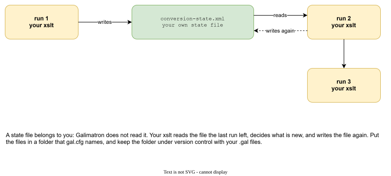

# Custom states

Galimatron keeps one state for you: the `.gal` files. Sometimes your XSLT needs a memory of its own: "which conversions did I already write", "what was the last build number", "which names have I already put in the dictionary". That memory is a **custom state**.

## The problem

An XSLT is a function. It reads its input and writes its output, and forgets. A generator needs a memory in three cases:

- **A counter** that must go on from where it stopped.
- **A record of what it generated**, so it does not overwrite a file that a person edited by hand.
- **A list that grows**: names, ids, a dictionary.

Galimatron does not need a database for this, and your XSLT does not need a side channel. Your state lives in files next to your `.gal` files, and goes through version control with them.



A state belongs to you. Galimatron does not read it, and does not check it. Your XSLT reads what the last run left, decides what is new, and writes it again.

## Two places for a state

### 1. In tags

The simplest state is data. The counter in the hello project is a tag:

```
version 0
{
    counter = { "1" };
}
```

Each run, a language XSLT reads it, adds one, and Galimatron writes it back into the `.gal` file. Advantages:

- It is versioned like the rest of the data, and it shows in the `history`.
- It can be [important](tags.md#important): then a hash closes it with the version.
- The Wizard can create and edit it (`wizard create tag ...`).
- The compiled view carries it, so a post XSLT can read it without a file.

The [Example: messages that grow](example-messages.md) keeps its dictionary in tags too: an aggregate `dictionary` with one `entry` tag per name. The language XSLT `fill-dictionary.xsl` adds an entry for every tag name that has none, and a person can edit the text of an entry next to it. A name already in the dictionary stays: the text a person wrote is not overwritten.

Use tags when the state *is* a part of the description.

### 2. In a file

When the state is a record about the **output**, not about the description, a file is better. The messages example keeps `conversion-state.xml`:

```xml
<conversion-state>
   <made from="v1" to="v3"/>
   <made from="v2" to="v3"/>
   <made from="v1" to="v4"/>
   ...
</conversion-state>
```

Each `made` says "the conversion from v1 to v3 was generated". The generator writes an empty conversion file for a pair that is not recorded, and a person fills it in. On the next run the pair is recorded, so the file is not touched, and the person's work is safe.

A state file needs three things from you:

1. **A place.** A store in `gal.cfg`, so the XSLT can write it:

    ```json
    {
        "store-dir" : "actual_gal/",
        "store-dir-string-alias" : "conversion-state",
        "extentions" : [".xml"],
        "delete-if-not-rewrited" : true
    }
    ```

2. **A write.** The XSLT writes it with the alias:

    ```xml
    <xsl:result-document href="@@conversion-state@@conversion-state.xml@@" method="xml" indent="yes">
        <conversion-state>
            <xsl:copy-of select="$old-state/conversion-state/made"/>
            <!-- ... and one made for each pair written in this run -->
        </conversion-state>
    </xsl:result-document>
    ```

3. **A read.** The XSLT finds the file by a path that Galimatron gives it, in `input_gal_dir`:

    ```xml
    <xsl:param name="input_gal_dir" as="xs:string"/>

    <xsl:variable name="state-uri" select="concat(gal:directory-uri($input_gal_dir), 'conversion-state.xml')"/>
    <xsl:variable name="state" select="if (doc-available($state-uri)) then doc($state-uri) else ()"/>
    ```

    On the first run the file does not exist yet, so `doc-available` guards the read.

!!! warning "Read and write are different URIs"
    Saxon does not allow reading and writing the same URI in one run. The write uses the alias form (`@@conversion-state@@...`) and the read uses a real file URI, so it works. If the state is stored in the *output* gal folder (as in the example, whose folders are apart for testing), read both the input and the output copy, because a step may have a state in either. In a project with one gal folder there is only one copy.

### Where to put the file

Put it in a folder that `gal.cfg` names, and commit it with the `.gal` files. A state file is part of the project's memory: lose it, and the generator forgets what it wrote.

!!! note
    Do not let a store delete your state. `delete-if-not-rewrited: true` removes files in the store that the run did not rewrite. For a state that you write on every run this is a correct cleanup. For files that a person edits (the conversions of the example) use `false`.

## What to remember when you design a state

- **Decide from the data, not from the clock.** Do not let a time change the output between two runs of the same input.
- **Grow, do not rewrite.** A state that only adds is easy to review in a diff.
- **Let a person edit, and respect it.** A generator that overwrites a hand-written file is worse than none. Record what you wrote, and skip it next time.
- **Keep it small.** The state travels with the project.
