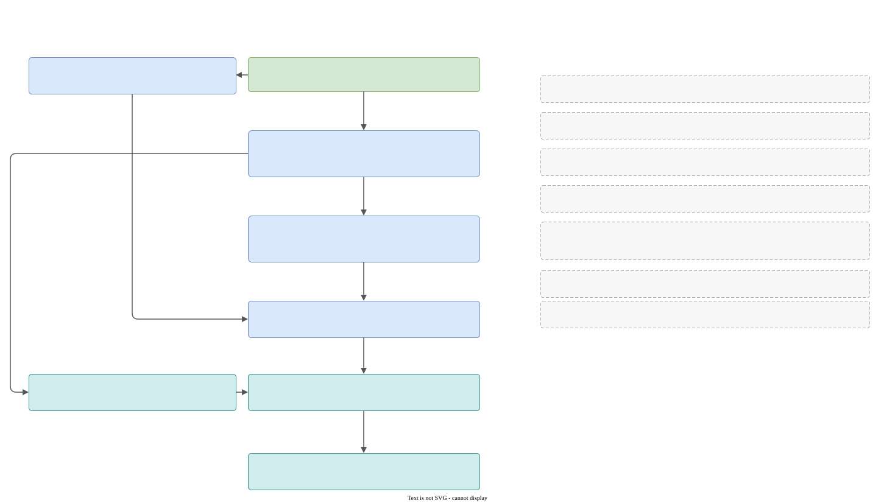

# Architecture

## Libraries and layers

Every box is a CMake target. An arrow means "links `PUBLIC` to". The dependency runs one way, from the executable down to `global`: `translator_library` does not know that `runtime_library` exists.

| Target | Folder | Links to | Role |
|---|---|---|---|
| `global_pch_library` | `global/pch_library` | Boost (asio, algorithm, graph, icl, leaf, program_options, uuid, multi_index), `logme`, `base64_library`, `magic_enum`, `nlohmann_json`, `pugixml`, `range-v3` | owns the precompiled header, and so makes those libraries visible everywhere |
| `global_common_library` | `global/common_library` | the PCH library, `multi_index_lookup`, `base64_library`, `magic_enum` | type aliases, logging helpers, scope guard, private memory |
| `global_filesystem_library` | `global/filesystem_library` | `global_common_library` | the filesystem as a struct of functions |
| `galimatron_common_library` | `galimatron/common_library` | `global_common_library` | exception vocabulary and path report |
| `galimatron_translator_library` | `galimatron/translator_library` | `galimatron_common_library`, `leaf_spy`, Boost, `range-v3`, `pugixml`, ANTLR runtime; privately Saxon, Taskflow, inja | the language and the pipeline of steps |
| `galimatron_runtime_library` | `galimatron/runtime_library` | `galimatron_translator_library`, `leaf_spy`, `global_filesystem_library` | the application around the translator |
| `galimatron_executable_library` | `galimatron/executable_library` | `galimatron_common_library` | the command line |
| `galimatron_executable` | `galimatron/executable` | the runtime and the executable library | `main()`; the output is `galimatron` or `galimatron.exe` |

Tests are separate targets: `global_tests`, `galimatron_tests` (and its helper `galimatron_crash_child`), and `uuid_protocol_tests`. See [Testing](testing.md).

`translator_library` is built from two ANTLR grammars (`g_lexer.g4`, `g_parser.g4`). CMake generates the lexer and the parser into the namespace `galimatron`, with the listener on and the visitor off.

### Why the translator does not touch the disk

The translator receives its input as `deferred_file_contents_with_paths_t` (a path and a function that reads the file when called) and returns its output through callbacks (`notify_transform_result`). Everything that opens, writes or deletes a file is in `runtime_library`. This is the reason the translator is easy to test: a test can feed it text and read what it sends out. The one exception in spirit is Saxon: it reads the XSLT text that the config gave it, but it also loads `catalog.xml` and the XSLT includes, which is why `xml2xml` knows the installed folder.

## Include and namespace rules

- Every `#include` is written from the repository root: `"galimatron/translator_library/state/holder/holder.hpp"`, `"global/common_library/log_subsystems.hpp"`. The root is in `include_directories`.
- The precompiled header `global/pch_library/pch.hpp` is **force-included** into every target (`target_precompile_headers(... REUSE_FROM global_pch_library)`). Source files do not include it, and they do not include the standard library: `<string>`, `<vector>`, `<ranges>`, `<stacktrace>` and the Boost and range-v3 headers all come from it. A header that uses `std::function` without an include is correct here.
- `REUSE_FROM` needs identical compile definitions. That is why `global_pch_library` sets `LOGME_INRELEASE` publicly.
- `global` never includes `galimatron`.
- Namespaces: `galimatron::translator::...` for the translator (`parser`, `state`, `transforms::<name>`, `translator`), `galimatron::runtime` for most of the runtime, `global::...` for the global libraries. Part of the runtime lives in `galimatron::executable::filesystem` and `galimatron::executable::filesystem_decorator`, a leftover from before the folder was named `runtime_library`. `galimatron/common_library/type_declaration.hpp` does `using namespace global;` and `namespace gf = global::filesystem;`, which is why `path_t` and `scope_guard_t` appear without a prefix.
- All libraries pick their sources with `file(GLOB_RECURSE ...)` without `CONFIGURE_DEPENDS`. After you add or remove a file, **run CMake again**.

## Naming

The suffixes are the rule of the whole code base (`global/common_library/naming_declaration.hpp`):

| Suffix | Meaning |
|---|---|
| `_t` | a type |
| `_ot` | `std::optional` of it |
| `_ft` | `std::function` |
| `_et` | an enum class, with SCREAMING_SNAKE enumerators |
| `_at` | `std::any` |
| `_rt`, `_crt` | `std::reference_wrapper`, and its const form |
| `_sptr_t`, `_sptr_ot` | `std::shared_ptr`, and optional of it |

A data member ends with `_`. A `vertex_descriptor` variable starts with `vd_`. A LEAF exception struct has **no** `_t`. Plural is a word (`aggregates`), not a letter. More in [Conventions](conventions.md).

## State that is global to a process

Galimatron runs one translation at a time per process. Some things are global because of that. Know them before you run two translations in one process (tests run them one after another).

| What | Where | Why it is global |
|---|---|---|
| the path report (`committed_report`, `config_dir`) | `common_library/path_report.hpp`, `current_path_report()` | Taskflow workers log paths. The catch side does **not** read it: it uses the copies in `e_path_info` |
| path-correction hooks while reading `gal.cfg` | `runtime_library/galimatron_config/detail/galimatron_config.cpp` | reading is done in three passes with function objects swapped between them. It is not re-entrant |
| the crash handler | `runtime_library/crash` | installed once (`std::call_once`) |
| Logme channels | `global/common_library/logging_utils.*` | one default channel, with the display filter that fans records out |
| the Taskflow executor | `translator_t::executor()` | Saxon attaches a Graal thread to each worker. A worker that exits without detaching leaves a thread in the isolate, and a later call dies with `StackOverflowError`. So one executor lives for the whole process |
| `log_tabulator_t` indent | `global/common_library/logging_utils.*` | a plain counter. It is not thread-safe, and the steps run one after another |

## Dependencies

All are fetched with CMake's `FetchContent` (see [Build, packaging, CI](build-ci.md)). Who uses what:

| Library | Used for |
|---|---|
| Boost.LEAF | every error (`leaf::throw_exception`) |
| Boost.Graph | the language graph, the ordering ranks |
| Boost.MultiIndex (with `multi_index_lookup`) | all the containers of the holder and the places |
| Boost.Algorithm | string work (see the `boost-string` rules in [Conventions](conventions.md)) |
| Boost.Hash2 | SHA-256 for the hashes |
| Boost.Program_options | the command line |
| Boost.DLL | finding the installed `catalog.xml` |
| Boost.Units | printing the memory size |
| range-v3 | views and actions throughout |
| ANTLR 4 | the parser |
| pugixml | the XML that the translator prints and reads (XPath is switched off) |
| SaxonC-HE | XSLT 3.0 |
| Taskflow | the chain of steps and the validation subflow |
| inja and nlohmann/json | the `_te` template strings; JSON in the log config |
| Logme (with JsonCpp) | logging |
| magic_enum | enum names in messages and the summary |
| doctest | tests |
| alpaca | serialization in the UUID protocol example only |
