# Build, packaging, CI



## Requirements

- CMake **4.0** or newer (`cmake_minimum_required(VERSION 4.0)`).
- A C++23 compiler: MSVC 19.5 or newer, GCC 13 or newer, Clang 18 or newer. CI uses MSVC 19.51, GCC 13.3 and Clang 18.1.
- Java, for the ANTLR parser generator.
- Git and a network at configure time: the dependencies are fetched.
- On Windows, a Developer Command Prompt (so that `cl.exe` is on `PATH`) when you use Ninja.

```text
cmake -S . -B build -G Ninja -DCMAKE_BUILD_TYPE=Release
cmake --build build --config Release
cmake --build build --config Release --target run_tests
cmake --build build --config Release --target package
```

## The root `CMakeLists.txt`

- `project(GalimatronProject VERSION 1.0.0 LANGUAGES CXX C)`, C++23, no extensions, `CXX_STANDARD` defined for the code.
- The CRT is dynamic: `/MD` in Release and `/MDd` in Debug. The ANTLR runtime is built static (`ANTLR4CPP_STATIC`) with `WITH_STATIC_CRT=OFF`, so it matches.
- Outputs: `lib/` for libraries, **`bin/`** for executables and DLLs.
- `CMAKE_PCH_INSTANTIATE_TEMPLATES ON`, and `include_directories(<root>)`, so includes are written from the root.
- Order: `cmake/dependencies.cmake`, then `externals`, `global`, `galimatron` (`common_library`, `executable_library`, `translator_library`, `runtime_library`, `executable`, `tests`), `examples`.
- The `run_tests` target and `cmake/cpack.cmake`.

### The precompiled header

`global_pch_library` is a static library whose only source is an empty `dummy.cpp`. It exists to **own** the PCH (`pch.hpp`). Every other target does `target_precompile_headers(<t> REUSE_FROM global_pch_library)`. Source files never include `pch.hpp`; it is force-included. `pch.hpp` includes the standard headers (including `<stacktrace>`), the Boost headers (algorithm, graph, icl, leaf, multi_index, uuid), range-v3, pugixml, nlohmann/json, magic_enum and `base64.hpp`.

On Windows it defines `_WIN32_WINNT 0x0602` and `NOGDI` (`wingdi.h` defines `ERROR` as 0, which breaks `antlr4::tree::ParseTreeType`), and at the end it `#undef`s `ERROR`, `DELETE` and `EOF`. On non-MSVC the runtime links `stdc++exp` for `std::stacktrace`.

## Dependencies

`cmake/dependencies.cmake`. Everything uses `FetchContent`. Most entries are `EXCLUDE_FROM_ALL` with `FIND_PACKAGE_ARGS`, so a system package is used first.

| Dependency | Source | Notes |
|---|---|---|
| Boost | `boostorg/boost`, `boost-1.92.0` | `BOOST_RUNTIME_LINK=shared` |
| JsonCpp | `1.9.6` | static, with the alias `JsonCpp::JsonCpp`. A generated `jsoncppConfig.cmake` stub lets logme find it. The stub is unset when found, so it cannot satisfy `FetchContent` itself |
| logme | `efmsoft/logme`, `main` | static, with JsonCpp (`USE_JSONCPP=ON`, `USE_ZLIB=OFF`): `LoadConfiguration()` parses JSON only then. Its output directories are reset so `logme.lib` lands in `lib/` |
| range-v3 | git | |
| ANTLR | the jar `antlr-4.13.2-complete.jar` (downloaded into the build folder) and the runtime `antlr/antlr4` tag `4.13.2` (`runtime/Cpp`) | patched, see below |
| pugixml | git | `PUGIXML_NO_XPATH` |
| nlohmann_json | git | |
| inja | `pantor/inja`, `v3.4.0` | patched, see below |
| alpaca | `p-ranav/alpaca` | the UUID protocol example only |
| doctest | git | patched |
| magic_enum | git | |
| Taskflow | `v4.0.0` | header-only; tests, examples, CUDA and similar are off |
| SaxonC-HE | `externals/Saxon/SaxonCHE-{windows,linux}-x86_64-13-0-0.zip` | version 13.0.0 exactly |
| leaf_spy | `goloveshin/leaf_spy`, `main` | header-only |
| multi_index_lookup | `goloveshin/multi_index_lookup`, `main` | header-only |

### Patches

`cmake/patches/`:

- `apply.cmake` takes `SOURCE_DIR` and `PATCH_FILE`. It strips CR from the patch (hiding `@` while it normalizes), writes an LF temp file, checks `git apply --check --reverse` (an already applied patch is skipped), and otherwise runs `git apply`. `FetchContent_Declare` runs it as `PATCH_COMMAND` on a first download; `galimatron_patch_dependency()` also patches a tree that was downloaded before. `.gitattributes` pins `*.patch` to `eol=lf`.
- `antlr4-profiling-chrono.patch` adds `#include <chrono>` to `ProfilingATNSimulator.cpp`.
- `doctest-cmake-4.0.patch` raises doctest's `cmake_minimum_required` to 4.0.
- `inja_cmake.cmake` overwrites inja's `CMakeLists.txt` (the upstream one runs a shell script) with an `INTERFACE` library `inja` (alias `pantor::inja`) that links `nlohmann_json`.

### Saxon

There is no patch file; `dependencies.cmake` edits the shipped `SaxonCCoreHE.cmake` with a regular expression to drop a `FILE_SET` entry for `saxonc-core_export.h`, which the zip does not ship. The package has only a **Release** import, so `MAP_IMPORTED_CONFIG_DEBUG Release` is set: a Debug build uses the Release Saxon binary. `src/` is added `EXCLUDE_FROM_ALL`. On Windows the custom target `saxonc_core_he_runtime` copies `saxonc-core-he.dll` into `bin/`.

## Packaging

`cmake/cpack.cmake`:

- installs `galimatron_executable` and `saxonc-he` into `bin/`, the Saxon core library into `bin/` (on Linux with a SONAME symlink, and `INSTALL_RPATH $ORIGIN` on the executable and `saxonc-he`), `gal-functions.xsl` into `share/galimatron/xslt/`, `cmake/catalog.xml` into `share/galimatron/`, `LICENSE`, `THIRD_PARTY_NOTICES.md` and `third_party_licenses/` into `share/doc/galimatron/`, and the MSVC runtime libraries.
- `catalog.xml` is one line: `<uri name="https://github.com/goloveshin/galimatron/xslt/gal-functions.xsl" uri="xslt/gal-functions.xsl"/>`. The executable loads `../share/galimatron/catalog.xml`.
- the package is `galimatron-<version>-<system>-<processor>`.
- **Windows**: ZIP, and NSIS if `makensis` is on `PATH`. NSIS uses `art/galimatron.ico` (also installed as `bin/galimatron.ico`), uninstalls an old version first, and offers a PATH page. `cmake/nsis/NSIS.InstallOptions.ini.in` replaces the CPack page, to drop the desktop shortcut.
- **Linux**: TGZ, and DEB if `dpkg-deb` and RPM if `rpmbuild` are on `PATH`. The RPM license is `BSL-1.0`.

## CI

`.github/workflows/`: `windows-ci.yml` and `linux-ci.yml`. Both run on `push` to `main`, on `pull_request` and on `workflow_dispatch`, with a concurrency group that cancels the previous run, and with `contents: read` and `actions: write`. Both use `lukka/get-cmake@latest` (CMake 4 and Ninja).

| Workflow | Jobs |
|---|---|
| Windows | `windows-latest`: MSVC Debug, MSVC Release (also packages). Uses `ilammy/msvc-dev-cmd@v1`; installs NSIS with Chocolatey for the package job |
| Linux | `ubuntu-latest`: GCC Debug, GCC Release (packages), Clang Debug, Clang Release. Installs `rpm` for the package job |

Each job: configure, build, `run_tests`, and for the package job `package`, which must produce a `.zip` and an `.exe` (Windows) or a `.tar.gz`, a `.deb` and an `.rpm` (Linux); they are uploaded as artifacts. `fail-fast` is off.

### Case-sensitive paths

Linux is case-sensitive and Windows is not. A test that compares `actual_gal` to `expected-gal` fails on Linux if a name differs in case only (`Protocol.gal` against `protocol.gal`). Keep names identical in case, in `.gal` fixtures and in expected folders.

## The release script

`scripts/release.py` (Python 3.8 or newer) fills the sibling folder `../galimatron`, a checkout of the public repository, from this one:

1. delete everything in the destination except `.git`;
2. copy this repository there, skipping `.git`;
3. remove what is local: `.cursor/rules` (the skills stay), `.cache`, the four `TODO*.txt` files, `project_dev.code-workspace`, `.vscode`, the benchmark's outputs (`incoming_gal`, `actual_gal`, `intermediate`, `matrix`), the git-ignored build products (`*.obj`, `*.lib`, `*.exe`, `build`, `__pycache__`, ...), the script itself and an empty `scripts/`.

It exits if the destination does not exist, or is the same as the source.

## Local development

A Windows debug build, as the project does it: Visual Studio Build Tools, `vcvars64.bat`, Ninja, a build folder of its own, and the test executable run from `bin/`:

```text
cmake --build <build>\Debug --target galimatron_tests -j 7
cd <build>\Debug\bin
galimatron_tests.exe --no-intro
```

Tests need `bin/` as the working directory, and a debug build does not need Saxon's debug binaries (Saxon is Release-only).

### MSVC constraints

The `coding-style` skill lists what MSVC does not accept:

- the first argument of `std::format` must be a string literal;
- a `std::string` from a `std::string_view` must be explicit: `name_t{ the_view }`;
- `ranges::to_vector` is an object, with no `()`; `ranges::to<T>()` has them;
- pass an **lvalue** into `views::transform`: an rvalue `std::vector` piped into it does not compile;
- `using enum entity_et` and `using enum context_et` together do not compile: use one, or qualify the enumerators.
