# The compiler

`transforms/cpp2post_cpp/` turns the language graph, where each version **says** something, into `compiled_part_t`, where each version **is** something: every aggregate has the full picture of every version. It never changes the language graph.



Panel D of [the map](pipeline.md#the-map) shows this page in one picture.

## Who calls it

`cpp2post_cpp::translate(language_state)` returns a `compiled_part_sptr_t`. It is called from:

- `translator_t::ensure_compiled()`: a cache. It does nothing if `compiled_state_` is set, or there is no graph or no root aggregate. It wraps the call in `capture_or_rethrow`, because it may run on a Taskflow worker.
- `cpp2cpp_validate` (`compile_for_validation`): validation finishes by compiling, which checks that every tag has the labels it uses.
- `translator/detail/xslt_seal.cpp`: it compiles the "before" and "after" graphs to compare their effective tags.
- The XML printer, through `ensure_compiled()`: for `<history>` and for the compiled document.

## The order of work

`detail/translate.cpp`:

1. Create the `compiled_part_t` and register the **label callback** `get_static_part_of_label_`: for a label vertex it finds the `LABEL_STATIC` child and returns `{name, static}`. A dynamic label gets an empty static part, so that indexing stays in range.
2. **The root aggregate first**: `create_merged_versions_entities`, then `compile_merged_versions_entities`, with `augment_aggregate(root.name)` in scope.
3. **Every other aggregate**, in `language.aggregates()` order: it records `aggregate_ordering_t {name, index}` for the default order, then the same two calls, with the root's merged entities passed in.
4. `notify_default_aggregates_ordering`: computes the rank of each aggregate.
5. `force_resolve_labels`.

## Merging the versions (`merge.cpp`)

`create_merged_versions_entities` builds a `merged_versions_t` per aggregate: a map from version index to the definition vertex, and a `version_entity_container` of statements. Each statement gets `index_in_versions`, **one counter across all versions of the aggregate**; this is what "later" means.

- **Root**: for each root definition, in order: first the parked bodies it owns (`from_anonymous = true`), then its own statements. `delete;` operations are skipped.
- **A non-root aggregate** iterates the **root's** versions, not its own, so the root defines the timeline. For each version, in this order:
    1. the root's statements of that same version index, copied in (see below),
    2. the parked bodies that the aggregate owns for this version,
    3. the aggregate's own statements.

  The root's statements come first, so with "the last declaration wins", the aggregate overrides the root.
- A non-root version whose declaration is `DELETED` has no body (`vd_version` is empty): it gets the root's copy but contributes nothing of its own.
- **What is copied from the root**: nothing if this version's mode is `local` or `own`. A root tag whose mode is `local` is not copied. A root `once` tag is copied for this version only.

The comment in the code about parked bodies: they come after the root's labels, so that a tag that was collapsed still sees its label.

### Which statements reach a version

`statement_reaches_version` (`detail/support.hpp`). Given the version being compiled, its **version mode**, the version the statement was written in, and whether the statement belongs to this aggregate:

| The statement is... | Reaches the version? |
|---|---|
| in the same version | yes |
| in a later version | no |
| in an earlier version, mode `inherit` | yes |
| in an earlier version, mode `local` | no |
| in an earlier version, mode `own` | only if it belongs to this aggregate (the root is dropped) |
| in an earlier version, mode `once` | only if it does **not** belong to this aggregate (the root's survive, this aggregate's earlier ones drop) |

On top of that, in `compile_tags_in_version`, a tag whose own mode is `once` or `local` is visible only in the version where it is written (never from a parked body). In `value_before_statement` they are also visible one version later. `state/tag_mode.hpp` has the authoritative text.

## Compiling a version (`compile_merged.cpp`, `tags.cpp`)

`compile_merged_versions_entities` first does three things for the whole aggregate:

1. `naming_unnamed_tags` (see below),
2. `remember_resolved_tag_names`: write the resolved names onto the merged entities, so later lookups by name share one index (the root runs first, because the others copy its entities),
3. `remember_values_before`: for each tag, the value visible just before it. This is what the history uses to tell `add` from `replace` without replaying visibility.

Then, for each `(version_index, vd_version)` in the merged versions, with `augment_version(version_index)` in scope:

1. `check_labels_in_version`: a label must not be named `important`; its static values must be unique. It checks only labels declared in this aggregate.
2. `compile_tags_in_version`: the tag list of the version, last declaration first.
3. `template_engine::render`: render the `_te` strings (below).
4. Reverse to forward order and insert into `tag_container` as `{vd_version, vd_tag, name, body = vertex_payload::vertex(...)}`.
5. For the root only: `compile_orderings_in_version`.

### `compile_tags_in_version`

1. Collect the tag and operation statements that reach the version, drop the `once`/`local` tags that are not local to this version, sort by `index_in_versions`.
2. For each `delete name;` of this aggregate in this version: if a **label** has that name, throw `cannot delete label 'x'`; if the tag is not present before, only log a warning (`delete tag 'x': tag is not present`).
3. Walk the list **from the end** with `find_and_process_unique`, keyed by the resolved tag name. The first statement seen per name wins; a `delete` consumes the name and emits nothing. So **the last declaration of a name wins, and a delete removes the tag** from the compiled state. This is the historical delete; the Wizard's physical delete removes vertices instead.
4. Each winning tag calls `notify_labels_for_tag`, which resolves the labels lazily.

## Naming (`naming.cpp`)

A tag without a name (`unnamed`) must have at least one label with `tag-name-from`. `naming_unnamed_tags` loops over them:

- `resolve_tag_name_labels_to_vd_labels`: for each label name on the tag (except `important`), find the latest `LABEL_STATEMENT` of that name at or before the tag's `index_in_versions` that reaches the version. None: `no label 'x' for tag`.
- `name_tag_from_label`: for each static label with `tag_name_from`, take the position of that value in `label.values`, and read `tag.string_values_at_zero_level[position]`. The text must match `identifier_pattern`. All naming labels must give the same name (`labels 'a' and 'b' name the tag differently`).
- The result is stored with `notify_name_for_tag` and logged (`empty tag name -> 'x'`).

Other errors: `label 'x' has tag-name-from but it is not among its values`, `tag has no value with index N`, `... is not a identifier`.

## Orderings and ranks

Orderings exist only in the root's version body. `compile_orderings_in_version` finds, per version, the unique orderings by name from the end, runs `check_ordering_names`, and stores them with `notify_ordering_for_version`.

`check_ordering_names`: every name must be a non-root aggregate that is declared and not deleted in this version (`ordering 'o' names 'a', which is not an aggregate`, `... which is absent from version N`); then `ranks_of_ordering` must succeed.

`ranks_of_ordering(parts)` (`state/holder/ordering_rank.cpp`):

1. Each part `{A, B, C}` becomes a chain of edges in a directed graph; a repeated name is the same vertex.
2. `boost::topological_sort`. A cycle (`not_a_dag`) is reported with the cycle found by a depth-first search.
3. The rank of a vertex is the length of the longest chain of predecessors.
4. A transitive closure checks that the result is a **strict weak order**: if two names have different ranks but there is no path between them, the smallest such pair is reported (`precedes itself`, `precede each other`, `does not precede`).

`notify_default_aggregates_ordering` then sorts all aggregates for each version that has an ordering: named ones by rank, unnamed ones after them in file order (equal ranks also keep file order). The stored `rank` is the final **position** (0-based) among all aggregates, not the raw rank. The compiled XML shows it as `<ordering name=".." index="position"/>`.

## Templates (`template_engine.cpp`)

`template_engine::render(graph, tags)` returns `rendered_string_t {vd_string, value}` for every `_te` string under the version's tags.

1. Collect every `TAG_STRING` with `is_template`. None: return.
2. Build the data: a `nlohmann::json` object from the tags (`version_data`). The compile passes the latest declaration first, so the first tag of a name wins. One value becomes `data[name] = value`; several become an array and the name is put in `several`.
3. `json_of`: a string, a value (its child), an array; a record with at least one keyed entry becomes an object (keyless entries are not template data); a record with only keyless values becomes an array.
4. `first_value_syntax` rewrites `{{name}}` and `{{ name }}` to `{{name.0}}` for a tag with several values. An explicit index like `{{name.2}}` is left alone.
5. Each string is rendered with `inja::Environment::render`.
6. `inja::InjaError` and `nlohmann::json::exception` become `template '...' failed: ...` (LEAF `template_engine`).

The result is stored in `compiled_part_t::rendered_strings_` by `(version, string)`, so one template inherited into several versions renders per version. The language graph keeps the raw `_te` text, which is why the language XML keeps the `template-engine` mark and the compiled XML does not.

## Errors

Almost everything is `throw_compiler(text)` (`detail/support.cpp`): LEAF `translator_library`/`cpp2post_cpp` plus `e_what_info`. Context comes from `augment_aggregate`, `augment_version` and `augment_where({path, version})`; the path is found by `file_path_of_tag`, which walks `vd_parent` up to the chunk. Paths in messages go through `galimatron_config::report_path`, so they are relative with `committed-report`, which is what lets the expected files hold no absolute path.

## The history (`transforms/history/`)

`history::document(parent, language, compiled)` appends a `<history>` node under `<galimatron>`. It is called by `translator_t::append_history` for every printed XML document, and read by user xslt through `gal:history` in `gal-functions.xsl`.

```xml
<history>
  <version index="N">                                  one per root version, from 0 until the first missing
    <change aggregate="A" kind="..." [name] [index] [root="true"]>
      [<before><string>..</string></before>] [<after><string>..</string></after>]
    </change>
  </version>
</history>
```

`kind` is one of `create-aggregate`, `delete-version`, `delete`, `label`, `ordering`, `add`, `replace`. `replace` means `value_before` is present. Aggregates are listed root first, then by index. The aggregate rows and the `before` values need a compile: without one, every tag looks like an `add`, which is why `language_xml_compiles()` makes the language printer compile when the run validates or compiles.

The grouping code (`group`, `group_of`) is not active today: the list of group marker tags is empty, and no `group` attribute is written.
