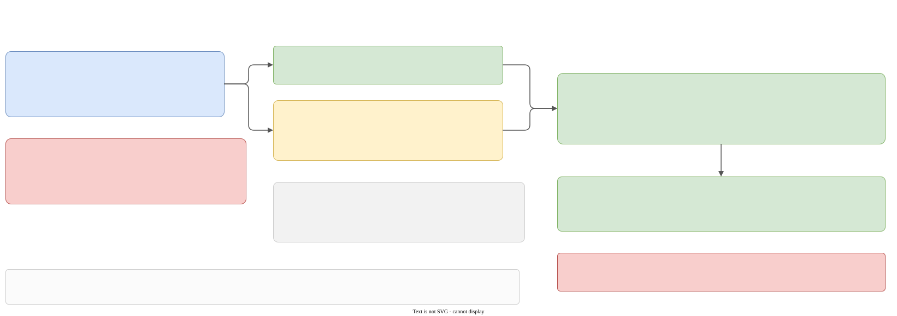

# Errors, logging, crashes

The rules, in four lines:

1. Every error is a **Boost.LEAF exception** that is **declared** in `galimatron/common_library/exception_declaration.hpp`.
2. It is **thrown** with `leaf::throw_exception` only inside `galimatron`.
3. It is **caught** only in the runtime, by `galimatron::runtime::try_catch` (the `leaf_spy`), and **printed** there.
4. A test prints one with `print_leaf_exception`.



Panel H of [the map](pipeline.md#the-map) draws the same path in the context of a run. The `exception-using` skill in `.cursor/skills/` has the same rules in short form.

## What an exception carries

`exception_declaration.hpp`, namespace `exception`. A LEAF exception struct has no `_t` suffix. There are three kinds of slot:

**Marks** (empty structs) say where an exception comes from:

| Kind | Values |
|---|---|
| `domain::` | `executable`, `executable_library`, `runtime_library`, `translator_library` |
| `subdomain::runtime_library::` | `filesystem`, `filesystem_decorator`, `galimatron_config`, `translate`, `translate_summary_xml` |
| `subdomain::translator_library::` | `parser`, `builder`, `cpp2post_cpp`, `gal2cpp`, `holder`, `cpp2gal`, `cpp2xml`, `xml2cpp`, `template_engine`, `translator`, `wizard` |

A subdomain may also mark an exception from another domain that passes through code related to it, such as a callback passed into the decorator.

**Detail enums** (`exception::details`): `io_operation_et { NON_EXIST, OPEN, READ, WRITE }`, and `validation_error_code_et`, a long enum (about 85 values) with the rule names of the validator and the wizard. See [The validator and the wizard](validate-wizard.md).

**Payloads**:

| Struct | Holds |
|---|---|
| `e_what_info {what}` | the **full message**. Put everything the user needs to read here |
| `e_path_info {path, committed_report, config_dir}` | a file. The two extra fields are copies of the run's path-spelling state, so the catch side can spell the path without global state |
| `e_aggregate_info {name}` | the aggregate |
| `e_version_info {version}` | the version index |
| `e_stacktrace_info {stacktrace}` | the stack at construction. It is printed but nothing constructs it by default: construct it at a throw site when you want a stack |

## Throwing

```cpp
leaf::throw_exception(
    exception::domain::runtime_library{},
    exception::subdomain::runtime_library::filesystem_decorator{},
    exception::e_what_info{ std::format("cannot find place for path '{}'", report_path(path)) },
    exception::e_path_info_for(path));
```

Pass marks and payloads as arguments. A `validation_error_code_et` value goes in the same list.

### Adding context with RAII guards

`common_library/exception_augment.{hpp,cpp}`. Each function returns an object that **you must keep alive** (all are `[[nodiscard]]`); while it lives, an exception that passes adds the payload to itself (`boost::leaf::on_error`).

| Function | Adds |
|---|---|
| `augment_domain(domain, subdomain)` | the two marks |
| `augment_path(path_ot)` | `e_path_info` (nothing for an empty path); reads `current_path_report()` for the copies |
| `augment_aggregate(name)` | `e_aggregate_info` |
| `augment_version(index)` | `e_version_info` |
| `augment_where({path, aggregate, version})` | up to three of them, each only if set |
| `e_path_info_for(path)` | not a guard: builds the payload when a throw statement makes it by hand |

The `error_load_t` template exists because the result of `on_error` has no move constructor: it is built in place and kept in `unique_ptr`s.

### The path report

`common_library/path_report.hpp`: `path_report_t {committed_report, config_dir}`, `current_path_report()` (a function-local static: one per process), `path_report_guard_t` (saves, sets, restores). `report_path(...)` (in `galimatron_config_declaration.hpp`) spells a path **relative to the `gal.cfg` folder with `/`** when `committed_report` is on and the folder is known, and as stored otherwise. **Every path that goes into a message must pass through `report_path`**; otherwise an expected file would hold an absolute path (see [Testing](testing.md#expected-files-have-no-absolute-paths)).

## Errors on a worker thread

A Taskflow worker has no LEAF context. `capture_or_rethrow` (`translator_library/capture_or_rethrow.hpp`):

```cpp
template <typename Fn> void capture_or_rethrow(Fn&& fn) {
    auto captured = leaf::try_capture_all(std::forward<Fn>(fn));
    if (!captured)
        throw ::leaf_spy::captured_leaf_exception{ std::move(captured) };
}
```

`fn` runs under `try_capture_all`, which collects every LEAF payload it loads into a `leaf::result<void>`. The wrapper throws a `captured_leaf_exception`. The `std::exception` crosses the worker boundary, `subflow.join()` or `future.get()` rethrows it on the caller's thread, and `leaf_spy` unloads the payloads into the catching context.

Use it whenever code that throws may run on a worker: `fail()` in the validator, `ensure_compiled()`, the Saxon errors in `xml2xml_impl.cpp`, and `translate_cpp2xml`. Load the context (`augment_where`, ...) **inside** the function you pass: a guard in the caller would attach to the `captured_leaf_exception`, and the printer would not see it.

## Catching and printing: `leaf_spy`

`D:\work\leaf_spy` (its own repository, header-only, `leaf_spy::leaf_spy`) provides `leaf_spy::try_catch`: `leaf::try_catch` plus a **spy** handler. The spy takes pointer arguments, so it sees any set of slot types; it is called when no direct handler matched. On an exception it tries the direct handlers; if none match it calls `spy_handler.visit(ctx, id, exception)` and rethrows (when `is_throw_out`). When it rethrows it unloads the slots so that an outer `try_catch` sees the full information. It also unwraps `captured_leaf_exception`.

Galimatron's part, `runtime_library/leaf_spy/`:

- `spy_handler_t {std::ostringstream& ss}` has an `operator()` that takes `const T*` for **every** mark, enum and payload (all of `exception_declaration.hpp`). Its body is empty: it exists to name the slots to load. A new slot type must be added there.
- A template `visit(context, error_id, std::exception*)` prints the text:
    1. `Exception details:`
    2. the `std::exception` message,
    3. the domain and subdomain marks,
    4. `ParseCancellationException` (ANTLR) and `nlohmann::json::parse_error` (with the byte offset), found by `dynamic_cast`,
    5. the detail enums by name (`magic_enum`), then `what`, path, aggregate, version, stacktrace,
    6. a warning when no domain or subdomain mark was found (`NO DOMAIN-SPECIFIC EXCEPTION CATEGORY MATCHED`),
    7. LEAF's own `diagnostic_info`.
- The path is spelled from `e_path_info`'s copies, because the run's path report may be gone when the text is built.
- `runtime::try_catch(args, direct_handlers...)` wraps `::leaf_spy::try_catch` with a `scope_guard_t`: a non-empty text is passed to `notify_printed` when the function exits, normally or by an exception.

It is used in three places:

| Where | What happens to the text |
|---|---|
| `translate_by_config.cpp`, the **inner** catch, `is_throw_out = true` | `summary_xml.set_error(info)`; the exception goes on |
| `translate.cpp`, the **outer** catch | `fLogmeE("{}", info)`; the result is 1; `is_throw_out` is `is_testing_mode` |
| the tests' `print_leaf_exception` | a handler checks `domain`, `subdomain`, `e_what_info`, ... |

The reason tests use `print_leaf_exception`: doctest's `REGISTER_EXCEPTION_TRANSLATOR` does not work for LEAF exceptions.

### Not LEAF

A syntax error is `antlr4::ParseCancellationException` (thrown by `parser::state_t`), and the spy prints it by `dynamic_cast`. A bad log config (`apply_log_config`) and a failed `merge_paths` are `std::runtime_error`. These show `NO DOMAIN-SPECIFIC EXCEPTION CATEGORY MATCHED`.

## Logging

Galimatron uses [Logme](https://github.com/efmsoft/logme). `global/common_library/logging_utils.*` wraps it.

### Subsystems

Every `.cpp` that logs declares **one** file-scope id, and nothing else in that anonymous namespace:

```cpp
namespace
{
Logme::SID SUBSID = Logme::SID::Build(global::log_subsystems::tr_tsp);
}
```

The ids are `const char*` constants in `global/common_library/log_subsystems.hpp`, each with a `brief:` and a `part:` comment. Use the id of the folder you edit. The list **must match** the `subsystems.allowed` list of every `log.cfg` in the repository (`log-subsystems` skill):

| Constant | Id | Folder |
|---|---|---|
| `exec` | `EXEC` | executable |
| `exlib` | `EXLIB` | executable_library |
| `rt` | `RT` | runtime, generic |
| `rt_fs` | `RT-FS` | filesystem |
| `rt_fsd` | `RT-FSD` | filesystem_decorator |
| `rt_cfg` | `RT-CFG` | galimatron_config |
| `rt_trn` | `RT-TRN` | translate |
| `rt_sum` | `RT-SUM` | translate_summary_xml |
| `tr` | `TR` | translator, generic |
| `tr_par` | `TR-PAR` | parser |
| `tr_bld` | `TR-BLD` | builder |
| `tr_cmp` | `TR-CMP` | cpp2post_cpp |
| `tr_g2s` | `TR-G2S` | gal2cpp |
| `tr_hld` | `TR-HLD` | holder |
| `tr_s2g` | `TR-S2G` | cpp2gal |
| `tr_s2s` | `TR-S2S` | cpp2cpp_wizard |
| `tr_s2x` | `TR-S2X` | cpp2xml |
| `tr_x2s` | `TR-X2S` | xml2cpp |
| `tr_xslt` | `TR-XSLT` | xml2xml |
| `tr_tsp` | `TR-TSP` | translator, and cpp2cpp_validate |
| `tr_wiz` | `TR-WIZ` | state/wizard |

Use `fLogmeD`, `fLogmeI`, `fLogmeW`, `fLogmeE` (format-string forms). The header of `logging_utils.hpp` `#undef`s Logme's `LS` and `LWS` macros because they clash with ANTLR token names.

### Configuration

`apply_log_config(const file_content_with_path_t&)`:

1. parse the JSON (comments allowed) to read `home-directory.path`. A relative value is resolved against the **folder of `log.cfg`**, not the executable or the working directory;
2. `SetHomeDirectory` before and after `LoadConfiguration`, because `LoadConfiguration` stores the raw value;
3. `DeleteAllChannels()`, then `LoadConfiguration(json)` (a failure is `std::runtime_error`);
4. adjust the **default channel**: `fLogme*` asks the default channel's level first, so its threshold is lowered to the most verbose level of all channels, and a display filter forwards each record to every other channel and applies the default channel's configured level to itself.

`log_tabulator_t` adds 4 to a global indent while it lives (used around the steps), and `use_console()` resets the default channel to the console. `flush_log()` flushes all channels; call it before you read a log file.

A step logs `begin of transformation: N, 'name'` and `end   of transformation: N, 'name': <time>`; with `committed-report` the time and the memory are left out, so a log can be committed and compared. Two tests do that: `no_xslt` and `xslt_catalog` keep `expected-log/galimatron.log`.

### Crash log

A crash writes `galimatron.crash.log` and a summary with `status="crash"`. See [The runtime](runtime.md#the-crash-handler).
