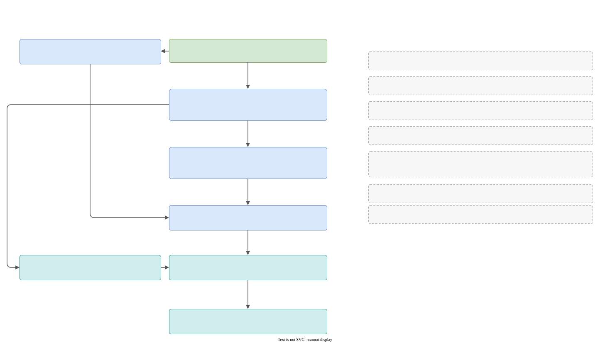

# Developer guide

This part of the documentation is for people who **change Galimatron itself**. The rest of the documentation is for people who use it.

It describes how the tool is built: the libraries and their layers, the pipeline of steps, the data model, the XML, the wizard and the validator, the seal, the error and logging machinery, the tests, the build and the CI. Every page names the files and the functions it talks about, so that you can open the code beside the text.

## Galimatron in five minutes

Galimatron is a **file tool**: files in, files out. One run does this:

1. The runtime reads `gal.cfg` and `log.cfg`, sets up logging and crash handling, and builds a **filesystem decorator**: folders with rules (the places).
2. The **translator** builds a list of steps from what you configured and runs them one after another. The first step parses the `.gal` files into a graph, the next ones check it, apply the wizard command, run your language XSLT through Saxon, check the seal, print the `.gal` text, compile the graph into a compiled view, print the compiled XML, and run your post XSLT.
3. Every step hands its output to the runtime, which writes it through the places and records it in `galimatron_summary.xml`.
4. If everything succeeded, the runtime writes the delayed files and removes stale ones. Then it exits with 0. Any error exits with 1.

The code is split into three libraries on top of a small global one:

| Library | What it owns |
|---|---|
| `translator_library` | The language and everything that works on it: parser, graph, wizard, validator, compiler, XML, seal, the sequence of steps. It does not touch the real disk. |
| `runtime_library` | The application: configuration, filesystem decorator, summary, crash handler, the printing of errors. It is the only place where the translator meets the disk. |
| `executable` and `executable_library` | `main()` and the command line. |
| `global` | Types, logging helpers, the scope guard, the filesystem abstraction, the precompiled header. Nothing here knows about GaL. |

## The map

[**One run, step by step**](pipeline.md#the-map) is one big diagram of the whole pipeline: the runtime before and after, the fifteen steps of a full run with their state in memory, files and failures, and nine panels that open the steps that hide the most. Read it first. Everything else in this guide is a closer look at some part of it.

## Reading order

| If you want to | Read |
|---|---|
| see how the pieces fit | [Architecture](architecture.md), then [The pipeline](pipeline.md) |
| understand what happens around the translator | [The runtime](runtime.md) |
| change the language, the graph or the builder | [The data model](model.md), [Parsing and printing](parsing.md) |
| change how versions and tags merge | [The compiler](compile.md) |
| change the XML or how Saxon is used | [XML and Saxon](xml.md) |
| add or change a wizard command or a check | [The validator and the wizard](validate-wizard.md) |
| touch hashes or the protection of closed versions | [Hashes and the seal](seal-hash.md) |
| throw, catch or print an error, or add logging | [Errors, logging, crashes](errors-logging.md) |
| write or run tests | [Testing](testing.md) |
| build, package, or touch CI | [Build, packaging, CI](build-ci.md) |
| write code that matches the code around it | [Conventions](conventions.md) |
| do one of the common changes step by step | [Recipes](recipes.md) |
| avoid a known trap | [Known quirks](quirks.md) |

## The repository

| Folder | What it holds |
|---|---|
| `galimatron/translator_library/` | `parser/`, `state/`, `transforms/`, `translator/`, `xslt/gal-functions.xsl` |
| `galimatron/runtime_library/` | `translate/`, `filesystem/`, `filesystem_decorator/`, `galimatron_config/`, `leaf_spy/`, `crash/`, `translate_summary_xml/`, `utils/` |
| `galimatron/common_library/` | the exception vocabulary, path report |
| `galimatron/executable/`, `executable_library/` | `main.cpp`, the command line |
| `galimatron/tests/` | the tests and their fixtures |
| `global/` | `common_library/`, `filesystem_library/`, `pch_library/`, `tests/` |
| `examples/` | `uuid_protocol/` and `benchmark/`, which are also tests |
| `externals/` | SaxonC-HE archives and the base64 header |
| `cmake/`, `scripts/`, `.github/` | dependencies, packaging, the release script, CI |
| `.cursor/skills/` | the written conventions of the project, see [Conventions](conventions.md) |

Two libraries have their own repositories and are fetched at configure time: `leaf_spy` (the LEAF spy) and `multi_index_lookup` (helpers over Boost.MultiIndex).
