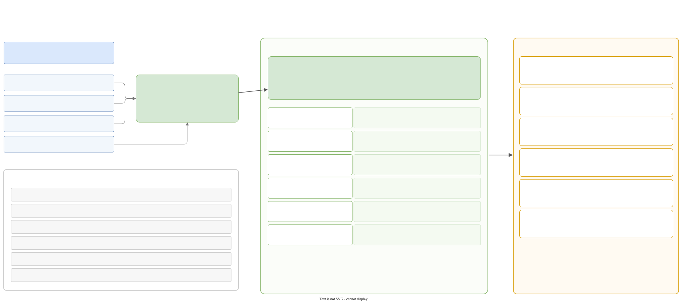

# The data model

The language lives in memory as a **graph** of small vertices, with a set of **index containers** over it. This page describes both, the `builder_t` that is the only way to add vertices, and the compiled view that is derived from the graph.



!!! note "Names"
    There is no `state_t` or `holder_t` that owns everything. The graph and its indexes are `holder::language_part_t`. The result of compilation is `holder::compiled_part_t`. `parser::state_t` is only an ANTLR parse session (see [Parsing and printing](parsing.md)).

Code: `galimatron/translator_library/state/`.

## Entities

`state/entity/entity.hpp`. Each node of the tree is a small struct. They form a `std::variant` (`entity_t`), and a plain enum `entity_et` names the type for cheap checks.

| Group | Types |
|---|---|
| structure | `root_t`, `chunk_t` (one per `.gal` file) |
| root aggregate | `root_aggregate_t`, `root_aggregate_version_declarations_t`, `..._declaration_t {index, status, comment, hash}`, `..._definitions_t`, `..._definition_t {index or owner, mode}` |
| aggregate | `aggregate_t {name, index}`, and the same four sub-entities |
| tag | `tag_statement_t`, `tag_values_t`, `tag_value_t`, `tag_record_t`, `tag_keyvalue_t`, `tag_array_t`, `tag_string_t {value, delimiter, is_template}` |
| label | `label_statement_t`, with a child `label_dynamic_t` or `label_static_t {values, tag_name_from}` |
| ordering | `ordering_statement_t {name, ordering_parts}` |
| operation | `operation_statement_t {name, is_version}` (the historical `delete`) |
| wizard | `wizard_statement_t {type, context, chunk_node, chunk_uri, data, commands}` |

Facts that are easy to miss:

- `tag_statement_t` has `index_in_version`, an optional `name` (absent: the compiler names it from a label's `tag-name-from`), the list of `labels`, the `mode`, `created_by_wizard`, and `string_values_at_zero_level`, a map from "value number i" to the vertex of that top-level string. That map is what lets naming, static labels and history read the first-level strings without walking the subtree.
- A version **definition** has either an `index` or an `owner`. A numbered body has an `index`. A **parked** body (`version before N`) has no index and is owned by version N: this is where `collapse version` puts the statements of the versions it merged.
- `created_by_wizard` exists on root aggregates, aggregates, version definitions and tags. The XML writer turns it into wizard marks, and the seal uses it to know which copies an xslt may finish.
- `wizard_statement_t` is in the graph but **never in the XML**. `cpp2xml` throws if it meets one. After the wizard runs, its text stays on the chunk as `//` comments.
- `entity_et::TAG_LABELS` exists, but no variant alternative has that type: the labels of a tag are a plain list inside `tag_statement_t`.
- Strings remember how they were quoted: `tag_string_t.delimiter` and `tag_keyvalue_t.key_delimiter` are indexes into a table kept by `language_part_t` (index 0 is a plain `"`). So `'a'`, `"a"` and `R"(a)"` survive a round trip.

## The graph

`state/holder/graph/`. A vertex (`vertex.hpp`):

```cpp
struct vertex_t {
    entity_et entity_type;
    entity_t entity;
    location_ot location;          // the file
    vertex_descriptor_t vd_parent; // not optional: every vertex except the root has one
    vertex_descriptor_t vd_self;
    strings_t user_comments;       // // and /* */ to the left of the vertex
    content_ot user_formatting;    // the source text from the first to the last token, incl. spaces
};
```

`graph_t` is a `boost::adjacency_list<listS, containerS, bidirectionalS, vertex_t>`. The vertex list is a **custom container**: `containerS` and specializations of `boost::container_gen` make Boost.Graph store its vertices in `vertex_container::container_t` (`graph/container.hpp`), a `boost::multi_index_container` with a random-access index and two ordered ones: by `entity_type`, and by `(vd_parent, entity_type)`. The second index is how code finds, for example, the `LABEL_STATIC` child of a label. The descriptor stays a `std::size_t`.

- Edges go from parent to child, in the order the children were added.
- `operator[]` of the container const-casts the stored vertex, because Boost.Graph writes properties through a const multi-index. **Never** change `entity_type` or `vd_parent` through it. Code that must change them (`detach_children`, `apply_aggregate_version_delete`) calls `vertices.modify(...)`.
- Vertices are **never removed**. A "delete" removes the edge and sets `vd_parent` to `vertex_descriptor_not_present`; the vertex stays orphaned in the container and its descriptor is never reused. Everyone who needs "what is in the graph" must go through the version containers, not scan all vertices.
- `vertex_payload.cpp` builds a canonical string for a subtree (`TAG_STATEMENT{...children...}`: identifying fields, no formatting, no locations). It is the `definition_payload` of a version (the seal compares them) and the `body` of each compiled tag.

## `language_part_t`

`state/holder/holder.{hpp,cpp}`. Not copyable, not movable.

```cpp
graph_t graph_;
vertex_descriptor_t root_node_;
aggregate_container::container_t         aggregates_;
version_container::container_t           versions_;
version_statement_container::container_t version_statements_;
ordering_link_container::container_t     ordering_links_;
vertex_descriptors_t                     wizard_statements_;
std::vector<string_delimiter_t>          string_delimiters_;   // index 0 = plain "
```

The graph holds the truth. The containers are **indexes over it**, kept in sync by the builder and by explicit calls. Forgetting a call produces a stale index without any compile error.

### The containers

All are Boost.MultiIndex, wrapped by `multi_index_lookup::container_extended_t`, which adds uniform lookups: `try_find_by`, `find_by_or_throw`, `find_by_and_do`, `try_erase_by`, `equal_range_by`, `try_find_by_and_modify`.

| Container | Row | Used to |
|---|---|---|
| `aggregate_container` | `{name, vd, is_root, chunk_path, vd_chunk, index, vd_declarations, vd_definitions, first_live, last_hashed}` | find an aggregate by name, descriptor, index or chunk. `first_live` is the smallest non-deleted declaration index. **`last_hashed`** is the highest declaration index that has a hash: the **seal boundary** |
| `version_container` | `{vd_aggregate, version_index, vd_declaration, vd_definition, status, hash, comment, definition_payload, ...order}`, plus a second set for parked bodies | one row per (aggregate, version) that merges its declaration (in `versions { }`) and its definition (the `version N { }` body). They are written in different places of a file, and the row joins them |
| `version_statement_container` | `{vd_aggregate, version_index, vd_definition, vd_entity, name, index_in_version, names_tag, entity_type}` | the direct statements of one version body, in order |
| `ordering_link_container` | `{aggregate_name, version_index, vd_ordering, ordering_name}`, names compared without case | which aggregates a root ordering names, so `delete aggregate` can refuse one |

The merged timeline and the compiled tags have their own containers, in `compiled_part_t`.

### Declarations, definitions, and what the file looks like

```text
CHUNK
 └ AGGREGATE | ROOT_AGGREGATE
    ├ AGGREGATE_VERSION_DECLARATIONS ─ AGGREGATE_VERSION_DECLARATION*     (index, status?, comment?, hash?)
    └ AGGREGATE_VERSION_DEFINITIONS  ─ AGGREGATE_VERSION_DEFINITION*      (index | owner, mode)
           └ TAG_STATEMENT | LABEL_STATEMENT | ORDERING_STATEMENT | OPERATION_STATEMENT
                 └ TAG_VALUES ─ TAG_VALUE ─ TAG_STRING | TAG_RECORD | TAG_ARRAY ...
```

Declarations say which versions **exist**, with their status, comment and hash. Definitions are the bodies. The rules that tie them together are the structural checks of the validator (`root` declares `0..n` without gaps; every aggregate repeats the root's declarations; definitions repeat the declarations that are not deleted; deleted versions form a prefix, a suffix, or an interior span owned by an anonymous body).

Some calls to know:

- `refresh_live_and_hashed(vd_aggregate)` recomputes `first_live` and `last_hashed`. The builder calls it when it creates a declaration; the wizard calls it after structural edits. The root's `last_hashed` is **the seal boundary**.
- `note_version_child(vd)` and `forget_version_child(vd)` keep `version_statements_` (and `ordering_links_` for root orderings) in sync.
- `bind_anonymous_owners` and `rebind_version_definitions` set the owner of parked bodies after a definitions list is read or reshaped. A parked body with no written owner takes the next numbered body.
- `refresh_version_records()` is called only by the seal, on the "before" and "after" graphs. It rebuilds the `definition_payload` of every version (the parked bodies owned by a version first, then its own children). Before that call the payload is not valid.
- `statements_in_order`, `statements_of`, `next_version_statement_index`, `version_names_tag`, `ordering_names`: the queries.

### Statement order

The order of statements in a version is `index_in_version`, **not** the order of the graph edges. `cpp2xml` renumbers while printing, so the indexes in XML can differ from the stored ones.

## The builder

`state/builder/builder.{hpp,cpp}` and `detail/*.cpp`. `builder_t` is the **only** code that adds vertices.

```cpp
builder_t(language_part_t&);                          // creates the ROOT vertex
builder_t(language_part_t&, on_existing_state_t);     // continue on a state that has a root
create_chunk, create_root_aggregate, create_aggregate,
create_*_version_declarations / _declaration / _definitions / _definition,
create_tag_statement / _values / _value / _record / _keyvalue / _array / _string,
create_label_statement / _dynamic / _static, create_ordering_statement,
create_operation_statement, create_wizard_statement,
apply_aggregate_version_delete(vd_definition),
clone_under({source, parent, tag_index, created_by_wizard}),
clone_from({source_graph, source, parent, tag_index, created_by_wizard, clear_formatting});
```

Each `create_*` takes a struct with the parent descriptor and the fields, calls `boost::add_vertex`, sets `vd_self`, adds the parent edge, and **registers the vertex in the containers** (aggregates, versions, statements, wizard statements).

- `apply_aggregate_version_delete(vd_definition)`: when a body contains `delete;`, every other child is detached and only the `delete;` stays. A numbered body also marks its declaration `DELETED`. The parser calls it at the end of each aggregate version definition.
- `clone_under` and `clone_from` copy a subtree, within one graph or from another graph. They rebuild `string_values_at_zero_level`, and can set the tag index and the `created_by_wizard` flag, and drop `user_formatting` and `user_comments`. The wizard and the seal use them.
- **Deleting** is not on the builder. It is `boost::remove_edge` and `vertices.modify(...)` in the wizard code and in `xslt_seal.cpp::detach_children`.

The same builder is used by the parser (`gal2cpp`), by `xml2cpp_saxon`, by the wizard and by the seal. Only `on_existing_state_t` differs.

## The compiled part

`compiled_part_t` (also in `holder.hpp`) is produced by the compiler ([The compiler](compile.md)). It does not own the graph. It refers to it by descriptors, so it must not outlive it or be used with another graph. `translator_t` resets it whenever the graph is replaced or edited.

| Container or member | Holds |
|---|---|
| `tag_container` | for each version, the **effective tags**, in order: `{vd_version, vd_tag, name, body}` |
| `tag_labels_container`, `static_label_container` | the labels each tag resolved to, and their static data |
| `tag_name_container` | the name given to an unnamed tag |
| `ordering_container` | the orderings visible in each version |
| `ordering_rank_container` | `{aggregate_name, version_index, ordering_name, rank}`: the **position** of each aggregate under each ordering |
| `merged_` (one per aggregate) | `version_entity_container` (the merged timeline of statements) and a map from version index to the definition vertex |
| `rendered_strings_` | the rendered text of each `_te` string, per (version, string) |
| `value_before_` | the value visible just before each statement, for the history |

`force_resolve_labels()` turns every label reference into its static value at the end of the compile, so the compiled part keeps no references to label vertices.

## Hashes and dynamic labels

- `state/content_hash.cpp`: `sha256_hex`, `important_tags_hash`, `hash_of_hashes`. See [Hashes and the seal](seal-hash.md).
- `state/dynamic_label.cpp`: `dynamic_value_of_label`, `dynamic_values_of_tag`, `tag_uses_dynamic_label`. A dynamic label has no values; its `value` is the id that marks the tags. The functions find the latest label with that name that is visible from the tag (the aggregate's label beats the root's; a higher version beats a lower one; inside a version, a higher index wins; inside the tag's own version, labels at or after the tag are excluded). They work on the language graph, not on the compiled part.
- `state/tag_mode.hpp`: `tag_mode_et { INHERIT, ONCE, LOCAL, OWN }`, with the authoritative comment on what each mode means.
- `state/version_status.*`: `version_status_et { DELETED }`; an empty optional means live.

## Invariants worth remembering

1. The language part and the compiled part are separate. The compiled part is recomputed from scratch and dropped whenever the graph changes.
2. Descriptors are stable and never reused.
3. Statement order is `index_in_version`.
4. After you reshape versions (wizard, seal), call `rebind_version_definitions`, `refresh_live_and_hashed`, `forget_version_child`, as needed.
5. The hash covers the **values** of `important` tags, not names, labels or aggregate order. Renaming or reordering does not break a seal, changing a value does.
6. A wizard statement is never in XML, and the wizard runs on the language graph before any xslt sees it.
7. `created_by_wizard` is how an xslt (and the seal) knows what is new.
8. `state/wizard/command.hpp` checks with `static_assert` that its command table is consistent: a command added to `command_et` without an entry in the table does not compile.
