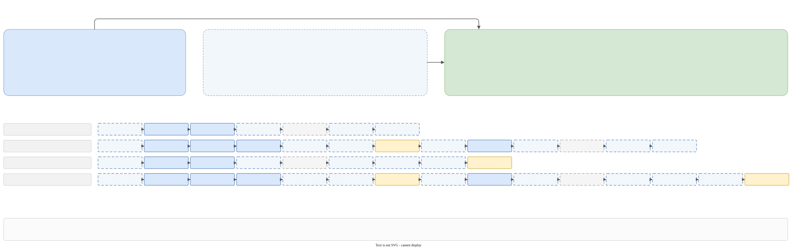

# The pipeline

## The map

<div class="big-diagram" markdown="0">
<a href="../../images/31_dev_pipeline_map.svg" target="_blank" title="Open the map at full size">

</a>
</div>

The map is large on purpose. [Open it in its own tab](../images/31_dev_pipeline_map.svg) and zoom: it is a vector image.

How to read it:

- **Band 1** is the runtime before the translator: command line, `rt::translate`, `translate_by_config`, the start of the run, and the call into the translator.
- **Band 2** is the translator. Each column is one step of a full run, in the order of the Taskflow chain. The rows say, from top to bottom: which domain the step is in, when the step is present at all, its name, the state types it converts (`GaL`, `CPP`, `XML`, `SAXON`), where the code lives, what it does, what the five memory slots of `translator_t` look like after the step, which files it writes, and how it fails.
- **Band 3** is the runtime after the translator: the delayed writes, the summary, the exit code, and the two bad endings (an error, a crash).
- **Panels A to I** open the parts that hide the most. They are described below, with a link to the page that has the details.

| Panel | About | Details |
|---|---|---|
| A | how the list of steps is built | this page |
| B | the twelve checks of the validator | [The validator and the Wizard](validate-wizard.md#the-validator) |
| C | the Wizard step | [The validator and the Wizard](validate-wizard.md#the-wizard-step) |
| D | the compile step | [The compiler](compile.md) |
| E | the XML round trip and the layout table | [XML and Saxon](xml.md) |
| F | where the output of a step goes | [The runtime](runtime.md#where-the-output-of-a-step-goes) |
| G | the seal | [Hashes and the seal](seal-hash.md#the-seal) |
| H | errors | [Errors, logging, crashes](errors-logging.md) |
| I | the places of the filesystem decorator | [The runtime](runtime.md#the-places) |

## What the translator is given

`translator::translate(const config_t&)` (`translator/translator.hpp`) is the only entry point of the translator. The runtime fills `config_t`:

| Field | Meaning |
|---|---|
| `galimatron` | the summary directory (for `taskflow.dot`) and `committed_report` |
| `saxon_processor` | `working-dir` and `config-file` of Saxon |
| `transforms` | the language and post-language user transforms from `gal.cfg` (the built-in ones are added by the translator) |
| `gal_state` | the `.gal` files as paths with **deferred** contents |
| `gal_version` | the number from `gal.version` |
| `split_path_by_parts` | a callback to split a path, used when printing locations into XML |
| `testing` | absent in production; the flags of a slice test otherwise |
| `notify_transform_result` | called by each step when it ends, with its output |
| `notify_taskflow_graph` | called once after the run with the text of the Taskflow graph |
| `notify_state_memory` | called once with the growth of private memory |

The translator reads no file and writes no file itself. It only calls those callbacks. See [Architecture](architecture.md#why-the-translator-does-not-touch-the-disk).

## `translator_t`

`translator/detail/translator_impl.hpp`. One object per run. Its members are the state that the steps share:

| Member | Holds |
|---|---|
| `transforms_` | the list of `transform_t`, the steps in order |
| `config_transforms_` | a `std::list` of `galimatron_config::transform_t`: a synthesized config entry for every built-in step (a list, so references stay valid) |
| `language_state_` | `shared_ptr<language_part_t>`, the current language graph |
| `language_before_xslt_` | the graph as it was before the language xslt. Needed because `xml2saxon` resets `language_state_` |
| `compiled_state_` | `optional<shared_ptr<compiled_part_t>>`, the compile of `language_state_`. Dropped when the graph is replaced or edited in place |
| `any_transform_states_` | named slots: the Saxon session and the layout table |
| `taskflow_` | the chain of tasks |

`translate_internal()`:

1. reads the private memory at the start (a `scope_guard_t` reports the growth at the end),
2. `parser::gal_version::require_supported(args_.gal_version)` on the main thread,
3. `prepare_transforms()`,
4. creates one Taskflow task per step and chains them with `previous.precede(task)`,
5. runs the graph with `executor().run(taskflow_).get()` (`wait()` would not propagate the exception),
6. a guard hands the text of the graph to `notify_taskflow_graph`, **also when the run throws**.

## A step: `transform_t`

```cpp
struct transform_t
{
    domain_and_state_t incoming_domain_and_state;   // e.g. { LANGUAGE, CPP }
    domain_and_state_t outgoing_domain_and_state;   // e.g. { LANGUAGE, XML }
    const galimatron_config::transform_t& config_transform;   // the name, the principal xml, the other files
    named_oet named;                                // GAL2CPP, CPP2GAL, or none: the runtime routes these two specially
    job_ft job;                                     // the work. returns the files it produced
    is_skipping_ft is_skipping;                     // true: log "skip transformation", status SKIPPED
    origin_et origin;                               // BUILD_IN or USER
    bool print_as_compiled_document;                // what the principal xml prints
    std::string_view description;                   // the description attribute of <galimatron>
};
```

Every built-in step is a factory function `translator_t::get_<name>_transform()` in its own file under `translator/detail/transforms/`. A factory calls `store_builtin_transform(name, principal_xml)` to make a config entry for itself, so that the runtime can treat built-in and user steps the same way. The names are constants in `translator/builtin_transform_name.hpp`, and the XML file names are in `translator/builtin_transform_xml.hpp`.

| Step | Factory file | Job |
|---|---|---|
| `gal2cpp` | `gal2cpp.cpp` | `compiled_state_.reset()`; `language_state_ = gal2cpp::translate(...)`. Skipped when `language_state_` is already set |
| `cpp2cpp_validate` | `cpp2cpp_validate.cpp` | `compiled_state_ = validate_language(language_state_, subflow)` |
| `cpp2cpp_wizard` | `cpp2cpp_wizard.cpp` | `compiled_state_.reset()`; `language_state_ = cpp2cpp_wizard::translate(...)`. Skipped without a Wizard statement |
| `cpp2cpp_before_xslt` | `cpp2cpp_before_xslt.cpp` | `language_before_xslt_ = language_state_` |
| `cpp2xml` | `cpp2xml.cpp` | empty job. The principal XML is printed by `execute_transform` |
| `xml2saxon` | `xml2saxon.cpp` | creates the Saxon session and adopts the printed language XML; resets `language_state_` (not in testing) |
| user language xslt | `xml2xml.cpp` | `xml2xml::operation_t::apply(saxon, config_transform)` |
| `xml2cpp` | `xml2cpp.cpp` | `compiled_state_.reset()`; `language_state_ = xml2cpp_saxon::translate(saxon, &layout_table)`; `saxon.reset()` |
| `cpp2cpp_after_xslt` | `cpp2cpp_after_xslt.cpp` | `language_state_ = reassign_sealed_edits(before, after)`; `language_before_xslt_.reset()`; validate again |
| `cpp2gal` | `cpp2gal.cpp` | prints one `.gal` text per chunk. In a slice test with `drop_tag_user_formatting` it first forgets the stored text of tags and orderings |
| `cpp2post_cpp` | `cpp2post_cpp.cpp` | `ensure_compiled()`. Skipped without a root aggregate |
| `post_cpp2post_xml` | `post_cpp2post_xml.cpp` | empty job; prints the compiled XML. Skipped without a compiled state |
| `post_xml2saxon` | `post_xml2saxon.cpp` | creates a new Saxon session and adopts the compiled XML. Skipped without a compiled state |
| user post xslt | `post_xml2post_xml.cpp` | the same apply as the language xslt |

### `execute_transform`

`translator/detail/transforms/execute.cpp` runs one step inside its Taskflow task:

1. `scope_guard_t` logs `begin of transformation: N, 'name'` and, at the end, `end   of transformation: N, 'name': <time>`. With `committed_report` the time is left out.
2. A second guard reports the result to `notify_transform_result` **in its destructor**, so it runs also when the job threw. The status is `FAILED` if `std::uncaught_exceptions()` grew, `SKIPPED` if the step skipped, `SUCCESS` otherwise.
3. If `is_skipping(tf)`, log `skip transformation` and stop.
4. Otherwise `tf.job(tf, subflow)` runs. Its return value is `produced_files`.
5. If the step's config entry names a principal XML file, the XML is printed **after** the job: from the Saxon document if the session has one (a user xslt step, or `xml2saxon`); otherwise, if there is a language graph, `translate_cpp2xml(print_as_compiled_document, description)`.

So `cpp2xml` and `post_cpp2post_xml` have empty jobs: their work is the printing in step 5.

### Skipping

A step may be in the list and still not run. The sequence builder puts `gal2cpp` in twice on purpose (once to start, once as the way from GaL back to CPP for the post part), and the second one is skipped because `language_state_` is set. The comment in the code says it keeps the sequence builder simple. The summary shows such a step as `SKIPPED`.

## The state types and domains

The builder thinks in two axes (`transform_sequence_builder.hpp`):

- **domain**: `LANGUAGE` (the language graph, what you write) or `POST_LANGUAGE` (the compiled view). The sequence must be: all `LANGUAGE` steps, then all `POST_LANGUAGE` steps. A return to `LANGUAGE` is an error.
- **state type**: `GaL` (text), `CPP` (the graph in memory), `XML` (pugixml text), `SAXON` (the document held by Saxon for an xslt).

A step is an edge from (domain, state type) to (domain, state type). `cpp2post_cpp` is the one edge that changes the domain.

## How the list of steps is built



`prepare_transforms()` (`translator/detail/prepare_transforms.cpp`) chooses production or testing.

### Production: `prepare_prod_transforms()`

1. **The seed**, in this order: `cpp2cpp_validate`, `cpp2cpp_wizard`; then, **only if some language user transform is enabled**, `cpp2cpp_before_xslt`, one `xml2xml` per enabled language transform, `cpp2cpp_after_xslt`; then one `xml2xml` (post flavor) per enabled post transform. A transform with `"enable": false` is not in the seed and never appears in the summary.
2. **The catalog**: eight state transforms, one edge each: `gal2cpp` (GaL→CPP), `cpp2gal` (CPP→GaL), `cpp2xml` (CPP→XML), `xml2saxon` (XML→SAXON), `xml2cpp` (SAXON→CPP), `cpp2post_cpp` (LANGUAGE CPP→POST CPP), `post_cpp2post_xml` (POST CPP→POST XML), `post_xml2saxon` (POST XML→POST SAXON).
3. `complete_sequence(seed, catalog, finish_sequence = true)` calls `transform_sequence_builder::builder_t`.

### The builder

`builder_t` (`translator/detail/transform_sequence_builder.{hpp,cpp}`, covered by `test_transform_sequence_builder.cpp`):

- `check_transform_sequence`: the domain order above.
- `check_state_transforms` (production only): the catalog must hold the seven edges `GaL→CPP`, `CPP→GaL`, `CPP→XML`, `XML→SAXON`, `SAXON→CPP`, `LANGUAGE CPP→POST CPP`, `POST CPP→POST XML`.
- `complete_transform_sequence` with `finish_sequence`:
    1. Split the seed into the language items and the post items (`is_post_transform`: a step that has a `POST_LANGUAGE` side).
    2. For each language item, `ensure_state(item.incoming, language_only = true)`: if the current representation differs, append the shortest path (`shortest_path`, a breadth-first search over the catalog that may not leave `LANGUAGE`). The search starts at `GaL`, so the first step of a run is `gal2cpp`.
    3. After the language items, unless the last step is already `cpp2gal`, append the path back to `LANGUAGE CPP` and then `cpp2gal`.
    4. If there are no post items, append the path to `POST XML`. Otherwise, for each post item `ensure_state` (the path from `GaL` to `POST SAXON` is `gal2cpp`, `cpp2post_cpp`, `post_cpp2post_xml`, `post_xml2saxon`) and append the item. After the last post item the state must be `XML` or `SAXON`.
- A path that cannot be found throws `transform sequence cannot be completed: <from> -> <to>`.

Results, for four common projects (the same as panel A of the map):

| Project | Steps |
|---|---|
| no xslt | `gal2cpp`, `cpp2cpp_validate`, `cpp2cpp_wizard`, `cpp2gal`, `gal2cpp` (skipped), `cpp2post_cpp`, `post_cpp2post_xml` |
| language xslt only | `gal2cpp`, `cpp2cpp_validate`, `cpp2cpp_wizard`, `cpp2cpp_before_xslt`, `cpp2xml`, `xml2saxon`, **your xslt**, `xml2cpp`, `cpp2cpp_after_xslt`, `cpp2gal`, `gal2cpp` (skipped), `cpp2post_cpp`, `post_cpp2post_xml` |
| post xslt only | `gal2cpp`, `cpp2cpp_validate`, `cpp2cpp_wizard`, `cpp2gal`, `gal2cpp` (skipped), `cpp2post_cpp`, `post_cpp2post_xml`, `post_xml2saxon`, **your post xslt** |
| both | all fifteen |

You can check this against any `taskflow.dot` or `galimatron_summary.xml`. The one of `examples/uuid_protocol/steps/12-collapse/generated/intermediate/` is the "both" case.

### Testing: `prepare_testing_transforms()`

Slice tests pass a `testing_t`: one flag per built-in step (`gal2cpp`, `cpp2cpp_validate`, `cpp2cpp_wizard`, `cpp2xml`, `xml2cpp`, `cpp2gal`, `cpp2post_cpp`, `post_cpp2post_xml`) and `drop_tag_user_formatting`. The seed is the flagged steps in that order. The catalog holds `gal2cpp` and `xml2saxon` only when their flags are on. The builder runs with `finish_sequence = false`: it keeps the seed as it is and inserts a catalog edge only where two seed steps do not meet. So a slice test runs exactly the steps it asked for.

!!! note
    The testing path is a second way to build the list. Production and testing do not share the code that chooses the seed, so a change to the sequence has to be checked in both.

## The Taskflow graph

The steps are **strictly sequential**: one task each, chained with `precede`. Parallelism exists only inside a step: `cpp2cpp_validate` builds a **subflow** of twelve checks (and `cpp2cpp_after_xslt` builds a second one). The runtime writes the graph as `taskflow.dot`, with pointer ids replaced by `n1`, `n2`, ... by `readable_taskflow_dump` (so the file is stable and can be committed).

Because tasks run on worker threads, a step must not rely on a LEAF context from the main thread. See [Errors, logging, crashes](errors-logging.md#errors-on-a-worker-thread).

## Memory slots at a glance

The lifetime of the five slots over a full run is drawn in band 2 of the map. In words:

- `language_state_` is created by `gal2cpp`, edited in place by the Wizard, **reset** by `xml2saxon` (production), rebuilt by `xml2cpp`, rewritten by the seal, and read until the end.
- `language_before_xslt_` is a second pointer to the same graph from `cpp2cpp_before_xslt` until `cpp2cpp_after_xslt`.
- `compiled_state_` is compiled by validation, reset by every step that changes the graph, and compiled again by `ensure_compiled()` when something needs it: the XML printer (for `<history>` and for the compiled document), the seal, the compile step.
- The Saxon session exists from `xml2saxon` to `xml2cpp`, and again from `post_xml2saxon` to the end.
- The layout table is cleared and refilled by **every** print of XML. It matters only between the print in `xml2saxon` and the read in `xml2cpp`.
