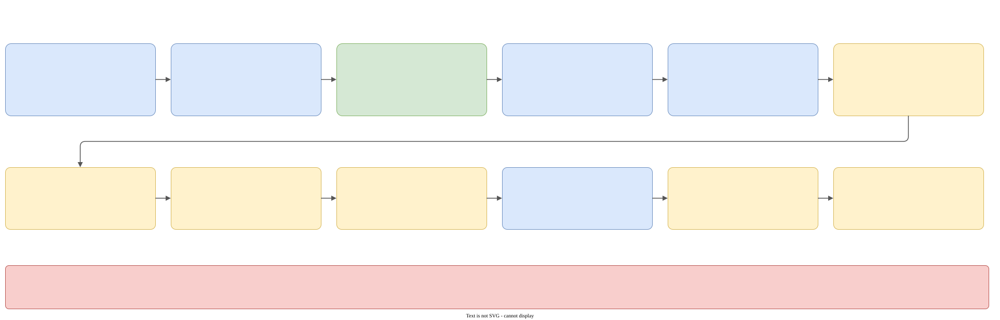

# The runtime

`galimatron/runtime_library` is the application around the translator. It reads the configuration, builds the folders-with-rules model, runs the translator, writes everything the translator produces, prints errors, writes the summary and survives crashes.

## From `main` to the translator

`executable/main.cpp`:

1. `executable_library/command_line.cpp` parses the arguments with Boost.Program_options: `--help`, `--log-config-file <path>`, `--gal-config-file <path>`. `--help` prints and exits with 0.
2. It calls `runtime::translate({ .get_log_config, .get_gal_config, .is_testing_mode = false })`. Both getters are lambdas that read a file: a missing `--gal-config-file` throws a LEAF exception with the domain `executable`.
3. The return value of `translate` is the exit code of the process.

`translate_t` (`translate/translate.hpp`) is the same entry for tests. A test passes `is_testing_mode = true`, so exceptions leave `translate()` and the test can look at them, and it may pass a `testing` slice. `translate_t::get_log_config_from_file` and `get_gal_config_from_file` are static helpers that read the files with the physical filesystem.

## `translate_impl_t::translate()`: the outer shell

`translate/detail/translate.cpp`. In order:

1. `crash::install()`.
2. `logging_to_console_by_default()`: errors are visible on the console even before `log.cfg` is read.
3. A `path_report_guard_t` with an empty report, which lives past the catch.
4. `runtime::try_catch` (the **outer** catch, see [Errors, logging, crashes](errors-logging.md)) around a job that
    - applies `log.cfg` (`logging_by_config`: `apply_log_config`, then `crash::arm_log()` to name the crash log),
    - reads `gal.cfg`,
    - sets `current_path_report()` from `committed-report` and the config directory,
    - logs `crash log: '<path>'`,
    - calls `translate_with_time(config)`.
5. `result` is 0 or 1 through the with-throw and without-throw notifications. The text of an error is logged with `fLogmeE`. `is_throw_out` is `is_testing_mode`.
6. `flush_log()`: the file backend queues lines, so the log is complete only after this call.

`translate_with_time` logs `begin of Galimatron` and `end of Galimatron: N min S sec, (ms)` through a `scope_guard_t` (the time is left out with `committed-report`), and calls `translate(config)` of `translate_by_config.cpp`.

## Reading `gal.cfg`

`galimatron_config/detail/galimatron_config.cpp`, `read_from_json`. The model is `config_t` in `translator_library/galimatron_config_declaration.hpp`, and the key names are in `galimatron_config_tags.hpp`. `gal.cfg` may contain comments (`ignore_comments = true`).

The file is parsed **three times**, with function objects swapped between the passes:

| Pass | Purpose |
|---|---|
| as-is | no path correction. Logged only |
| relative to config | paths get the `gal.cfg` folder in front. Logged only. Its useful result is the corrected `saxon_processor.working_dir` and `intermediate_xml_dir` |
| absolute | directory paths become absolute; `principal-xsl.file` is resolved against the corrected Saxon working dir; `principal-xml.file` against the corrected intermediate XML dir; each XSLT becomes a `deferred_file_content_with_path_t` that reads the file **when called** |

The hooks are file-scope variables, so reading is not re-entrant. `to_json` of `principal_xsl_t` writes the path and the parameters, never the content.

Documentation for users of each key is in [Configuration](../configuration.md).

## `translate_by_config`: the run



`translate/detail/translate_by_config.cpp`, `translate_impl_t::translate(config)`. Step by step:

1. `filesystem = physically::make_filesystem()` and `fsd = filesystem_decorator_t({ .filesystem })`.
2. **Mode**: `is_normal_mode = (input_gal_dir == output_gal_dir)`. The log says which mode it is.
3. **The places** (below): the `.gal` place(s), the intermediate place, one place per `other-files` store of every enabled user transform. The aliases must be unique inside one transform (`store-dir-string-alias is not unique` otherwise). Places may not be nested.
4. The **summary builder** and a **scope guard**. On entry it sets the result to "fail". On exit, always, it writes `galimatron_summary.xml` with `filesystem.write` (not through the decorator).
5. `process_result`, the callback that the translator calls for each step (below).
6. The **inner** `try_catch` runs this job, with `is_throw_out = true`:
    1. `fsd.do_jobs_at_begin()`,
    2. `crash::arm_summary(summary_file)`,
    3. `add_directory_parameters`: six `xsl:param`s (`input_gal_dir`, `output_gal_dir`, `intermediate_xml_dir`, `intermediate_log_dir`, `intermediate_summary_dir`, `saxon_working_dir`), each the absolute `generic_string()` of a directory, are appended to every **enabled** user transform in the run copy,
    4. `translator::translate({...})` with the callbacks,
    5. `summary_xml.set_result(true)`,
    6. `fsd.do_jobs_at_end()`.
7. `notify_printed` of the inner catch puts the error text into the summary.

The run works on a **copy** of the config transforms (`run_transforms`), so the `place_id` of each store and the extra parameters never leak back into the config object.

### The places


A **place** (`filesystem_decorator/detail/forward.hpp`) is a folder with rules:

```cpp
struct place_t {
    name_t name;                    // for the log
    string_alias_ot string_alias;   // used by xslt: @@alias@@relative@@
    path_t root;
    std::set<path_t> extentions;    // the extensions this place lists and owns
    struct read_t   { bool cache = true; } read;
    struct write_t  { bool delayed_to_demand = false; bool if_content_differ = false; bool once = false; } write;
    struct remove_t { bool at_begin = false; bool not_rewrited_at_end = false; } remove;
};
```

What `translate_by_config` creates:

| Place | Root | Ext. | Read | Write | Remove |
|---|---|---|---|---|---|
| `input/output .gal files` (normal mode) | the gal dir | `.gal` | cached | **delayed** to the end, only if the text differs, once | `.gal` files that were not rewritten are removed at the end |
| `input .gal files` (separate) | `input-gal-dir` | `.gal` | not cached | – | – |
| `output .gal files` (separate) | `output-gal-dir` | `.gal` | not cached | at once, once | everything removed at the start |
| `intermediate xml files` | `intermediate-xml-dir` | `.xml`, `.html` | not cached | at once, once | everything removed at the start |
| `<transform> (<alias>)`, one per `other-files` entry | `store-dir` | from the config | not cached | at once, only if the text differs, once | files not rewritten are removed at the end, unless `delete-if-not-rewrited` is false |

Not places: the log folder (Logme opens the files named in `log.cfg`), `galimatron_summary.xml` and `taskflow.dot` (written directly), and any absolute path that a user xslt writes (also direct).

### The filesystem decorator

`filesystem_decorator/filesystem_decorator.{hpp,cpp}` and `detail/place_container.{hpp,cpp}`. A `filesystem_decorator_t` is not copyable and not movable. It keeps the `places_` (a Boost.MultiIndex container with an index by id and one by alias) and, per place, a map from path to a small record: the cached content, `pending_write`, `saved`, `remove_at_end`.

- `add_place` refuses a root nested in another place's root, in either direction (`place root '...' is nested in '...'`), because places list their folders recursively.
- `do_jobs_at_begin()`: for each place create the root; with `remove.at_begin` delete the files that have its extensions; with `remove.not_rewrited_at_end` mark every file now on disk as "remove at end".
- `do_jobs_at_end()`: for each tracked file, write it if `pending_write`; delete it if it is still marked "remove at end".
- `get_place_content(id)`: the files of the place as paths with deferred contents (each deferred read calls `filesystem.read`, and caches the text if the place has `read.cache`). The closures hold a reference to the place: they must not outlive the decorator.
- `printout_to_place` and `printout_by_alias` write a file. Both end in the private `printout`:
    1. If an old path is given, split it by the owning place (`cannot find place for path` if none).
    2. `merge_paths(old, new)`: **the place root wins**.
    3. If `write.once` and the file was saved already: error `path '...' cannot be saved twice`.
    4. Clear `remove_at_end`: the file was rewritten, so the end cleanup must keep it.
    5. If `write.if_content_differ`, compare the new text with the cache, or with the disk, or with nothing.
    6. If a write is needed: store the text; with `delayed_to_demand` set `pending_write`, otherwise write now.
    - It returns `finally_path`.
- `unmangled_saxon_uri(text)` understands `@@alias@@relative@@` (regex `@@(.+?)@@(.+?)@@`) and returns the alias and the relative path. A `file:///x` or `file:/x` prefix is stripped. Anything else is returned as a path.

!!! warning
    Confinement of writes is by construction, not by check. Nothing verifies that `finally_path` stays under the place root: a relative path with `..` is only normalized, and a non-empty `replace_by.root` would replace the root. Absolute paths from a user xslt bypass the decorator entirely.

### Where the output of a step goes

`process_result` receives a `translate_result_t {sequential_number, name, origin, named, status, produced_xml, produced_files, config_transform}` from each step, **while the run goes on** (not at the end).

- `produced_xml` (the principal XML): written to the intermediate place. In separate mode its `<filesystem>` elements are removed first (`omit_filesystem_from_printout`, a regex), so the written file has no absolute path and can be compared between machines.
- `produced_files`, if the step is `cpp2gal` (`named == CPP2GAL`): each text goes to the output `.gal` place. The old path is split by the place root, and `replace_by` is empty.
- `produced_files` of a user xslt: each `path` is the `href` of an `xsl:result-document`. After `unmangled_saxon_uri`:
    - the text may be passed through `replace_escaped_form_to_original_symbols` (`&quot; &apos; &lt; &gt; &amp;` back to the characters, `&amp;` last). It runs if the matching store sets the flag; for a path with no alias, if any store of the transform sets it. The reason: Saxon's `disable-output-escaping` and character maps are not reliable for this;
    - in separate mode, an `.xml` result also loses its `<filesystem>` elements;
    - **alias form**: the store with that alias in this transform's `other-files`. If there is none: error `no store-dir-string-alias`. The file goes to that store's place;
    - **a relative path**: the intermediate place;
    - **an absolute path**: `filesystem.write`, bypassing the decorator.
- Every `finally_path` goes into the summary entry. With `committed-report` it is made relative to the `gal.cfg` folder by `report_path`.

### What a failed run leaves behind

This follows from the places. It is the answer to "what is on disk after an error".

| Written | Normal mode | Separate mode |
|---|---|---|
| the new `.gal` texts | **nothing**: they are delayed to `do_jobs_at_end`, which runs only after success. A failure at **any** step, even in a post xslt, leaves every `.gal` file as it was | each text is written at once by `cpp2gal`. A failure later (a post xslt) leaves the new files; a failure before `cpp2gal` leaves the folder empty, because it was emptied at the start |
| the XML dumps and the files of your xslt | written as each step ends. After a failed run some are new, some old | same |
| removal of stale files | only after success | only after success (and the output `.gal` folder is emptied at the start in any case) |
| `galimatron_summary.xml` | always, with `status="fail"` and the error text | same |
| the wizard command | stays in `console.gal`, so it runs again | the input is never changed |

## The summary

`translate_summary_xml/` writes `galimatron_summary.xml`:

```xml
<transformations status="success|fail|crash" state-bytes="N">
    <transformation index="0" name="gal2cpp" from="build-in" status="SUCCESS"/>
    <transformation index="1" name="cpp2cpp_validate" from="build-in" status="SUCCESS">
        <produced-xml path="intermediate/lang-parsed.xml"/>
    </transformation>
    ...
    <error><![CDATA[...]]></error>
</transformations>
```

`builder_t::append_transform`, `set_result`, `set_state_bytes`, `set_error`, `printout`. A transform may also have `<user-data>` (the `user-data-for-info` of the config) and `<produced-files count="N">`. `set_result` and `set_state_bytes` replace the old attribute; `set_error` appends a child on every call. A path that is absolute keeps its native spelling, a relative one (with `committed-report`) uses `/`. The tag names are in `translate_summary_xml/detail/xml_tags.hpp`.

## The crash handler

`crash/` (`crash.hpp`, `detail/crash.cpp`). Three functions: `install()`, `arm_log()`, `arm_summary(path)`.

- `install()` runs once. On Windows it sets `SetUnhandledExceptionFilter`, on other systems `sigaction` for SIGSEGV, SIGABRT, SIGBUS, SIGFPE, SIGILL with `SA_RESETHAND`.
- `report(kind, code, address)` is the single path. A second crash while reporting goes straight to `stop_process`, because `std::stacktrace` itself can crash. It writes the text (`crash`, the signal or exception, the address, `std::stacktrace::current()`) with `Logme::CrashWrite`, which takes no channel locks, and writes the summary by hand with direct OS calls (`CreateFileW` or `open`): no pugixml, no decorator.
- The summary is `<transformations status="crash"><error><![CDATA[...]]></error></transformations>`, with `]]>` escaped.
- `stop_process` ends with `TerminateProcess` or `_exit(128 + signal)`: no C++ destructors run on purpose, so the destructor of the summary guard cannot overwrite the crash summary.
- `arm_log()` finds the first `Logme::FileBackend`, names the crash log `<stem>.crash<ext>` (`galimatron.crash.log`; the main log is held open exclusively), and opens it. `arm_summary` stores the path first and sets a flag with release ordering, so a crash before the summary folder exists writes no summary.
- `test_crash.cpp` runs `galimatron_crash_child` as a separate process and checks the log and the summary.

## Other parts

- `leaf_spy/`: the printer of errors, see [Errors, logging, crashes](errors-logging.md).
- `utils/omit_filesystem.cpp`: `omit_filesystem_from_printout`, a `std::regex` built from `xml_tags::file::filesystem`. It runs on the text written to disk only. The in-memory document keeps the node, because a later `xml2cpp` needs the path.
- `utils/replace_escaped.cpp`: `replace_escaped_form_to_original_symbols`, with `boost::replace_all`.
- `filesystem/`: `physically::make_filesystem()`, the physical filesystem with the runtime's loggers and LEAF throwers (`read`, `try_read`, `write`, `remove`, `create_directory`, `list_files`, `compare_directories`). It wraps `global_filesystem_library`.

## The global filesystem library

`global/filesystem_library` has two layers:

- `abstract::filesystem_t` is a struct of `std::function`s: `exist`, `is_regular_file`, `read`, `try_read`, `write`, `remove`, `create_directory`, `to_absolute`, `split_path_by_parts`, `merge_paths`, `list_files`, `list_files_with_deferred_content`, `compare_directories`, and more. The rest of the code uses only this.
- `physically` is the `std::filesystem` implementation. Its functions take argument structs that carry the **injected** callbacks (`logger_ft`, `thrower_ft`), so each caller chooses how to log and how to fail.

Things to know:

- `read` is binary, but `write` opens the stream in **text** mode. On Windows a bare `\n` is written as `\r\n`. That is why the printers normalize line ends and why some fixtures are pinned to `eol=crlf` in `.gitattributes`.
- `compare_directories` runs `git diff --no-index` through `std::system` and needs `git` on `PATH`. It is test infrastructure.
- `list_files` matches extensions exactly and case-sensitively.
- `merge_paths` composes a path from "parts" (`root`, `relative`, `filename` as `prefix`, `name`, `suffix`, `extension`): each part comes from the new parts if set, otherwise from the old ones. A set `relative_and_filename` replaces everything but the root.
