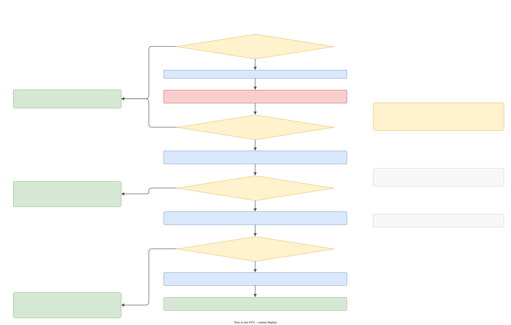

# Hashes and the seal

Two mechanisms keep a closed version closed. The **hash** detects a change to the important values of a version. The **seal** keeps a language xslt from changing a closed version at all, and moves such a change to the first open version.

User-level description: [Hashes and closed versions](../hashes.md). This page is about the code.

## The content hash

`state/content_hash.{hpp,cpp}`:

```cpp
std::string sha256_hex(std::string_view bytes);                 // boost::hash2::sha2_256, lowercase hex
std::string important_tags_hash(const graph_t&, vertex_descriptor_ot vd_definition);
std::string hash_of_hashes(const std::vector<std::string>&);
```

### What is hashed

The hash of one version body covers **only tags whose label list contains `important`**, found as the direct children of the numbered version definition. For each such tag only the subtree under its `TAG_VALUES` child is serialized. The tag's name, its labels, its index, mode and string delimiter are **not** hashed. The encoding is length-prefixed and typed:

| Node | Encoding |
|---|---|
| string | `s<len>:<text>;` |
| key | `k<len>:<key>;` followed by its value |
| array | `a ... ;` |
| record, value, values | `r ... ;` |

An absent definition hashes empty text. A `_te` string is hashed as its **source** text, not the rendered one. The hash uses the numbered definition's own children only; parked bodies owned by that version are in the seal's `definition_payload` but not in this hash.

### Roll-up

- Each live aggregate's declaration for version N stores `important_tags_hash(its definition for N)` in its `hash`.
- The **root's** declaration stores `hash_of_hashes(...)` over the content hashes of all live aggregates, **including the root's own**. The hashes are sorted before they are combined (each appended as `h<len>:<hash>;` before the final SHA-256), so file order and names do not matter.
- A deleted declaration has no hash.
- The Wizard writes them (`write_version_hash`); the validator recomputes them.

### Where a hash lives

In the graph: `root_aggregate_version_declaration_t::hash` or `aggregate_version_declaration_t::hash`. It is printed in `.gal` as `hash = "..."` and in XML as the `hash` attribute. It is mirrored into the version container (`record.hash`) and into the aggregate's `last_hashed`.

### `write_version_hash(language, index)`

`cpp2cpp_wizard/detail/hash.cpp`:

1. `clear_deleted_version_hashes`: a deleted declaration stays without a hash.
2. `live_version_hash_rows`: for each aggregate with a non-deleted declaration at `index`, the content hash of its definition.
3. Non-root rows: `set_declaration_hash(graph, vd_declaration, hash)`.
4. The root: `set_declaration_hash(root, hash_of_hashes(all row hashes))`.
5. `remember_stored_fields(...)` copies hash, comment and status into the version container, then `refresh_live_and_hashed` (the comment in the code: the seal closes the version from `last_hashed`, and the stored hash is left as written).

`set_declaration_hash` and `clear_version_hash` also reset `user_formatting`, because the stored source text still shows the declaration without the hash.

## Closed and sealed

A **closed** version is a root version at or before the root's `last_hashed`. The xslt seal calls the same history **sealed**.

`last_hashed` is the highest declaration index that has a stored hash. It is computed by `version_container::last_hashed_index`, cached in the aggregate record, and refreshed by `refresh_live_and_hashed`. The validator reads it through `root_last_hashed_index()`, and the seal reads `before.aggregates().root().last_hashed`.

## The seal

`translator/detail/xslt_seal.cpp`, `reassign_sealed_edits(before, after)`. It is called by `cpp2cpp_after_xslt`, only when a language xslt is enabled. `before` is `language_before_xslt_`, `after` is the graph that `xml2cpp` built from the xslt's result.



1. No root on either side, or no hashed version (`last_hashed` is empty): return `after`.
2. `before->refresh_version_records()` and `after->refresh_version_records()`: the `definition_payload` of every version is rebuilt (parked bodies owned by a version first, then its children).
3. `reject_sealed_shape`: an aggregate of `before` missing in `after` (`xslt removed aggregate 'x', which belongs to the sealed history`), or a version inserted into the sealed range (`xslt inserted version N into the sealed history`): **error**.
4. `sealed_history_differs`: for each sealed version and each aggregate, compare existence of the declaration, hash, comment, status and `definition_payload`; and for an aggregate that is new in `after`, a non-empty payload in a sealed version. If nothing differs: return `after`.
5. `effective_edits`: compile both graphs (`cpp2post_cpp::translate`) and diff the **effective tags** of the last sealed version of each aggregate (`diff_tags`: a tag whose body changed or is new is `REASSIGN`; a tag that vanished is `DELETE_TAG`). This is what the user would see in the compiled picture, so a change in formatting only gives no edits.
6. `only_wizard_dynamic_copies`: if **every** edit is a `REASSIGN` of a tag that the Wizard copied into that version (`created_by_wizard` and `tag_uses_dynamic_label`), the xslt only finished the copies (assigned a new id, for example). Then `write_version_hash(after, last_sealed)` refreshes the hash of the sealed version, and the function returns. This is the one way an xslt may change a closed version.
7. Otherwise `restore_sealed_history`: every sealed version of `after` is replaced by a **clone from `before`**: the declaration fields (hash, comment, status), the presentation (`user_formatting`, `user_comments`) and the definition's children (`clone_from`). A sealed version that `after` has and `before` did not is emptied (`detach_children`).
8. If there were no effective edits: return (the log says `xslt changed a sealed version; restored the sealed text`).
9. `destination_version`: the first declared root version after `last_sealed`, or `open_next_version`, which creates a new version for the root and for every live aggregate (a declaration with no hash, and a definition marked `created_by_wizard`).
10. `write_edits`: in that version, for each edited aggregate (skipping one whose version is deleted), for each change: if the version already names a tag of that name, leave it; for `DELETE_TAG` write `delete name;` (`create_operation_statement`); for `REASSIGN` clone the new tag with `clone_from` (`created_by_wizard = true`, `clear_formatting = true`).

The user sees this as: an xslt may "edit" an old version, and the result is that the edit appears in the next open version, while the old text stays as it was.

After the seal, `cpp2cpp_after_xslt` runs `validate_language` again. **A user xslt never rewrites a hash**; the language is checked as it is. Hash `force` options do not apply in this run.

## Things to remember

- `write_version_hash` is shared by the Wizard and the seal.
- The seal needs a **compile** of both graphs, which is the most expensive part of the step on a large project.
- An xslt that adds a new aggregate may not give it content in a sealed version (`sealed_history_differs` sees a non-empty payload).
- The seal only runs when a language xslt is enabled. Without one nothing can change a closed version except the Wizard, and the validator guards that.
