# Testing

All tests use [doctest](https://github.com/doctest/doctest). There are three test executables and one helper.



| Executable | Defined in | Links | What it tests |
|---|---|---|---|
| `global_tests` | `global/tests/` | `global_common_library`, `global_filesystem_library` | scope guard, utils, private memory, the filesystem, and `boost_leaf` (LEAF itself) |
| `galimatron_tests` | `galimatron/tests/` | `galimatron_runtime_library`, `galimatron_executable_library`, `Boost::process` | everything in `galimatron/` |
| `uuid_protocol_tests` | `examples/uuid_protocol/tests/` | `global_common_library`, `Boost::process` | the example: clients and servers of every step |
| `galimatron_crash_child` | `galimatron/tests/` | `galimatron_runtime_library` | **not a test**: a program that crashes on purpose, started by `test_crash.cpp` |

Every test target reuses the precompiled header. Each test CMake globs `*.hpp *.cpp` recursively. Run CMake again after you add a file.

Static counts, from the sources: `galimatron_tests` has about 80 test cases with about 360 subcases (the biggest are `parser/test_base.cpp` with 114 subcases, `test_validate.cpp` with 81, and `test_cpp2post_cpp.cpp` with 27); `global_tests` about 30 cases; `uuid_protocol_tests` 14 cases.

## Layout

```text
galimatron/tests/
  main.cpp  forward.hpp  utils.{hpp,cpp}  test_axes.hpp  case_folders.hpp  disable_all_logging.cpp
  executable_library/   test_command_line.cpp
  runtime_library/      test_crash, test_filesystem_decorator, test_galimatron_config, test_galimatron_config_tags, test_log_home, test_xml_tags
  translator_library/
    parser/             test_base, test_gal_version
    state/              test_content_hash, test_gal_and_xml_tags, test_wizard, test_wizard_tags
    transforms/         cpp2cpp_validate/test_validate, cpp2gal/test_cpp2gal, cpp2post_cpp/{test_cpp2post_cpp, test_template_engine}
    translator/         test_{builtin_transform_xml, gal_version, no_xslt, taskflow_dump, transform_sequence_builder, xslt_catalog, xslt_seal}
                        test_wizard_{batch, collapse_version, continue_aggregate, copy_aggregate, create_aggregate, create_hash,
                                     create_root_aggregate, create_version, delete_aggregate, delete_hash, delete_version, version_statements}
  test_data/translator_library/<area>/<case>/...
```

`galimatron/tests/disable_all_logging.cpp` is a doctest listener: at the start of every test case it removes the backends of all Logme channels except the default one, so a test prints nothing unless it asks to.

## Test axes

Every suite is tagged with an **axis**, in the doctest description (`galimatron/tests/test_axes.hpp`):

```cpp
TEST_SUITE("galimatron/translator_library" * galimatron::test_axes::mark(galimatron::test_axes::product))
```

The suite name is the feature path. `mark()` keeps the pointer of a `string_view`, so an axis must be a string literal.

| Axis | Meaning |
|---|---|
| `product` | a full integration test: `gal.cfg` and `log.cfg`, `translate_production()` on real files |
| `translator_slice` | a partial integration test: a chosen run of built-in steps with `translate_slice()` on real files |
| `parser` | the `.gal` grammar and the version rule, without the production translate |
| `component` | one helper (values, tags, digests, argv): no translate and no grammar |
| `process` | the crash handler in a child process |

Which suite has which axis: all `test_wizard_*`, `test_gal_version` (translator), `test_no_xslt`, `test_xslt_catalog`, `test_xslt_seal` and the `template_engine_xslt` suite are **product**; `test_cpp2gal`, `test_cpp2post_cpp` and the `template_engine` suite are **slice**; `test_validate` has a product suite and a component suite; the parser tests are **parser**; `test_crash` is **process**; the rest are **component**. The `global/tests` suites have no axis.

## The helpers

`galimatron/tests/forward.hpp` is the common include. `config_tests.hpp` is generated from `cmake/config_tests.hpp.in` and gives `path_to_galimatron_test_data` and `path_to_galimatron_crash_child`. `case_folders.hpp` names the case folders: `incoming_gal`, `actual_gal`, `actual_xml`, `actual_log`, `intermediate`, `actual_summary`, `expected-gal`, `expected-xml`, `expected-log`.

`galimatron/tests/utils.{hpp,cpp}`:

- `translate_production(case_root)`: runs `runtime::translate` with `get_log_config_from_file(case_root/"log.cfg")` and `get_gal_config_from_file(case_root/"gal.cfg")` and `is_testing_mode = true`.
- `translate_slice(case_root, translate_slice_t)`: the same with `.testing` set. The flags map to `translator::detail::testing_t` (`gal2cpp`, `cpp2cpp_validate`, `cpp2cpp_wizard`, `cpp2xml`, `xml2cpp`, `cpp2gal`, `cpp2post_cpp`, `post_cpp2post_xml`, and `drop_tag_user_formatting`). See [The pipeline](pipeline.md#testing-prepare_testing_transforms).
- `print_leaf_exception(func, is_print_to_cout, handlers...)`: wraps the check in `runtime::try_catch` with `is_throw_out = true`, so the test can look at domain, subdomain and payloads.

## A case is a folder

Under `galimatron/tests/test_data/translator_library/<area>/<case>/`:

```text
gal.cfg  log.cfg  xslt/config.xml (+ your .xsl)
incoming_gal/*.gal          the input
expected-gal/*.gal          the oracle for actual_gal
expected-xml/*.xml          the oracle for actual_xml (Linux text)
expected-xml-windows/*.xml  Windows overrides of same-named files
expected-log/*              the oracle for actual_log (only in two areas)
```

`actual_*` folders are written at run time into a **build copy** of the test data and are not committed. CMake copies `test_data` into `<build>/bin/galimatron_test_data` at configure time (it deletes the old copy first), so tests read and write there and the source tree stays clean.

### Comparing

Product and slice tests call `compare_directories` (`git diff --no-index`) on `actual_gal` against `expected-gal`, and on `actual_xml` against `expected-xml`. A typical test (`test_wizard_delete_hash.cpp`) runs `translate_production(root)` and then two `CHECK(compare_directories(...))`. A test of a failure uses `print_leaf_exception` with a handler that takes `domain`, `subdomain`, `e_what_info`, and often the path, the aggregate and the version, and `CHECK`s the message, the normalized path, the name and the index (see `expect_validation` in `test_validate.cpp` and `expect_compiler` in `test_cpp2post_cpp.cpp`).

The XML files compared are the ones of [Logs and diagnostics](../diagnostics.md#xml-dumps): `lang-parsed.xml`, `lang-wizard.xml`, `lang-xslt.xml`, `lang-final.xml`, `post-compiled.xml`, and `edit.xml` in the seal cases.

### Expected files have no absolute paths

Oracle folders (`expected-gal`, `expected-xml`, `expected-xml-windows`, `expected-log`) live **only** under `galimatron/tests/test_data` and hold no absolute path. A path in an oracle is relative to the `gal.cfg` folder with `/`, produced by `report_path` when `committed-report` is on. If an `actual_*` file contains an absolute path, **fix the writer**, not the oracle (`expected-files` skill).

### Windows oracles

Windows prints XML a little differently (the declaration, indentation, a space before `/>`). `galimatron/tests/CMakeLists.txt` handles it at configure time: on Windows it copies every file under `expected-xml-windows/` over the same name in `expected-xml/` of the build copy. There are about 45 such files. When a file that has a Windows twin changes, **update both**. A Windows twin is added only for a name whose print differs.

### Shared configuration

The `gal.cfg`, `log.cfg` and `xslt/config.xml` that most cases share live once in `test_data/translator_library/common/`: `common/default/` and `common/xslt_seal/`. CMake copies them into the cases at configure time (a list of about 180 case folders, then loops for the seal and the catalog). So many case folders in git have **no** `gal.cfg`. A case that differs keeps its own (`no_xslt`, `xslt_catalog`, `cpp2gal/template_engine_xslt`). The `edit.xsl` of the seal cases gets `gal-functions.xsl` copied beside it.

### `// good` and `// bad`

Automated incoming `.gal` fixtures (`validate`, `wizard_create_aggregate`, `wizard_create_root_aggregate`, and the wizard consoles) mark the line a case is about: `// good: ...` is input that must be accepted, `// bad: ...` input that must fail. A trailing comment is printed on the **next** declaration, so the expected `.gal` follows that shift; the comment on the last declaration is not printed. `uuid_protocol` is a test for a human to run, and gets no such marks (`test-gal` skill).

### The fixtures

| Area | Cases | Driven by |
|---|---|---|
| `validate` | 84 | `test_validate.cpp` |
| `cpp2post_cpp` | 27 | `test_cpp2post_cpp.cpp`: `delete_tag`, `delete_version`, `ordering`, `naming`, `label`, `tag_mode`, `version_mode`, `version_own` |
| `wizard_*` | 1 to 9 each | `test_wizard_*.cpp` |
| `xslt_seal` | 5 | `reassign`, `inherit`, `open`, `present`, `unchanged` |
| `cpp2gal` | 7 | `test_cpp2gal.cpp`, `test_template_engine.cpp` |
| `parser` | 102 files in 8 groups | read directly by `parser/test_base.cpp` |
| `no_xslt`, `xslt_catalog`, `gal_version`, `cpp2xml` | 1 or 2 | their tests |

## The rule for product and slice tests

A product or slice test **may not touch file bytes**: no `ifstream`, `ofstream`, `filesystem.read`, `write`, `remove`, no rewriting of a path, no reading of XML to count attributes. Only `compare_directories` and exception checks are allowed. If a case seems to need more, **stop and tell the maintainers** (the `tests` skill). Share `.cfg` and `.xsl` through `common/`.

## Running

- **The target**: `run_tests` (root `CMakeLists.txt`) depends on the three executables and runs `cmake -P cmake/run_tests.cmake` with their paths and `bin/` as the working directory. The script runs them in order (`global_tests`, `galimatron_tests`, `uuid_protocol_tests`) and stops with `FATAL_ERROR` on the first non-zero exit. It is one cmake process on purpose: a crashing helper inside a suite does not become the exit code of the step.
- **On CI** (`GITHUB_ACTIONS=true`) it adds `--abort-after=1`.
- **The working directory must be `bin/`**: the uuid tests use relative paths like `uuid_protocol/steps/...`.
- Filter with doctest's own options: `galimatron_tests --test-case="*wizard*"`, `--test-suite=...`, `--no-intro`.

## The crash test

`test_crash.cpp` starts `galimatron_crash_child` with `boost::process::v2` (on Windows with `CREATE_BREAKAWAY_FROM_JOB | CREATE_NEW_PROCESS_GROUP | DETACHED_PROCESS`), passing a log path and a summary path. It checks that the exit code is not 0, that `galimatron.crash.log` has `crash\n` and `stacktrace:\n`, that the summary has `status="crash"`, and that the log names `exception:` on Windows and `signal:` elsewhere.

## The examples as tests

`examples/uuid_protocol` is a client and a server that speak a binary protocol over TCP (port 5557), with message types generated from GaL. It has thirteen steps (`00-no-dto-hello-ok-bye` to `12-collapse`), each the next point in the history of one project. The CMake function `uuid_protocol_add_step` runs Galimatron on the step's `generated/` folder (a custom command with a stamp file), builds the generated library and the hand-written one, and makes a client and a server. The test target depends on every endpoint, so `run_tests` builds every step and runs the generator.

`uuid_protocol_tests`:

- a suite per step (`uuid_protocol/steps/<folder>`, steps 0 to 9, 11 and 12; there is none for step 10) with one case: start the server, wait a second, start the client, both must exit 0;
- `uuid_protocol/cross`: one server with `--accept-until-stopped` for the "converting" step (the step before the first folder that has `collapse` in its name), and every client against it. A client of step 0 or newer than the converting step must fail; every other must succeed. A second case does the same for the server after the converting step.

`examples/benchmark` is **not** part of the normal build. Its targets (`benchmark`, `benchmark_matrix`, `benchmark_matrix_static`, `benchmark_matrix_static_no_xslt`) generate a project with `create_initial_protocol.cmake` and measure it. See [Benchmark](../benchmark.md).
