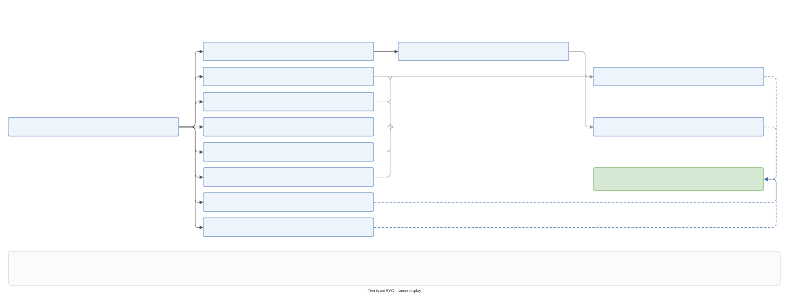

# The validator and the Wizard

Two steps work together on the language graph: `cpp2cpp_validate` checks it, and `cpp2cpp_wizard` changes it on command. The Wizard asks the validator, through the same class, whether each command may run. This page describes both and the rules that tie them together.

Code: `transforms/cpp2cpp_validate/`, `transforms/cpp2cpp_wizard/`, `state/wizard/`.

## The validator



Panel B of [the map](pipeline.md#the-map) draws the same checks.

### Where it runs

`prepare_prod_transforms()` puts it in two places:

1. **before the Wizard**, as the first step (`cpp2cpp_validate`): "Wizard checks see the file before the command is applied",
2. **after a language xslt**, inside `cpp2cpp_after_xslt`, after the seal.

It does **not** run after the Wizard when there is no language xslt. The Wizard re-checks each command itself, immediately before changing the graph. It never validates the result of a command.

### The files

| File | Content |
|---|---|
| `cpp2cpp_validate.hpp/.cpp` | `validate_memo_t`, `validate_language(language, subflow)`, the class `cpp2cpp_validate_t`, `compile_for_validation` |
| `detail/support.{hpp,cpp}` | helpers and `fail(...)` |
| `detail/validate_memo.cpp` | getters and setters under a `std::shared_mutex` |
| `detail/snapshot.cpp` | the constructor, which builds the snapshot, and the read-only accessors |
| `detail/build.cpp` | `build(tf::Subflow&)`: the Taskflow graph of the checks |
| `detail/structure.cpp` | the structural checks |
| `detail/hash.cpp` | the hash checks and `hash_force_indexes()` |
| `detail/wizard/wizard_root.cpp` | `may_execute_wizard_command` (the dispatcher), `skips_root_aggregate_checks`, `is_wizard_command_single`, create root aggregate |
| `detail/wizard/wizard_aggregate.cpp` | create, copy, continue, delete aggregate |
| `detail/wizard/wizard_version.cpp` | create, delete, collapse version |
| `detail/wizard/wizard_statement.cpp` | batch, tag/label/ordering statements, hash commands |

### `validate_language`

```cpp
compiled_part_sptr_ot validate_language(const language_part_sptr_t&, tf::Subflow&);
```

It returns nothing if there is no graph. Otherwise it builds a `validate_memo_t` and a `cpp2cpp_validate_t`, calls `build(subflow)` and `subflow.join()`, and returns `compile_for_validation(language)`: `cpp2post_cpp::translate` inside `capture_or_rethrow`, empty when there is no root aggregate. The compile is part of validation (it checks that every tag has the labels it uses), and its result is **kept** as `compiled_state_`.

The step writes no file itself. `execute_transform` prints `lang-parsed.xml` after it, so a failed check or a failed compile writes no file.

### The snapshot

`cpp2cpp_validate_t` is not copyable. Its constructor takes a **snapshot** of the aggregates: one row per aggregate (`name`, `vd`, `is_root`, `chunk_path`, the declaration indexes, `live_indices`, `deleted_indices`, `definition_indices`, and for the root `last_hashed_index`). The snapshot is partial on purpose: status and hash are read live from the version container, and statements and bodies straight from the graph. Because the aggregate list is snapshotted, anything that changes aggregates between two checks has to build a new checker (the Wizard does, in `refresh_checks()`).

### The memo

`validate_memo_t` caches the result of **three root checks** (`is_root_aggregate_single`, `..._declarations_from_zero_continuous`, `..._definitions_repeat_declarations`), under a shared mutex because the checks run on worker threads. It caches only success: a failure throws. The memo lives as long as the checker, and the Wizard replaces both together.

### The graph of checks

`build()` calls `subflow.retain(true)` and creates one task per check. It never joins; `validate_language` does.

```text
is root aggregate single
 ├─> declarations from zero continuous ─> declarations match root ─┐
 ├─> root definitions repeat declarations ─────────────────────────┤
 ├─> aggregate declarations deleted continuous ────────────────────┤
 ├─> aggregate definitions not deleted ────────────────────────────┼─> version hashes match
 ├─> aggregate definitions repeat declarations ────────────────────┤    version hashes present
 ├─> anonymous versions owned ─────────────────────────────────────┘
 ├─> aggregate names unique
 └─> aggregate indices unique continuous
```

Twelve tasks. The hash checks wait for six checks; `names unique` and `indices unique continuous` have no successors.

When the command is, or a batch contains, **`create root aggregate`**, `skips_root_aggregate_checks()` is true and seven checks do nothing (the four root checks, `anonymous versions owned`, and both hash checks): the root does not exist yet. The command's own checks run in the command and use the same checker.

None of the checks looks at a Wizard command. They check the **file**.

### What each group checks

| Group | Rule | Codes |
|---|---|---|
| root | exactly one root aggregate | `ROOT_AGGREGATE_MISSED`, `ROOT_AGGREGATE_MUST_BE_ONE_ONLY` |
| root declarations | start at 0, no gaps | `ROOT_AGGREGATE_VERSION_DECLARATIONS_MUST_START_WITH_ZERO`, `..._MUST_BE_CONTINUOUS` |
| root definitions | equal to the live declarations; a root body may not be `local` or `own` | `ROOT_AGGREGATE_VERSION_DEFINITIONS_MUST_REPEAT_DECLARATIONS`, `ROOT_AGGREGATE_VERSION_CANNOT_BE_LOCAL`, `..._CANNOT_BE_OWN` |
| aggregate declarations | the same indexes as the root's | `AGGREGATE_VERSION_DECLARATIONS_MUST_MATCH_ROOT` |
| deleted versions | a prefix, a suffix, or an interior span owned by the next live version's parked body (not just `delete;`) | `AGGREGATE_VERSION_DECLARATIONS_DELETED_MUST_BE_CONTINUOUS` |
| definitions of deleted versions | none, except a body that is only `delete;` | `AGGREGATE_VERSION_DEFINITIONS_MUST_NOT_BE_DELETED` |
| aggregate definitions | equal to the live declarations | `AGGREGATE_VERSION_DEFINITIONS_MUST_REPEAT_DECLARATIONS` |
| parked bodies | have an owner, sit right before it, and are only `delete;` if the owner is deleted | `ANONYMOUS_VERSION_MUST_HAVE_OWNER`, `..._MUST_PRECEDE_OWNER`, `..._MUST_BE_DELETED` |
| aggregates | unique names (case-sensitive), indexes `0..n-1` | `AGGREGATE_NAMES_MUST_BE_UNIQUE`, `AGGREGATE_INDICES_MUST_BE_UNIQUE_CONTINUOUS` |
| hashes | every stored hash matches; if any aggregate stores a hash at a version, all live ones do | `HASH_DOES_NOT_MATCH`, `HASH_MUST_BE_ON_EVERY_AGGREGATE` |

The root-mode rule has no check function of its own: it is raised from `is_root_aggregate_version_definitions_repeat_declarations`. A search for `CANNOT_BE_LOCAL` finds it there.

### The hash checks

`hash_force_indexes()` builds the set of versions that the pending command exempts: a `create hash` or `delete hash` with `force` (inside a batch too). An empty list of versions means the root's last declaration.

`is_version_hashes_match`, for each root declaration index not in that set:

1. gather a row for every aggregate with a non-deleted declaration at the index;
2. a row's content hash is `important_tags_hash(graph, definition)`;
3. the expected root hash is `hash_of_hashes(all content hashes)`: sorted first, so aggregate names, file paths and order do not matter;
4. if no row stores a hash, skip the version;
5. otherwise compare: a root row against the root hash, an aggregate row against its content hash;
6. the message lists aggregates first and the root last; a version that already names an aggregate does not also name the root.

`is_version_hashes_present` uses the same rows and requires that every non-deleted row stores a hash once any does. See [Hashes and the seal](seal-hash.md).

### How a failure is raised

```cpp
[[noreturn]] void fail(validation_error_code_et code, std::string what, const error_where_t& where = {})
{
    capture_or_rethrow([&] {
        const auto location = exception::augment_where(where);
        leaf::throw_exception(domain::translator_library{}, subdomain::translator_library::translator{},
                              code, e_what_info{ std::move(what) });
    });
}
```

A Taskflow worker has no LEAF context, so the throw happens inside `capture_or_rethrow`, which captures every payload and throws a `captured_leaf_exception`. `subflow.join()` rethrows it on the caller. The `augment_where` call has to be **inside** the capture: a guard in the caller would attach to the captured exception, and the printer would not see it. See [Errors, logging, crashes](errors-logging.md#errors-on-a-worker-thread).

The error carries the domain `translator_library`, the subdomain `translator`, a `validation_error_code_et`, `e_what_info` with the full message, and optionally the path, the aggregate and the version.

Because the checks run in parallel, the **first** error that surfaces is not deterministic when several checks fail. `is_aggregate_version_definitions_repeat_declarations` avoids duplicating one error on purpose: it skips an aggregate that has an illegal deleted definition, which `..._not_deleted` reports.

## The Wizard step



Panel C of [the map](pipeline.md#the-map) draws this. The Wizard works **in place** on the language graph, through the same `builder_t` as the parser. There is no dry run: the checks run on the real graph right before each change.

### Flow

`cpp2cpp_wizard::translate(language)`:

- no Wizard statement: return the graph unchanged (the step is also skipped by `is_skipping`);
- else `cpp2cpp_wizard_t(*language).translate()`:

```cpp
void cpp2cpp_wizard_t::translate() {
    validate_->is_wizard_command_single();    // exactly one Wizard statement in the whole graph
    const auto& command = wizard_statement(*language_state_);
    if (command.type == BATCH) apply_wizard_batch(); else apply_one(command.type);
    comment_executed_command();
}
```

`apply_one` is a `switch` over `command_et`. Every `apply_*` begins with `validate_->may_execute_wizard_command()`, which switches over the same type and calls the per-command checks in order, so the first failing check throws.

**A batch** (`apply_wizard_batch`):

1. `may_execute_wizard_command()` checks only the batch context.
2. Save the stored statement. For each item: `refresh_checks()` (a new memo and a new checker, so the aggregate snapshot is fresh), **overwrite** the stored statement's `type` and `data` with the item, `is_wizard_batch_command_create()`, `apply_one(item.type)`.
3. Restore the statement.

Overwriting the statement is how every check that reads `wizard_statement(...)` (and `hash_force_indexes`) sees the current item. `chunk_node`, `chunk_uri` and `context` stay those of the batch, so all items resolve file paths against the batch's chunk. "No version" means "the last version", and it is resolved per command on the fresh snapshot, so `create version; create hash;` hashes the version just created. There is no RAII around the overwrite: an exception leaves the statement changed, which does not matter, because the run is abandoned.

Allowed in a batch: `CREATE_ROOT_AGGREGATE`, `CREATE_AGGREGATE`, `CREATE_VERSION`, `DELETE_VERSION`, `COLLAPSE_VERSION`, `CREATE_LABEL`, `CREATE_TAG`, `DELETE_TAG`, `CREATE_ORDERING`, `CREATE_HASH`. Not allowed: `COPY_AGGREGATE`, `CONTINUE_AGGREGATE`, `DELETE_AGGREGATE`, `DELETE_HASH`.

### Commands

Declared in `state/wizard/command.hpp` (`command_et`, with a block comment per command that is effectively the reference), with data in `data.hpp` (`command_data_t`, a `std::variant`; `batch_command_t {type, data}` keeps it non-recursive) and messages in `tags.hpp`. A compile-time registry describes each command: its entities and the action on each (C, U, D), and whether the edit is **physical** (the graph changes) or **historical** (a `delete` is written). Four `static_assert`s check that the table is consistent and that every enumerator has exactly one declaration.

| Command | Edit | Checked by | Applied by |
|---|---|---|---|
| `CREATE_ROOT_AGGREGATE` | P | `is_wizard_create_root_aggregate_*` | `apply_wizard_create_root_aggregate` |
| `CREATE_AGGREGATE` | P | `is_wizard_create_aggregate_*` | `apply_wizard_create_aggregate` |
| `COPY_AGGREGATE` | P | `is_wizard_copy_aggregate_*` | `apply_wizard_copy_aggregate` |
| `CONTINUE_AGGREGATE` | P | `is_wizard_continue_aggregate_*` | `apply_wizard_continue_aggregate` |
| `DELETE_AGGREGATE` | H | `is_wizard_delete_aggregate_*` | `apply_wizard_delete_aggregate` |
| `CREATE_VERSION` | P | `is_wizard_create_version_*` | `apply_wizard_create_version` → `add_next_version` |
| `DELETE_VERSION` | P | `is_wizard_delete_version_*` | `apply_wizard_delete_version` |
| `COLLAPSE_VERSION` | P | `is_wizard_collapse_version_*` | `apply_wizard_collapse_version` |
| `CREATE_LABEL`, `CREATE_TAG`, `CREATE_ORDERING` | P | `is_wizard_version_statement` | `apply_wizard_create_label`, `..._tag`, `..._ordering` |
| `DELETE_TAG` | H | `is_wizard_version_statement` | `apply_wizard_delete_tag` |
| `CREATE_HASH` | P | `is_wizard_create_hash_*` | `apply_wizard_create_hash` → `write_version_hash` |
| `DELETE_HASH` | P | `is_wizard_delete_hash_*` | `apply_wizard_delete_hash` → `clear_hashes_of_version` |
| `BATCH` | – | `is_wizard_batch_*` | `apply_wizard_batch` |

Checks are in `cpp2cpp_validate/detail/wizard/wizard_{root,aggregate,version,statement}.cpp`; applications are in `cpp2cpp_wizard/detail/{aggregate,version,statement,hash}.cpp`.

### What each command does to the graph

Common to all: vertices that the Wizard creates get `created_by_wizard = true` (except the statements of `create tag/label/ordering`, and the bodies that `copy aggregate` clones), and after a structural edit the code calls `refresh_live_and_hashed(vd_aggregate)`.

- **`create root aggregate`**: a new chunk `<command folder>/<name>.gal`, the aggregate, and **empty** declarations and definitions. There is no version 0; the next `create version` makes it.
- **`create aggregate`**, for each name: a chunk (optionally under `in <directory>`), an aggregate with `index = next_index()`, a declaration for **every** root version (all `DELETED` except the last), and one definition, for the last version only, with the given mode. This is why the last version must be open: the new aggregate is live there and would change a closed version's root hash.
- **`copy aggregate`**: every source declaration (with status, hash and comment) and every body, including parked bodies, cloned with `created_by_wizard = false`. Orderings are not touched.
- **`continue aggregate`**: `add_next_version`, then the new aggregate is deleted in every earlier version and live only in the new one. It gets the statements the source's new body already carries (the dynamic copies), then the rest of the source's previous body; the mode follows the source. Finally the source's new-version body gets `delete;` (`apply_aggregate_version_delete`).
- **`delete aggregate`**: with no names, every non-root aggregate whose versions are all deleted is removed (its chunk is dropped; `cpp2gal` no longer prints it). With `physically`, or for a fully deleted aggregate, the aggregate is removed from its chunk, and from the root if no other aggregate remains in it. Otherwise (the historical case) `delete;` is written into the last live version.
- **`create version`** (`add_next_version`): version `last + 1` (0 if none) on the root and every non-root aggregate. A non-root aggregate whose last declaration was deleted gets a deleted declaration and no body. Then **dynamic tags are copied**: the tags of the previous body whose mode is `inherit` and that use a dynamic label, minus those removed by a later `delete name;`, cloned with `created_by_wizard = true`. `once` and `local` tags are not carried. A `local` version body is a copy of the previous one (labels and orderings included).
- **`delete version`**: only trailing versions (the validator keeps the indexes `0..n-1`): definitions and declarations are detached, `forget`, then refresh.
- **`collapse version a-b`**: the range is parked in the version after it (a numbered or anonymous owner) or, if the range ends on the last version, in a **new** version. The parked body keeps the **last** statement of each `(kind, name)` (a tag with no name takes its name from `tag-name-from`; `delete name;` shares the key space with tags; a version `delete;` is dropped). The sources are detached, each declaration of the range is marked deleted (hash and formatting cleared), then `rebind_version_definitions`. Collapse is not guarded by a closed-version check.
- **`create label`, `create tag`, `delete tag`, `create ordering`**: append a statement to the **last** version of the named aggregate. The index comes from `next_version_statement_index`. `write_tag_json` turns a `Wizard::json_t` into vertices.
- **`create hash`**: `write_version_hash` (see [Hashes and the seal](seal-hash.md)). **`delete hash`**: clear every aggregate's hash of the version.

### The executed command disappears

`comment_executed_command()` runs at the end of `translate()`. It appends the statement's `user_comments` to its chunk, then the text of the statement, each line prefixed with `// `, with a blank `//` between a description and the text (the same rule as a comment above a function). Then it clears the statement's comments and formatting. `cpp2gal` prints only comments for a Wizard statement, so the command is gone and its text is at the **top of the chunk**, not where the command was. The text got there from `gal2cpp`, which stores the source of the command in `user_formatting`.

### Closed versions

A version is **closed** if it is a root version at or before the root's last hashed declaration (`last_hashed`). The protection is **entirely in the validator**; the `apply_*` functions assume it passed. Every command that writes into a version must refuse a closed one (`wizard-closed-version` skill):

| Command | Behavior |
|---|---|
| `create aggregate` | refused if the root's last version is closed (`WIZARD_CREATE_AGGREGATE_LAST_VERSION_MUST_BE_OPEN`) |
| `copy aggregate` | refused if the source has a non-deleted declaration at or below the seal (`..._SOURCE_IN_CLOSED_VERSION`) |
| `continue aggregate` | allowed: the new aggregate is deleted in all earlier versions, so the root hash stays. The source's last version must be live |
| `delete aggregate` (historical) | the last version must be open |
| `delete aggregate physically` | refused if any non-deleted declaration is at or below the seal (`..._CANNOT_DELETE_CLOSED_VERSION`) |
| `create version` | always adds an open version |
| `delete version` | each listed version must be above the seal |
| `collapse version` | not protected on purpose |
| `create label`, `create tag`, `delete tag`, `create ordering` | the aggregate's last version must be above the seal (`WIZARD_VERSION_STATEMENT_VERSION_MUST_BE_OPEN`); a deleted last version and a missing definition are refused too |
| `create hash` | closes the version |
| `delete hash` | opens it |

Declarations that are `DELETED` do not block `copy` and physical `delete`.

### Messages and codes

The Wizard error codes are the `WIZARD_*` values of `validation_error_code_et` (`common_library/exception_declaration.hpp`), grouped by command:

| Command | Codes (after `WIZARD_<COMMAND>_`) |
|---|---|
| any | `COMMAND_MUST_BE_ONE`, `<CMD>_CONTEXT_MUST_BE_CHUNK` |
| `CREATE_ROOT_AGGREGATE` | `ROOT_AGGREGATE_MUST_BE_ABSENT`, `COMMAND_FILE_IS_THE_AGGREGATE`, `CHUNK_MUST_BE_ABSENT` |
| `CREATE_AGGREGATE` | `ROOT_AGGREGATE_MUST_EXIST`, `NAMES_MUST_BE_UNIQUE`, `COMMAND_FILE_IS_THE_AGGREGATE`, `CHUNK_MUST_BE_ABSENT`, `LAST_VERSION_MUST_BE_OPEN` |
| `COPY_AGGREGATE` | `ROOT_AGGREGATE_MUST_EXIST`, `SOURCE_MUST_EXIST`, `CANNOT_COPY_ROOT_AGGREGATE`, `NAMES_MUST_BE_UNIQUE`, `AGGREGATE_MUST_BE_ABSENT`, `COMMAND_FILE_IS_THE_AGGREGATE`, `CHUNK_MUST_BE_ABSENT`, `SOURCE_IN_CLOSED_VERSION` |
| `CONTINUE_AGGREGATE` | the same shape, plus `LAST_VERSION_MUST_EXIST`, `LAST_VERSION_IS_ALREADY_DELETED` |
| `DELETE_AGGREGATE` | `ROOT_AGGREGATE_MUST_EXIST`, `NAMES_MUST_BE_UNIQUE`, `AGGREGATE_MUST_EXIST`, `CANNOT_DELETE_ROOT_AGGREGATE`, `LAST_VERSION_MUST_EXIST`, `LAST_VERSION_IS_ALREADY_DELETED`, `CANNOT_DELETE_CLOSED_VERSION`, `VERSION_DEFINITION_MUST_EXIST`, `ORDERING_NAMES_AGGREGATE` |
| `CREATE_VERSION` | `ROOT_AGGREGATE_MUST_EXIST` |
| `DELETE_VERSION` | `ROOT_AGGREGATE_MUST_EXIST`, `LAST_VERSION_MUST_EXIST`, `VERSION_MUST_EXIST`, `CANNOT_DELETE_CLOSED_VERSION`, `MUST_STAY_CONTINUOUS` |
| `COLLAPSE_VERSION` | `ROOT_AGGREGATE_MUST_EXIST`, `VERSION_MUST_EXIST`, `OWNER_MUST_BE_PRESENT`, `RANGE_MUST_ASCEND` |
| tag, label, ordering | `WIZARD_VERSION_STATEMENT_`: `AGGREGATE_MUST_BE_NAMED`, `ROOT_AGGREGATE_MUST_EXIST`, `AGGREGATE_MUST_EXIST`, `AGGREGATE_MUST_BE_ROOT`, `LAST_VERSION_MUST_EXIST`, `VERSION_MUST_BE_OPEN`, `VERSION_IS_DELETED`, `DEFINITION_MUST_EXIST` |
| hashes | `VERSION_MUST_EXIST` for create and delete hash |
| batch | `WIZARD_BATCH_CONTEXT_MUST_BE_CHUNK`, `WIZARD_BATCH_COMMAND_MUST_BE_CREATE` |

The message texts are the `string_view` constants of `state/wizard/tags.hpp`, shared with the unit tests. Changing a message is a visible change to the tests. A few `version_statement` checks reuse the phrases of `delete_aggregate`.

## What has to stay in sync

1. **A command's execution assumes its checks passed.** `version_write_target` dereferences without testing; `apply_wizard_delete_aggregate` does `declarations.back()`. A new command must add its checks to the dispatcher in `wizard_root.cpp` and must call `may_execute_wizard_command()` first.
2. **The state the Wizard leaves must satisfy the structural checks** of the next `validate_language` run: every aggregate declares exactly the root's indexes (so `add_next_version` and `create aggregate` create a declaration for every one, including deleted ones); definitions equal live declarations; a deleted version has a body only if it is `delete;`; a parked body sits right before its owner (collapse creates it with no index and an owner, then `order_child_before`); aggregate indexes are `0..n-1`.
3. **The hash rules are the same code on both sides.** `write_version_hash` and `is_version_hashes_match` both use `important_tags_hash`, `hash_of_hashes` and the same row selection (live aggregates only). Change one without the other and you get `HASH_DOES_NOT_MATCH`.
4. **"Closed" has one definition**, `last_hashed`. After any change of hashes or declarations the Wizard must call `refresh_live_and_hashed`; in a batch the next command would otherwise see a stale seal.
5. **The checker snapshots at construction.** Code that changes aggregates between commands must call `refresh_checks()`.
6. **`force`** exempts a version only in the run before the Wizard. The run after a language xslt checks what the command stored.
7. **`write_version_hash`** is also called by the seal (`translator/detail/xslt_seal.cpp`), when an xslt only finished Wizard copies. It is a cross-module dependency.

## Things that are easy to trip over

- `is_wizard_command_single` counts Wizard statements in the **whole graph**, not per file.
- Case rules differ: command name checks (`name_already_listed`, `command_file_is_the_aggregate`) are case-insensitive; `is_aggregate_names_unique`, `try_aggregate` and `chunk_path_exists` are case-sensitive. `ordering_link_container` compares names without case, `aggregate_container::by_name` with case.
- `delete aggregate` with no names passes the per-name checks trivially, and the data is recomputed at execution time.
- `create version` has the fewest checks (the context and the root). The validity of a mode is not checked.
- Whether the "empty chunk, no aggregates in that file" restriction for a Wizard file is enforced is decided by the grammar (a file is Wizard statements or an aggregate), not by the validator.
