# XML and Saxon

The XML is the **primary output** of Galimatron, and the only thing an xslt sees. Four pieces of code are about it: `cpp2xml` prints the graph, `xml2xml` runs xslt in Saxon, `xml2cpp_saxon` reads the graph back, and `layout_table` carries the source text across the round trip. `gal-functions.xsl` is the library of helper functions for the xslt that users write.



Panel E of [the map](pipeline.md#the-map) shows the round trip in the context of a run.

## `cpp2xml`: graph to XML

`transforms/cpp2xml/cpp2xml.hpp`, `detail/translate.cpp` and one file per entity.

```cpp
struct translate_t {
    const language_part_sptr_t language_state;
    const compiled_part_sptr_ot compiled_state;   // present: print the compiled document
    split_path_by_parts_ft split_path_by_parts;
    layout::table_t* layout_table = nullptr;      // null: no layout marks
    std::string_view description = {};            // an attribute on <galimatron>
};
pugi_document_with_meanful_node_t translate(const translate_t&);   // the document and the <language> or <compiled> node
```

`translator_t::document_cpp2xml(as_compiled_document, description)` is the usual caller: it calls `ensure_compiled()` if the document is compiled or the run validates or compiles, runs `cpp2xml::translate`, and then `append_history`. `translate_cpp2xml` prints it (`pugi_forward::printout`: 4-space indent).

The printer walks the graph recursively. Everything about **what a version contains** is in `childs_of(vd)`:

- **language document**: the version's statements from `language_state_->statements_of(vd)`, in `index_in_version` order. Wizard statements are always dropped.
- **compiled document**: for a version, `compiled_state_->tag_container().try_find_range_by_vd_version(vd)`: only the effective tags. Label statements are dropped.

### The two documents

```text
<?xml version="1.0" encoding="UTF-8"?>
<galimatron [description="..."]>
  <language> | <compiled>
     <chunk [layout-mark]><location><filesystem path root relative relative-and-filename stem extension/></location> ...</chunk>
  </language|compiled>
  <string-delimiters><string-delimiter raw quote [dashes]/>...</string-delimiters>
  <history>...</history>
</galimatron>
```

The names are constants in `state/gal_and_xml_tags.hpp` (and `xml_tags.hpp` for the common ones). Several namespaces there come in pairs: the plain one names the XML element, and the `_gal` one the GaL text that `cpp2gal` prints.

| Entity | Language XML | Compiled XML |
|---|---|---|
| root aggregate | `<root-aggregate name>` with `<root-aggregate-version-declarations>` (`<..-declaration index status comment hash/>`) and `<root-aggregate-version-definitions>` (`<..-definition index|owner mode>`) | the same |
| aggregate | `<aggregate name index>`, the same four sub-nodes | the same, plus `<orderings><ordering name index/></orderings>` inside each version definition, where `index` is the **position** of the aggregate under that ordering |
| tag | `<tag index [name] [mode="once|local"] [layout-mark]>` with `<label-refs><static><label-ref name index/></static></label-refs>` and `<values>` | `<tag name>` (**always named**), no `label-refs`, `<values>` |
| value | `<value index><string delimiter [template-engine="true"]>CDATA</string></value>`, or `<record>` with `<key delimiter>`, or `<array>` | the same, but each first-level `<value>` has **one attribute per static label**, named after the label, holding the label's value at that index: `<value index="0" field="type">`. A string holds the **rendered** text, with no `template-engine` mark |
| label | `<label index name>` with `<static><values><value index value/></values><tag-name-from value/></static>` or `<dynamic value/>` | not printed |
| ordering statement | `<ordering index name><ordering-parts><ordering-part><aggregate-ref name/>...` | not printed (the `<orderings>` above are the result) |
| delete | `<delete index [name]/>` (no name: the whole version) | not printed (the delete has already taken effect) |
| wizard statement | never printed | never printed |

Wizard marks, **language XML only**: for a vertex with `created_by_wizard`, a child `<dynamic wizard="new-version|new-aggregate|new-root-aggregate"/>`; for a tag that is a wizard copy and uses a dynamic label, a child `<dynamic need_new_uuid="need_gen_uuid"/>`: one attribute per dynamic label, **named after the label**, holding the label's dynamic value. `gal:tag-uses-dynamic($tag, 'need_gen_uuid')` tests the attribute values.

!!! warning "Three meanings of `dynamic`"
    `<dynamic value=".."/>` under a `<label>` is the **label's** value. `<dynamic labelname="value"/>` under a `<tag>` marks a **wizard copy**. `<dynamic wizard=".."/>` under an aggregate or version marks a **wizard-made entity**. `xml2cpp_saxon` skips the last one by name and has no use for the second.

### Layout marks

When `layout_table` is not null and a vertex has `user_formatting` or `user_comments`, `cpp2xml` writes `layout-mark="N"` (N from a counter) after the children are written, and stores `{formatting, comments, fingerprint}` under N. The printer clears the table at the start of every translate. This is also done for the compiled document.

### The history

`<history>` is added by `append_history` to every printed document. See [The compiler](compile.md#the-history-transformshistory).

## The layout table

`transforms/layout_table.{hpp,cpp}`, namespace `galimatron::translator::layout`.

An xslt rewrites the XML, but your comments and exact source text live on graph vertices, not in the XML. The table is a side channel:

1. `cpp2xml` stamps `layout-mark="N"` and stores the text under N, with the **fingerprint** of the node.
2. The xslt may change anything. Attributes that it does not touch stay.
3. `xml2cpp_saxon::restore_layout` reads the mark. The **comments** are restored unconditionally. The **source text** is restored only if the fingerprint of the node now equals the stored one. A node that the xslt created has no mark and no layout.

`fingerprint(node)` is recursive: the element name, the attributes except `layout-mark` sorted by `(name, value)`, the children, and the non-blank text. White-space-only text (the serializer's indentation) is ignored. The fingerprint covers the whole subtree, so a change anywhere inside a node discards the stored text of the node and of its ancestors.

There are **two implementations** that must give the same text for the same XML: `layout::fingerprint` on pugixml and `fingerprint` in `xml2cpp_saxon/detail/node.cpp` on Saxon nodes. The table lives in `any_transform_states_.layout_table()` for the whole run.

## `xml2xml`: Saxon

`transforms/xml2xml/xml2xml.hpp` and `detail/xml2xml_impl.{hpp,cpp}`.

```cpp
using session_state_t = std::any;     // holds std::shared_ptr<saxon_session_t>
struct operation_t {
    static void adopt(session_state_t&, const file_content_t& xml);
    static bool has_document(session_state_t&);
    static file_content_t printout(session_state_t&);
    static pugi_document_with_meanful_node_t to_pugi(session_state_t&);
    static file_contents_with_paths_ot apply(session_state_t&, const galimatron_config::transform_t&);
};
session_state_t prepare(const prepare_t&);                       // { saxon_processor_t config }
file_content_t apply_primary(const saxon_processor_t&, const file_content_t& document, const std::string& xslt);
```

`saxon_session_t` is one Saxon processor and one document for a whole translation. `apply()` replaces the document, and the next `apply()` reads that result. It is `testing: no`.

- `prepare()` is lazy. It creates `SaxonProcessor(config_file)`, loads the installed catalog, creates the `Xslt30Processor` and sets its working directory to `working-dir`. `load_installed_catalog` looks at `<folder of the executable>/../share/galimatron/catalog.xml` (via `boost::dll::program_location`); the catalog maps `https://github.com/goloveshin/galimatron/xslt/gal-functions.xsl` to the installed file, so user xslt can include it without a network. With no catalog the log says `xslt catalog: none`, and the xslt must use a relative include. A build that is not installed has no catalog.
- `adopt(xml)` does nothing if a document exists; otherwise `parseXmlFromString`.
- `compile_and_apply`: sets each global parameter (strings only, from `input.principal-xsl.parameters`) **before** compiling; `compileFromString(xslt)`; sets the global context item and the initial match selection to the current document; with `capture_side_results` it calls `setCaptureResultDocuments(true)` and `setSaveXslMessage(true)`; the result of `applyTemplatesReturningValue()` becomes the new document.
- `apply(config)` reads the XSLT text (`deferred_content()`), calls `compile_and_apply` with side results, logs the `xsl:message` text between `begin messages from Saxon` and `end messages from Saxon`, and returns the result documents as `{content = node->toString(), path = href}`. The comment says the result document already carries its output method: the XML serializer would put an XML declaration in front of a text file.
- `take_document_node()` returns the node and whether the caller owns it. `getHead` hands the node over when the document holds it; if the document **is** the node, the session still deletes it.
- Errors: `throw_translator(SaxonApiException&, path)` first builds the text with `printout_native_saxon_exception` (`what`, error code, line, message, ...; it must run while the processor is alive), then throws LEAF `translator` with `e_what_info` and `e_path_info_for(path)` inside `capture_or_rethrow`.

`execute_transform` uses `has_document` to decide whether to print the principal XML from Saxon or from the graph.

!!! note
    A comment on `serialize()` in `xml2xml_impl.hpp` talks about an XML declaration and a 3-space indent, but the code only calls `XdmValue::toString()`. The comment is out of date or wrong; test what the file really looks like before you rely on it.

## `xml2cpp_saxon`: XML back to the graph

`transforms/xml2cpp_saxon/` (`translate(session, layout_table)`), `detail/xml2cpp_saxon.cpp` and `detail/node.{hpp,cpp}`.

- `node_t` wraps an `XdmNode*` in a move-only RAII class with a small API that mirrors `pugi::xml_node`: `local_name`, `is_element`, `text`, `parent`, `child(name)`, `children()`, `attribute(name)`, `attributes()`, `adopt(ptr, owns)`. Arrays that Saxon returns (`getChildren`, `getAttributeNodes`) are owned by a helper that nulls out the items it hands over.
- `translate()`: `take_document_node()`, then `xml2cpp_saxon_t walker{node_t::adopt(...), layout_table}`. A document node is kept in `kept_document_` and its first element is taken. The source is the element `language` or `compiled`, found under the root (`xml has no language or compiled node` otherwise). The members are declared so that a child wrapper dies **before** the document.
- `read_string_delimiters` rebuilds the quote table from `<string-delimiters>`.
- `walk(node, parent)` dispatches by `local_name()`: `chunk`, `root-aggregate`, `aggregate`, the declarations and definitions containers, `tag`, `label`, `ordering`, `delete`. It **skips** `location`, `orderings`, and the wizard `dynamic`. Anything else: `unexpected xml node 'x'`.
- Each `read_*` calls the matching `builder_.create_*`, with the same arguments as `gal2cpp`:
    - `index` is required on tags, labels, orderings and operations (`node 'x' has no index`); a missing aggregate `index` takes the next one.
    - `once` and `local` are the only tag modes; `once`, `local`, `own` for versions. `own` on a tag is `unknown tag mode`.
    - a `template-engine="true"` string is a template; a missing `delimiter` is 0.
    - a top-level `<value index>` re-fills `string_values_at_zero_level`.
    - `bind_anonymous_owners` and `apply_aggregate_version_delete` are called as in the parser.
- After every node, `restore_layout`.

Compiled XML can be read back too (the walker accepts `compiled`), but it has no labels: nothing rebuilds a label from an attribute.

### `xml2cpp` (pugixml)

`transforms/xml2cpp/` is the same reader over pugixml. The header calls it "unused: kept so a later processor can read a document that never entered Saxon". Nothing calls it. It and `xml2cpp_saxon` are line-for-line parallel, and `layout::fingerprint` and `node.cpp::fingerprint` are a second pair. If you change the format, change both, or delete the dead one.

## `gal-functions.xsl`

`translator_library/xslt/gal-functions.xsl`, namespace `xmlns:gal="https://github.com/goloveshin/galimatron"`, XSLT 3.0. It is installed to `share/galimatron/xslt/`. A user xslt includes it by the URL that the catalog maps, and inside the repository by a relative path.

| Function | Gives |
|---|---|
| `gal:tagvalue($version, $name)` | the first string of a tag, or empty |
| `gal:has-tag($version, $name)` | whether the version has the tag |
| `gal:labeled-string($tag, $label, $part)` | the first string of the value marked by a static label |
| `gal:tags-labeled($parent, $label)` | tags that use the label (**language XML**: it reads `label-refs`) |
| `gal:tags-with-label($version, $label)` | direct tags with a value carrying the label attribute (**compiled XML**) |
| `gal:versions-with-tag($anchor, $index, $name)` | aggregate versions of one index with such a tag |
| `gal:array-has-label($array, $label)` | whether the tag of the array has the label |
| `gal:version-definition($node)`, `gal:version-index($node)` | the version definition around a node, and its index |
| `gal:tag-uses-dynamic($tag, $id)` | a wizard copy with that dynamic label |
| `gal:is-open-version($definition)` | live and no later definition of the aggregate |
| `gal:next-statement-index($version)` | one past the highest statement index |
| `gal:history($anchor)` | `<history>` |
| `gal:ctx($version, $names)` | a map name → tag value, for templates (a hyphen in a name is an underscore in the tag) |
| `gal:file-uri`, `gal:directory-uri` | `file:///` URIs |
| `gal:next-uuid`, `gal:is-system`, `gal:is-payload`, `gal:is-payload-enum`, `gal:structs`, `gal:payload-items`, `gal:dictionary-entry` | written for the UUID protocol example |

The last group is not general: it is there because the example uses it. The key `struct-by-index` is also for the example.

Rules for writing xslt are in the `xslt` skill: say "xslt" and not "stylesheet", write `version="3.0"`, prefer an XML template for generated text (`templates/<name>.xml`, root `code:template`), put a function call in a predicate and not as the whole `match`, and reuse and extend `gal-functions.xsl` instead of repeating paths.
