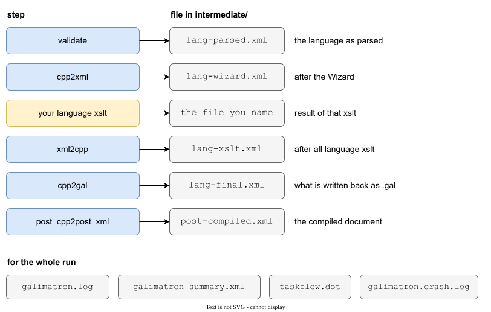

# Logs and diagnostics

A tool that edits your files must be able to explain itself. Galimatron leaves four kinds of evidence of every run:

| Evidence | Where | Answers |
|---|---|---|
| the console and `galimatron.log` | `log.cfg` | What happened, in order, and how long did it take? |
| `galimatron_summary.xml` | `intermediate-summary-dir` | Which steps succeeded, and which files did each write? |
| XML dumps | `intermediate-xml-dir` | What did the data look like after each step? |
| the exception text | the console and the log | Why did the run stop? |



## The log and log.cfg

`log.cfg` is the configuration of the logger (Logme). It is JSON and passed with `--log-config-file`.

```json
{
    "home-directory": { "path": "." },
    "flags": {
        "text-console": { "timestamp": "none", "signature": true, "method": false, "eol": true, "highlight": true },
        "text-minimal": { "timestamp": "none", "signature": true, "method": false, "eol": true, "highlight": true, "subsystem": true }
    },
    "channels": [
        { "name": "", "flags": "text-console", "level": "info",
          "backends": [ { "type": "ConsoleBackend" } ] },
        { "name": "file", "flags": "text-minimal", "level": "info",
          "backends": [ { "type": "FileBackend", "file": "intermediate/galimatron.log", "append": false } ] }
    ],
    "subsystems": { "allowed": [ "EXEC", "EXLIB", "RT" ] }   // the real file lists them all
}
```

| Part | Meaning |
|---|---|
| `home-directory` | The base for relative file names. Run Galimatron from the project folder, or set an absolute path. |
| `flags` | What each line carries: a `timestamp` (`local` or `none`), the `subsystem` tag, the end of line. |
| `channels` | Where lines go. The unnamed channel is the console. A channel with a `FileBackend` writes a file. `"append": false` starts a new file on every run. |
| `level` | How much a channel shows. `info` is the usual level. Raise the detail to `debug` to see the work of each step. |
| `subsystems.allowed` | Which parts of Galimatron may write to the log. |

Two habits worth knowing:

- Use `"timestamp": "none"` in a project that commits its log: the file then only changes when the run changes.
- Keep one channel for the console and one for the file. The file keeps the whole story when the console has scrolled away.

### What the log says

```
#RT-TRN begin of Galimatron
#RT-TRN normal mode - unparsing will be overwrite incoming .gal
#TR-TSP begin of transformation: 0, 'gal2cpp'
#TR-TSP end   of transformation: 0, 'gal2cpp': 0 min 0 sec, (15 ms)
#TR-TSP begin of transformation: 2, 'cpp2cpp_wizard'
#TR-TSP skip transformation
...
#TR-TSP begin of transformation: 6, 'increment counter and write the greeting'
#TR-TSP end   of transformation: 6, 'increment counter and write the greeting': 0 min 0 sec, (20 ms)
...
#RT-TRN all state: 30.7 MB (32231424 bytes)
#RT-TRN end of Galimatron: 0 min 0 sec, (124 ms)
```

Each transformation has a begin and an end line with its time. The user transforms carry the `name` that you gave them in `gal.cfg`, so a slow one is easy to find. The last lines say how much memory the state used and how long the run took. The [benchmark](benchmark.md) is built on these lines.

### Subsystems

A line carries the subsystem that wrote it. This list is in `log.cfg`. Remove a name to silence that part.

| Subsystem | Part |
|---|---|
| `EXEC`, `EXLIB` | the executable, command line |
| `RT`, `RT-FS`, `RT-FSD`, `RT-CFG`, `RT-TRN`, `RT-SUM` | runtime: files, `gal.cfg`, the run, the summary |
| `TR` | translator in general |
| `TR-PAR`, `TR-BLD` | parser, builder |
| `TR-CMP` | compiler (the merge of versions) |
| `TR-G2S`, `TR-S2G`, `TR-S2S`, `TR-S2X`, `TR-X2S` | conversions between GaL, state and XML |
| `TR-HLD` | holder of the state |
| `TR-XSLT` | the XSLT processor |
| `TR-TSP` | the sequence of transformations |
| `TR-WIZ` | the wizard |

## The summary

`galimatron_summary.xml` lists every step with its status and what it produced:

```xml
<transformations state-bytes="32231424" status="success">
    <transformation index="0" name="gal2cpp" from="build-in" status="SUCCESS" />
    <transformation index="2" name="cpp2cpp_wizard" from="build-in" status="SKIPPED" />
    <transformation index="6" name="increment counter and write the greeting" from="user" status="SUCCESS" />
    <transformation index="9" name="cpp2gal" from="build-in" status="SUCCESS">
        <produced-xml path="intermediate\lang-final.xml" />
        <produced-files count="1">
            <file index="0" path="incoming_gal\hello.gal" />
        </produced-files>
    </transformation>
    <transformation index="14" name="write hello.html" from="user" status="SUCCESS">
        <produced-files count="1">
            <file index="0" path="page\hello.html" />
        </produced-files>
    </transformation>
</transformations>
```

It is the answer to "which files did this run write?". `from` says whether a step is built in or yours. A failed run has `status="fail"`. With [`committed-report`](configuration.md#committed-report-output-that-you-can-commit) the paths are relative and the memory size is dropped, so the file can go into version control, and a test can compare it.

## XML dumps

Galimatron saves the XML at the points where your XSLT take over and give back.

| File | Taken | Use it to see |
|---|---|---|
| `lang-parsed.xml` | after parsing and the first validation | the language as it was read. |
| `lang-wizard.xml` | after the wizard | what the wizard changed. This is the input of your first language XSLT. |
| `lang-xslt.xml` | after all language XSLT | what your XSLT made. |
| `lang-final.xml` | after the seal and the second validation | what is written back as `.gal`. |
| `post-compiled.xml` | after compilation | what your post XSLT read. |
| the file you name in `principal-xml` | after that transform | the result of one transform. |

`lang-parsed.xml`, `lang-final.xml` and `post-compiled.xml` are written on every run. `lang-wizard.xml` and `lang-xslt.xml` belong to the XSLT part of the run (the XML is handed to Saxon and read back), so a run with no language XSLT does not write them.

The dumps answer the question "my XSLT gave the wrong result" in a mechanical way: compare the dump before your transform with the dump after it. Where they differ is your template.

!!! tip
    To see one XSLT alone, give its `principal-xml` a `file`. Then open the file in an editor that can compare two files.

Both the language XML and the compiled XML carry a `<history>` element: for each version, which tags were added, changed or deleted, and their values. Your XSLT can read it with `gal:history(.)`. The [UUID protocol](uuid-protocol.md) turns it into a dictionary of every tag name and the version that introduced it, and into `history.html`.

## taskflow.dot

`taskflow.dot` is a [Graphviz](https://graphviz.org/) file. It draws the steps of the run and, inside the validation, each check as a subflow. Open it when you want to know which checks exist and in which order they depend on each other:

```
dot -Tsvg intermediate/taskflow.dot -o taskflow.svg
```

## When a run fails

Galimatron prints the exception, writes the same text to the log, and exits with a non-zero code. A real example, a hash that does not match:

```
Exception details:
  domain: translator_library
  subdomain: translator_library::translator
  validation:
    what: HASH_DOES_NOT_MATCH
  what info:
    message: hash does not match: version 0: Apple
```

How to read it:

- `what` is the short name of the rule. The [Reference](reference.md#error-names) lists them.
- `message` says in words what failed and where: *version 0, the aggregate Apple*.
- For a syntax error, the message names the parsing rule that failed. The line comes from the file named in the text.
- `domain` and `subdomain` tell which part of the tool stopped: the translator, the runtime, the XSLT processor.

The part below it (`Boost.LEAF diagnostic info`) is for the author of the tool. The first lines are the ones to read.

An error in **your XSLT** is reported with the XSLT file, the line, and Saxon's message, because `config.xml` asks for line numbers.

### galimatron.crash.log

Galimatron also names a crash log in `intermediate-log-dir` at the start of a run. On a normal run it stays empty. If Galimatron itself crashes (a fault of the tool, not of your data), the details go there. Attach it when you report the problem.

## A short checklist

1. Read the last lines of the console. The error is there.
2. Read `what` and `message`. Most errors say what to do.
3. If the failure is in your XSLT, open the XML dump before it and the one after it.
4. If you do not know which step ran, open `galimatron_summary.xml`.
5. If you want to know why a step is slow, look at its time in `galimatron.log`.
