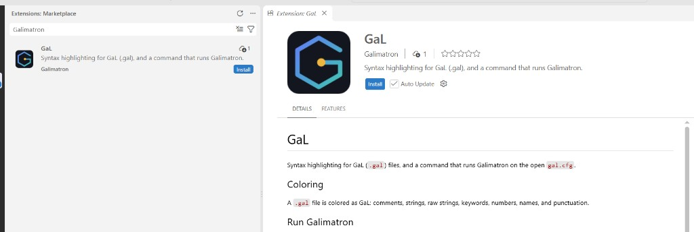

# Editor support

Galimatron works on files, so any editor will do. For Visual Studio Code there is an extension called **GaL** (`gal-syntax`). It does two things.



To install it, open the Extensions view in Visual Studio Code, search for `Galimatron`, and press **Install**.

## Coloring

A `.gal` file is recognized as the language *GaL*. The extension colors:

- comments (`// ...` and `/* ... */`),
- strings, including raw strings `R"(...)"` and the `_te` mark of a template,
- keywords (`aggregate`, `version`, `label`, `wizard`, `create`, ...),
- numbers, names and punctuation.

The reason it matters: a `.gal` file is something you read often. With color, the structure of versions and the commands of the Wizard are visible at a glance, and an unclosed string stands out at once.

## Run Galimatron from the editor

1. Open your project's `gal.cfg` and keep it the active editor. The command runs the open `gal.cfg`, and refuses any other file.
2. Open the Command Palette and run **Galimatron: execute**. A `gal.cfg` with unsaved changes is saved first.

The command runs

```
galimatron --gal-config-file gal.cfg --log-config-file log.cfg
```

with the folder of `gal.cfg` as the working directory. It needs `log.cfg` in the same folder as `gal.cfg`. Paths in `log.cfg` such as `intermediate/galimatron.log` are therefore relative to your project, as they should be.

The run is a Visual Studio Code task. Its output goes to a dedicated terminal panel named *Galimatron*, which is cleared at each run, and the files that Galimatron rewrote update in the editor. A good loop is: edit a `.gal` file or write a Wizard command in `console.gal`, run **Galimatron: execute**, read the result.

## The executable

When the extension starts, it looks for the installed executable and stores the path in the setting **Galimatron: Executable** (`galimatron.executable`).

| System | It looks for | In |
|---|---|---|
| Windows | `galimatron.exe` | `PATH`, then `Program Files\Galimatron\bin` |
| Linux | `galimatron` | `PATH`, `/usr/bin`, `/usr/local/bin` |

A path that already points to a file is left as it is, so you can set your own build there.

If nothing is found, the extension asks whether you want to install Galimatron. Answer yes: it opens the Galimatron project on GitHub. Restart Visual Studio Code after the installation, so the executable can be found. The question is asked once, and the search runs again on the next start. If the path is still empty when you run the command, the extension asks you to choose the executable and stores it.

## A project to try

The project `galimatron_hello` is made for this. Open its folder, open `gal.cfg`, run **Galimatron: execute**. If `incoming_gal/hello.gal` has a new counter and `page/hello.html` appears, the extension and the executable work. See [Getting started](getting-started.md#the-smallest-project).
