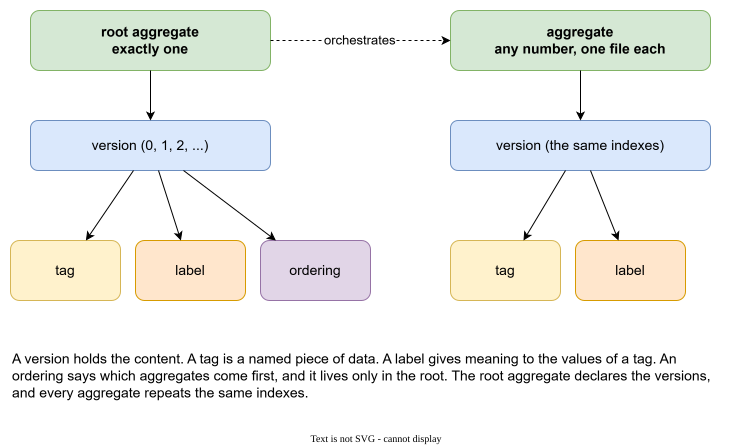
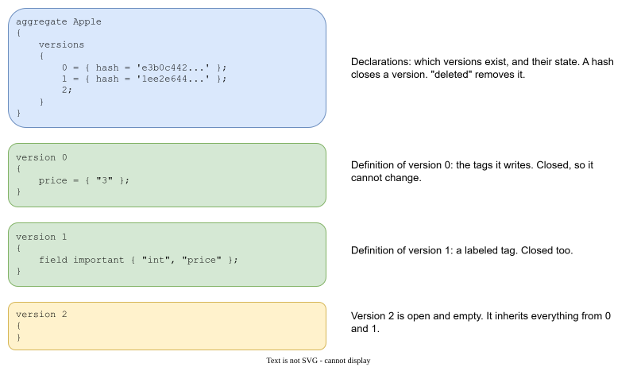

# Entities

GaL has a small set of entities, on purpose. Anything else you need is built from tags.



| Entity | What it is | Belongs to | How many |
|---|---|---|---|
| **root aggregate** | The top of the description. It lists the versions and orchestrates the aggregates. | nothing | exactly one |
| **aggregate** | A named group of tags. One message, one table, one setting group. | the root, through versions | any number, one file each |
| **version** | The content of an aggregate at one moment. | an aggregate | many |
| **tag** | A named piece of data. The main entity. | a version | many |
| **label** | Gives meaning to the values of a tag. | a version | many |
| **ordering** | Says which aggregates come before which. | a root version | many |

## The problem each one solves

**Aggregate.** A description with a hundred items in one file is hard to read and hard to merge. Each aggregate lives in its own file, so a change to `Apple` is a change to `Apple.gal`, and two people rarely edit the same file.

**Root aggregate.** Items often share settings: a currency, a namespace, a flag that says "published". You do not want to repeat them. A tag written in the root flows into every aggregate (see [Aggregates and versions](aggregates-and-versions.md)).

**Version.** Data changes, and the old state must stay available. A version is a numbered state. The root says which versions exist, and every aggregate repeats the same indexes.

**Tag.** The unit of data: a name and values. A tag is not typed by the language. Strings, records and arrays are enough. The meaning is yours.

**Label.** A tag in a code generator needs a type and a name, a default, a flag. Labels give structure to values *without adding keywords to the language*. A label says: the first value is the `type`, the second is the `name`. See [Labels](labels.md).

**Ordering.** Files have no natural order, and generated code often needs one: an enum before the struct that uses it. An ordering says it in the data. See [Ordering](ordering.md).

## What you can do with an entity

Every entity has a life: it is created, it changes, it may be deleted. GaL keeps this small and clear.

| Entity | Create | Update | Delete |
|---|---|---|---|
| root aggregate | `wizard create root aggregate` | `wizard create version` | not possible, the root stays |
| aggregate | `aggregate Name { ... }` or `wizard create aggregate` | `wizard create version` | `delete;` in a version (history stays), or `wizard delete aggregate ... physically` |
| version | `version N { }` or `wizard create version` | by tags, and by a hash that closes it | `wizard delete version`, `wizard collapse version` |
| tag | `a = { ... };` | `a = { ... };` in a later version | `delete a;` |
| label | `label name = ...;` | a later statement of the same name wins | not possible, a label name is final |
| ordering | `ordering name = { ... };` | a later statement of the same name wins | not possible |

Two kinds of delete are worth knowing:

- **Historical delete** writes `delete;` or `delete a;` into a version. The history stays in the file. The compiled view drops what was deleted from that version on.
- **Physical delete** removes the file, or removes a version from every aggregate. It is refused while a closed version still holds the aggregate, and it only removes open versions. It is for a draft that never shipped, or for a mistake.

## Where entities are written

An aggregate is a file. A file has two parts:



The first part is the **declaration**: which versions exist, which are closed (a hash), which are deleted. The second part is the **definitions**: one block per version with the tags it writes.

```
aggregate Apple
{
    versions
    {
        0 = { hash = 'e3b0c442...' };
        1 = { hash = '1ee2e644...' };
        2;
    }
}

version 0
{
    price = { "3" };
}

version 1
{
    field important { "int", "price" };
}

version 2
{
}
```

`field` in version 1 is a label that the root declares (see [Labels](labels.md)). `version 2` is open and empty. It inherits everything from 0 and 1 (see [Aggregates and versions](aggregates-and-versions.md#what-a-version-sees)).

The root aggregate has the same shape with the word `root`: `root aggregate shop { versions { ... } }`. The root file may also hold labels and orderings.

## Names

An aggregate or tag name is a letter followed by letters, digits and underscores: `Apple`, `hello_t`, `version_number`. Names of aggregates must be unique, ignoring case. The name of the root aggregate does not matter to the data. The word *comment* and the other words of the language are reserved (see the [Reference](reference.md#keywords)).

Strings use `"..."` or `'...'`. A raw string `R"(...)"` keeps every character as written. Comments are `// ...` and `/* ... */`.
