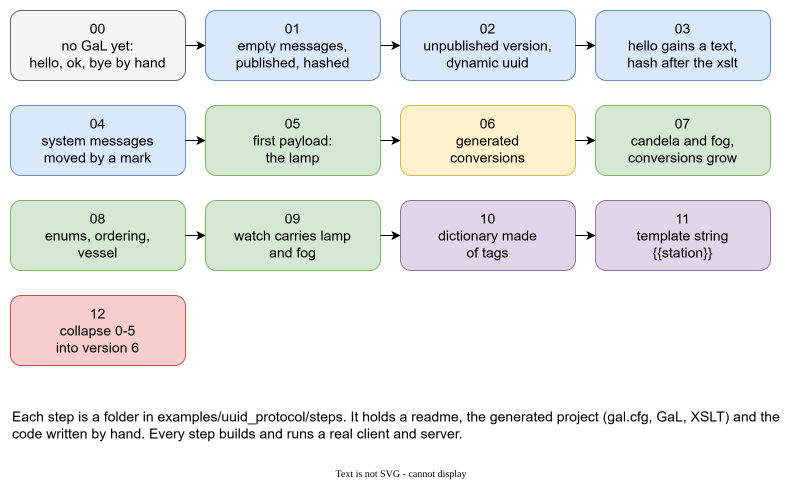

# Example: messages that grow

A client and a server exchange messages. The messages change over thirteen versions of the project, and every step is a complete, building, running state, so you can see in the files what each feature of Galimatron does.

The project is in the Galimatron sources, in `examples/uuid_protocol`. Its root aggregate is called `protocol`, and the snippets below show the real files.

## Why messages

Messages are a good example because they **almost always need versioning**. They are added and they change, old clients stay in the field, and everything must still be understood. This is exactly the problem that versions, hashes and the Wizard solve, so messages show every feature in a setting that is easy to follow.

The example generates source code, because the client and the server are programs. This is a choice of the example: the same descriptions could generate a schema, another language, or documentation, because Galimatron is not tied to any output.

## The problem

A set of messages has a life:

- It starts small: hello, ok, bye.
- It gets new messages and new fields. Version 3 of a client talks to a server that already knows version 6.
- The server must understand **every** version a client may use, and convert old messages to the new shape.
- Every message has a stable **uuid**, and the uuid must change when the message changes.
- A published version must never change by accident.
- The types, the registration of messages, the conversions and the documentation must all agree with that.

Written by hand, this is a place where two copies always drift. Described in GaL, it is one description, and the code is generated.



## What a step contains

```
steps/11-substitution/
    readme.txt          what this step shows
    CMakeLists.txt      builds and runs the step
    by_hand/            code that a person writes (handlers, cases, conversion bodies)
    generated/
        gal.cfg         the configuration
        log.cfg
        incoming_gal/   the .gal files that start the step
        actual_gal/     the .gal files after Galimatron ran
        xslt/           the XSLT and their templates
        generated_dto/        the source files of every published version
        generated_conversion/ the source files of every conversion
        dictionary/           dictionary.md
        intermediate/         log, summary, XML dumps
```

This example is also used as a test, so it keeps `incoming_gal/` and `actual_gal/` apart: you can compare what a step started with and what it produced (see [two different folders](configuration.md#your-files-are-rewritten-in-place)). Your own project uses one folder, as in [Getting started](getting-started.md#a-project-is-a-folder).

The step reads the `.gal` files from the previous step and applies one Wizard batch (`console.gal`). The comment above the batch says *why*.

## The model

The root aggregate is `protocol`. Each message is an aggregate, one file each:

```
generated/actual_gal/
    protocol.gal            root: versions, published, version_namespace
    console.gal             the Wizard command (commented out after the run)
    dictionary.gal          an aggregate: the names used in the messages
    system/                 hello, ok, bye, error
    payload/                lamp, fog, vessel, watch, enums
```

`protocol.gal` declares the versions and what each one is:

```
root aggregate protocol
{
    versions
    {
        0 = { hash = '27025d7a...' };
        1 = { hash = '704dd06e...' };
        ...
        5 = { hash = 'b099af2e...' };
        6;
    }
}

version 3
{
    version_number = { "4" };
    version_namespace = { "v4" };
    published = once important { };
}
```

- Version N of the project *is* version N+1 of the messages. `version_namespace` says in which namespace the version is generated (`v4`).
- `published = once important { }` marks a version as published. It is `once`: each version states it again, so a version that is not published (the last, open one) has no such tag.
- `important` puts it into the hash. A published version is closed with a hash, and the root file keeps all of them.

A message is an aggregate:

```
aggregate lamp { versions { 0 = deleted; 1 = deleted; 2 = { hash = '...' }; ...; 6; } }

version 2
{
    payload_message = { };
    struct_name = { "lamp_t" };
    uuid = need_new_uuid important { "6f1e0005-0000-4000-8000-000000000001" };
    field important { "bool", "lit", "false" };
}

version 3
{
    uuid = need_new_uuid important { "6f1e0005-0000-4000-8000-000000000002" };
    field important { "int", "candela", "0" };
}
```

The lamp appears in version 2 (the earlier versions are deleted), gains a `candela` field in version 3, and every version has a new uuid. The `field` label comes from the root.

## The steps

| Step | What it adds | Feature |
|---|---|---|
| **00** no generation | Four system messages, written by hand, and a session: hello, ok, bye. | The messages before Galimatron. |
| **01** empty messages | The four messages are described in GaL and generated. Version 0, `published`, a hash. | [The Wizard](wizard.md) batch, [hash](hashes.md), the first [XSLT](xslt.md) and its [templates](templates.md). |
| **02** an unpublished version | A new, open version 1 and a **dynamic label** that asks for the next uuid. | [Dynamic labels](labels.md#dynamic-labels-values-that-must-change-with-every-version), `create version`. |
| **03** hello gains a text | `hello` gets a `message` field. A trial version is removed and replaced. Hash after the XSLT. | `delete version`, `create label`, `create tag`, [hash and XSLT](hashes.md#the-hash-and-your-xslt). |
| **04** system messages | The system messages move to the namespace `system`, marked by a tag **outside the hash**. | Tags without `important`. |
| **05** the first payload | `lamp`, the first user message, in a folder `payload/`. | `create aggregate ... in payload`, field defaults. |
| **06** conversions | The generator writes an empty conversion from each older version into the last. | [Custom state](custom-states.md) in a file. |
| **07** candela and fog | The lamp gets brightness. `fog` appears. | A new published version beside closed ones. |
| **08** enums and a vessel | Two enums, a vessel, and an **ordering**: an enum before the type that uses it. | [Ordering](ordering.md), a second label. |
| **09** a watch | One message carries lamp and fog. Some messages become plain types. | A conversion body that generation leaves for you to write. |
| **10** a dictionary | A dictionary of every tag name, built from the data. It is a new kind of entity that Galimatron does not know. | State in tags, post XSLT that writes Markdown. |
| **11** a template string | A greeting substitutes `{{station}}`. | [Template strings](tags.md#template-strings). |
| **12** collapse | Versions 0 to 5 collapse into version 6. | [Collapse](aggregates-and-versions.md#collapsing-history). |

## Ideas worth taking from each step

**Step 1: one description, many outputs.** The four system messages become four small `.gal` files, and `generate-sources.xsl` writes the source files of version 1 into `generated_dto/v1/`: the type, `get_uuid`, the declarations of the handlers and the registration. The XSLT reads the *compiled* XML and fills text templates (see [Generating text](templates.md)).

**Step 2: ids that move by themselves.** `uuid` is a tag with the dynamic label `need_new_uuid`. A new version copies it, and the copy asks the XSLT for the next uuid:

```
// generate-uuid.xsl
<xsl:template match="tag[gal:tag-uses-dynamic(., 'need_gen_uuid')]/values/value/string/text()">
    <xsl:value-of select="gal:next-uuid(.)"/>
</xsl:template>
```

The uuid has the form `6f1e0005-0000-4000-8000-000000000002`. The first groups name the message, the last group is a version counter. The result: no one types a uuid, and no one forgets to change it.

**Step 3: the hash covers what the XSLT made.** The Wizard batch ends with `create hash`. The hash is taken after `generate-uuid.xsl`, so it includes the new uuids. The hashes of version 0 stay, because its closed values did not change.

**Step 4: not everything is `important`.** `system_message` is a tag outside the hash. It decides the namespace in which a type is generated. Moving the system messages did not break any hash, because this change is not part of what was published.

**Steps 5 to 8: the messages grow.** Each step is one Wizard batch: `create version`, new aggregates and tags, `create tag protocol published = once important { }`, `create hash`. The batch is the *change request*. Its comment says why. The old versions are untouched, and every hash stays true.

In step 8 the batch also writes an ordering:

```
create ordering protocol enum_precedes_struct = { sea_state_enum, fog, vessel_kind_enum, vessel };
```

Without it, the generated code would put `fog` before `sea_state_enum`, and the code would not compile.

**Steps 6 and 9: conversions.** For each pair of published versions the generator writes an empty conversion, for example from version 3 to version 6: a function that takes the old message and the server state, and has an empty body.

A person writes the body once (it is in `by_hand/conversion/`). The generator keeps a file that is already recorded in `conversion-state.xml`, so it never overwrites the work. The store has `delete-if-not-rewrited: false`. See [Custom states](custom-states.md).

**Step 10: the dictionary.** The data knows every tag name and the version that introduced it (the `history` element). The XSLT adds an entry for each name that has none, and a person writes the text of an entry. The result is the generated `dictionary.md`:

```
## Version 2
- `lit`
- `payload_message`: a user message, not a system message
```

!!! important
    Look at what happened in this step. Galimatron has no "dictionary" and no "dictionary entry" in its model, and it was not changed to get one. The dictionary is an ordinary aggregate, `dictionary`, whose tags hold the entries. It has versions and a history like everything else, a person edits it like any other `.gal` file, and one XSLT keeps it complete while another prints it.

    So a new kind of thing, shaped to what this project needs, was made from the parts that every project already has: aggregates, versions, tags, and XSLT. This is the way to use the tool. The model is small on purpose, and a thing it lacks is built from it, not asked from it.

**Step 11: a string that quotes a tag.** `station = { "North Light" }` and `greeting = { "{{station}} on watch"_te }`. The `.gal` file keeps `{{station}}`, the compiled data holds `North Light on watch`, and the dictionary shows it.

**Step 12: collapse.** `wizard collapse version 0-5` retires six versions into one anonymous body owned by version 6. The generator now writes only `v6`, and the conversions are not generated. A client that speaks an older version gets the error *no message with uuid*. This is the end of life of old versions as a deliberate command.

## What the post XSLT write, and in what order

`gal.cfg` of step 11 lists three post-language transforms:

| # | Transform | Writes |
|---|---|---|
| 1 | `history-page.xsl` | `intermediate/history.html`, from the `history` element |
| 2 | `generate-dictionary.xsl` | `dictionary/dictionary.md` |
| 3 | `generate-sources.xsl` | `generated_dto/`, `generated_conversion/`, `actual_gal/conversion-state.xml` |

(and two language transforms before them: `generate-uuid.xsl` and `fill-dictionary.xsl`). The sources generator is last: it does not copy the compiled document through, so the transforms that copy it must come before.

## Try it

Open `steps/11-substitution/generated/` and look at `gal.cfg`, `xslt/` and `intermediate/`. Run Galimatron there, then compare `incoming_gal/` with `actual_gal/`: the Wizard batch in `console.gal` is commented out in `actual_gal/`, and the new tags are in the `.gal` files next to it. `intermediate/galimatron.log` shows the time of each step, and the dumps show the data after each one.

Then read `by_hand/` to see what is *not* generated: the handlers, the test cases and the conversion bodies. That is the border between what Galimatron owns and what a person owns.
