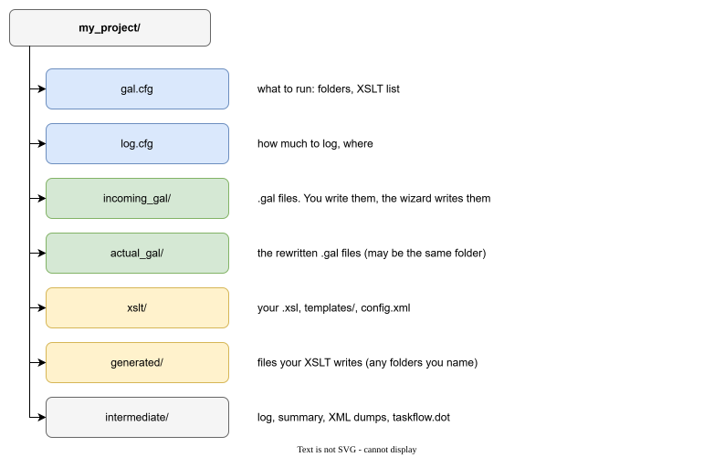

# Getting started

This page installs Galimatron and runs the smallest useful project. You will see what you write, what Galimatron changes, and what your XSLT produce.

## Install

Galimatron is one executable (`galimatron.exe` on Windows, `galimatron` on Linux) with the SaxonC libraries beside it (Saxon is the XSLT processor that Galimatron uses to run your XSLT). The installer puts these in place, in the install folder (on Windows, `C:\Program Files\Galimatron`):

| What | Where |
|---|---|
| the executable and the Saxon libraries | `bin/` |
| `gal-functions.xsl`: helper functions for your&nbsp;XSLT | `share/galimatron/xslt/` |
| `catalog.xml`: maps the address of `gal-functions.xsl` to that file | `share/galimatron/` |

The catalog is why your XSLT can write

```xml
<xsl:include href="https://github.com/goloveshin/galimatron/xslt/gal-functions.xsl"/>
```

and still work without a network. Galimatron loads the catalog from the folder beside `bin/`.

!!! note
    A build that is not installed has no catalog. Include `gal-functions.xsl` by a path in that case.

If you use Visual Studio Code, also install the [GaL extension](editor.md). It colors `.gal` files and runs Galimatron on an open `gal.cfg`.

## A project is a folder

Galimatron has no project file in a hidden place. A project is a folder with two configuration files, your `.gal` files and your XSLT.



| Item | Who writes it | What it holds |
|---|---|---|
| `gal.cfg` | you, by hand | which folders to use and which XSLT to run |
| `log.cfg` | you, by hand | how much the log says, and where it goes |
| `incoming_gal/` | you, by hand (Galimatron rewrites the files in place) | your `.gal` files |
| `xslt/` | you, by hand | your XSLT programs |
| `generated/` | your XSLT, during a run | the files you generate: source code, SQL, pages |
| `intermediate/` | Galimatron, during a run | the log, the summary, the XML dumps |

The names of the folders are yours. `gal.cfg` says which is which. See [Configuration](configuration.md).

## The smallest project

The project `galimatron_hello` has one `.gal` file, one language XSLT, one post XSLT and one template.

`incoming_gal/hello.gal`:

```
root aggregate hello
{
    versions
    {
        0;
    }
}

version 0
{
    counter = { "0" };
    greetings = { };
}
```

The file says: there is a root aggregate `hello`. It has one version, 0. In that version are two tags: `counter` with the value `"0"` and `greetings` with no value.

`xslt/language.xsl` changes the data. It adds one to the counter and writes a greeting:

```xml
<xsl:mode on-no-match="shallow-copy"/>

<xsl:template match="tag[@name='counter']/values/value/string/text()">
    <xsl:value-of select="xs:integer(.) + 1"/>
</xsl:template>
```

`xslt/page.xsl` reads the compiled data and writes `page/hello.html` from the template `templates/page.xml`. See [Generating text](templates.md).

`gal.cfg` lists both XSLT. The first is a *language* transform, the second a *post-language* transform. The difference is explained in [How a run works](how-it-works.md).

## Run it

Open a terminal in the project folder and run

```
galimatron --gal-config-file gal.cfg --log-config-file log.cfg
```

(or run **Galimatron: execute** in Visual Studio Code with `gal.cfg` open).

After the first run `incoming_gal/hello.gal` holds

```
version 0
{
    counter = { "1" };
    greetings = { "Hello world from Galimatron!" };
}
```

and `page/hello.html` exists. Run again: the counter is 2. The `.gal` file is the memory of the project, and Galimatron rewrites it in place. The console shows each step of the run and its time.

## Look at what happened

The folder `intermediate/` explains the run:

| File | It says |
|---|---|
| `galimatron.log` | every step, its time, the memory used |
| `galimatron_summary.xml` | the result of every step and every file that was written |
| `lang-parsed.xml` | the language as Galimatron read it, before your XSLT |
| `lang-final.xml` | the language after your XSLT, as it is written back |
| `post-compiled.xml` | the compiled view that your post XSLT read |

Open `lang-parsed.xml` and `lang-final.xml` of the second run side by side. The counter is 1 in the first and 2 in the second. That is the difference your XSLT made. See [Logs and diagnostics](diagnostics.md).

## What next

- The model you will write in: [Entities](entities.md).
- A project that grows, step by step: [Example: messages that grow](example-messages.md).
- Commands that edit the `.gal` files for you: [The Wizard](wizard.md).
