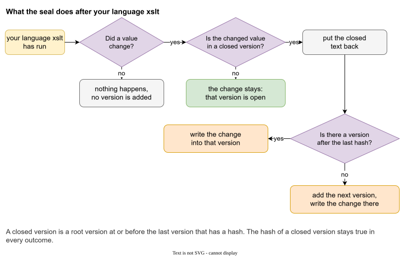
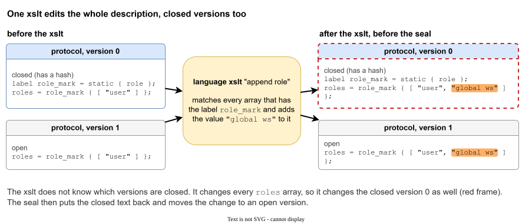
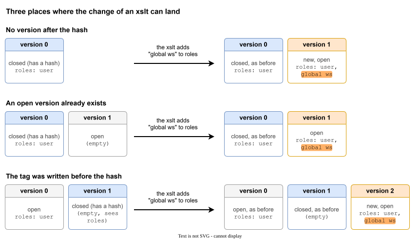

# Hashes and closed versions

## The problem

You published version 2 of a description. Programs in the field were built from it, and files that were written with it are still in use. A month later somebody "fixes" a field in version 2, and now the description and everything that was shipped disagree. Nobody notices until something breaks.

A **hash** makes this impossible to do quietly. A hash closes a version. If the important values of a closed version change, the next run fails and says which aggregates differ.

## What a hash covers

A hash is made of the **important** values only: the values of tags marked `important` (see [Tags](tags.md#important), which also says how to decide what is important and what is not).


- Each aggregate has a content hash of its important tags in that version.
- The root stores the combination of all of them: the aggregate hashes sorted, then combined.
- **Left out**: tag names, labels, aggregate names, file names and paths, comments, and every tag that is not `important`.

The reason is freedom. You can rename a file, move an aggregate to another folder, add a label part, add a note. The published meaning did not change, so the hash does not either.

A hash is stored in the declaration of a version:

```
versions
{
    0 = { hash = '27025d7a1482f343d1f2f0bb2865d7055458e172a1ff90dd9b4cccfd4aba3035' };
    1 = { hash = '704dd06e344f8b26bf000ed10194d6f0e856afec347f962900e05a15e1df091b' };
    2;
}
```

Every aggregate that is not deleted in that version stores its own hash in its own file. The root file stores the combined one. A version with a hash on the root but not on some aggregate is an error (`HASH_MUST_BE_ON_EVERY_AGGREGATE`).

## Closed versions


A **closed version** is a root version that stores a hash, and **every version before it**. If version 3 has a hash, versions 0, 1, 2 and 3 are closed. History does not have holes.

What is closed:

- Its important values do not change. Any change fails the check.
- `wizard delete version` refuses it.
- `wizard delete aggregate` and `wizard copy aggregate` refuse an aggregate that it contains.
- `wizard create tag` and the other statement commands write into the **last open version**, so a closed version is never touched by accident.

What is still allowed in a closed version: unimportant tags, labels, comments. They are outside the hash.

## Creating and removing a hash

```
wizard create hash;           // the last version
wizard create hash 3;         // version 3
wizard create hash 3, 4;      // both
wizard delete hash 3;         // open version 3 again, on purpose
```

`wizard create version` always adds a new **open** version after the closed ones. The usual rhythm is: write into the open version, check, `wizard create hash` to publish, `wizard create version` to start the next.

To change a closed version, first delete its hash. This is a deliberate act: you cannot do it by accident, and you must say it with a command.

### force

```
wizard create hash 3 force;
wizard delete hash 3 force;
```

Normally Galimatron checks the stored hash of every version before the Wizard runs. If a stored hash does not match because you edited by hand, the run fails, and the message names the version and the aggregates.

`force` is for the version you name. `create hash ... force` stores the hash of the important tags *as they are now*. `delete hash ... force` removes a hash that does not match. Use it when you know the data is right and the hash is stale. Versions you do not name are still checked.

## The hash and your XSLT

A hash is taken from the data **after** the Wizard and **after** your language XSLT. When `create hash` and an XSLT that generates values (a new uuid) run together, the hash covers the generated values. The [Example: messages that grow](example-messages.md) does this at step 3.

Your XSLT must not break a closed version. What if it must? For example a generator changes a type name that the closed version holds. Galimatron has an answer: the **seal**.


After your XSLT Galimatron compares the text before and after. Where the XSLT changed a value that belongs to a closed version, it **moves the change to the first open version after it**, and creates that version when it does not exist. The closed version keeps its text, and its hash stays true.

The effect for you: an XSLT can be written as if it edits the whole description, and history is still safe. The change shows up in the first open version, where you can see it and publish it.

### Why there is a seal

A closed version is a promise: its text and its hash stay. A language XSLT runs on the XML of every version, so a template that rewrites a value rewrites the closed versions too. An XSLT that appends the version number to every tag string does exactly that, version 0 included.

Without the seal there are two outcomes. The edit stays in the closed version, the stored hash no longer matches, and the run stops with `HASH_DOES_NOT_MATCH`, so nothing is written. Or every language XSLT has to skip the closed versions by itself. That is possible for a narrow job: in the [messages example](example-messages.md) the XSLT that fills in uuids only touches the Wizard copies that are marked for it. It is not possible for an XSLT that walks the whole document. With the seal, such an XSLT is written once, as if there were no history.

### What the seal does



The seal compares the text before and after your XSLT and asks the questions of the picture for each change. Most runs stop at the first or second question. A new version is added only when the change belongs to a closed version and there is no version after the last hash.

### Where the change lands

The pictures below use one XSLT. The description has a label `role_mark` and a tag `roles = role_mark { [ "user" ] }`. The language XSLT `append role` adds the value `"global ws"` to every array that has the label `role_mark`:

```xml
<xsl:template match="array[gal:array-has-label(., 'role_mark')]">
    <xsl:copy>
        <xsl:apply-templates select="@* | node()"/>
        <value>
            <string>global ws</string>
        </value>
    </xsl:copy>
</xsl:template>
```

The template does not ask which version it is in. It changes the `roles` array everywhere, in the closed versions too:



That is the input of the seal. The next picture shows what the seal does with it in three layouts of the same description. In each, the `roles` tag gets the new value in the first version after the last hash:



- **No version after the hash.** Version 0 is closed and the XSLT edits it. The seal puts the old text back and adds version 1 with the new value.
- **An open version already exists.** The seal puts the old text back in the closed version and writes the new value into the open one. No version is added.
- **The tag was written before the hash.** The closed version 1 has no `roles` of its own: it sees the one from version 0. The XSLT changes `roles` as version 1 sees it. The seal does not patch version 0, and it does not touch version 1. It compares the tags that the last closed version has *as it sees them*, and writes the difference into the first version after the hash, here a new version 2.

If the XSLT edits an open version itself, that edit stays and nothing is added. If it changes nothing, no version is added.

A change that the last closed version does not show is restored and not copied forward. That is the case when a later closed version has already replaced that tag.

Then the validation runs again. A user XSLT does not rewrite a hash, so a hash that no longer matches fails the run, and nothing is written.

## What Galimatron checks about hashes

| Rule | Error |
|---|---|
| The stored hash of a version equals the one computed now. | `HASH_DOES_NOT_MATCH`, naming the aggregates of each differing version, then a version that differs only in the root. |
| A version with a hash has it on the root and on every live aggregate. | `HASH_MUST_BE_ON_EVERY_AGGREGATE`, naming each declaration where it is absent. |
| `create hash` and `delete hash` name versions that exist. | `WIZARD_CREATE_HASH_VERSION_MUST_EXIST`, `WIZARD_DELETE_HASH_VERSION_MUST_EXIST` |

A version with no hash is not checked.
