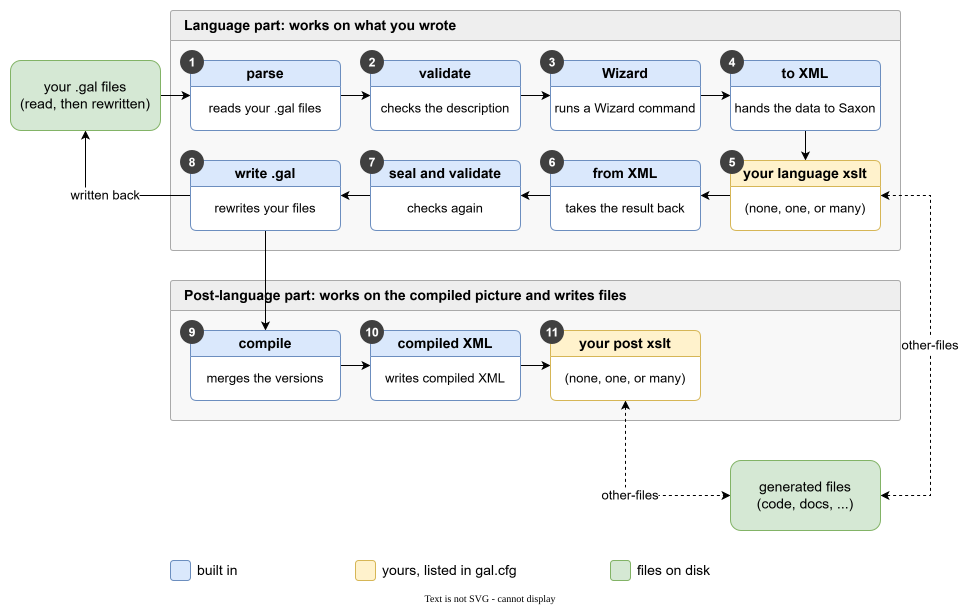
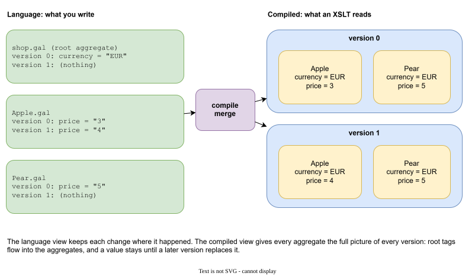
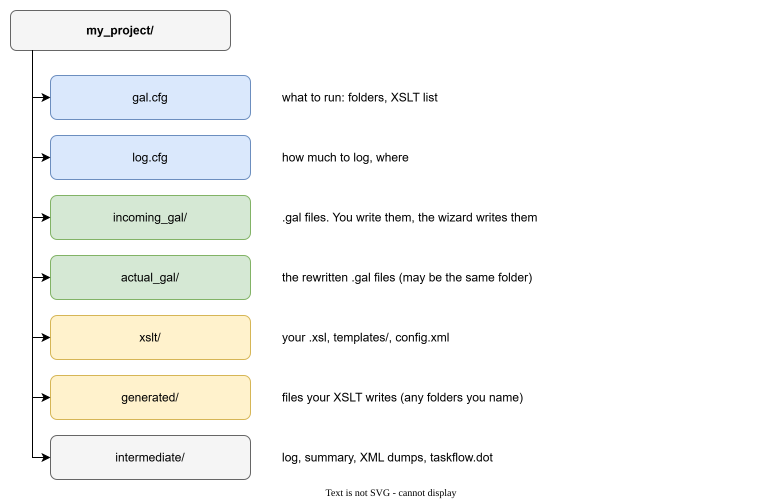

# How a run works

One run of Galimatron reads your `.gal` files, checks them, applies a wizard command if there is one, runs your XSLT, checks again, writes the `.gal` files back, and runs your post XSLT.

## The steps

Steps 1 to 8 are the **language part**: they work on what you wrote. Steps 9 to 11 are the **post-language part**: they work on the compiled picture and write files.

| # | Step | What it does for you |
|---|---|---|
| 1 | parse (`gal2cpp`) | Reads every `.gal` file in the input folder. A syntax error stops the run here, with the file and the line. |
| 2 | validate (`cpp2cpp_validate`) | Checks the whole description: one root aggregate, versions without gaps, every hash matches. |
| 3 | wizard (`cpp2cpp_wizard`) | Runs the one wizard command, if a file holds one. See [The wizard](wizard.md). |
| 4 | to XML (`cpp2xml`, `xml2saxon`) | Turns the description into XML and hands it to Saxon. |
| 5 | your language XSLT | Zero, one or many of your transforms. Each result is the next input. They may edit the description. |
| 6 | from XML (`xml2cpp`) | Reads the edited XML back. |
| 7 | seal and validate (`cpp2cpp_after_xslt`) | Keeps closed versions closed, then checks again. See [Hashes](hashes.md). |
| 8 | write `.gal` (`cpp2gal`) | Prints the new `.gal` text. In separate mode it is written at once. In normal mode it is written when the whole run has succeeded. |
| 9 | compile (`cpp2post_cpp`) | Merges the versions into the compiled picture. |
| 10 | compiled XML (`post_cpp2post_xml`) | Turns that picture into XML. |
| 11 | your post XSLT (optional) | Zero, one or many of your transforms. They read the compiled XML and write files. The XML itself is already on disk after step 10. |

If the wizard has no command, or you list no XSLT, those steps are skipped. The log says `skip transformation`.

A step that fails stops the run. Read the message, fix the cause, run again. What a failed run leaves on disk depends on the mode (see [Configuration](configuration.md#two-modes-one-folder-or-two)):

- **Normal mode** (the input and output folders are the same). Step 8 does not write the `.gal` files at once. Galimatron keeps the new text in memory and writes it **only when the whole run has succeeded**, post XSLT included. A failure at any step, even in your post XSLT, leaves every `.gal` file as it was, and a wizard command is still there to run again.
- **Separate mode** (the folders differ). The output folder is emptied at the start, and step 8 writes the `.gal` files into it at once. A failure in your post XSLT therefore leaves the new `.gal` files in the output folder, and a failure before step 8 leaves it empty. The input folder is never changed.

In both modes the files that other steps write are written as soon as the step finishes: the XML dumps, and the files your XSLT produce. After a failed run some of them are new and some are older. The files that an earlier run produced and this run did not rewrite are removed only after a run that succeeded.

## Two views of the same data

The language and the compiled picture are two different views.

**Language** is what you write and what your language XSLT edit. Each change is stated where it happened: version 1 of `Apple` says `price = "4"`, and says nothing about the currency.

**Compiled** is what your post XSLT read. Every aggregate has the full picture of every version: the root's tags flow into the aggregates, and a value stays until a later version replaces it.

Why two views? When you edit, you want the smallest possible statement. When you generate, you want the full picture and no search through older versions. See [Aggregates and versions](aggregates-and-versions.md) for the rules of the merge.

### Which XSLT should I write?

| You want to | Use a | Why |
|---|---|---|
| change data: advance a counter, give a new id, fill a table | language transform | The result is written back into `.gal`. |
| generate code, documents, test data | post-language transform | It reads the full picture and cannot damage the sources. |

The two kinds are described in [XSLT](xslt.md).

## The primary output is XML

Galimatron does not generate code, documents or any other text by itself. It has no built-in generator and no templates for any language. Its primary output is **XML**: the description, checked and compiled, with the history of every version.

- `intermediate/post-compiled.xml` is the compiled XML. It is written on every run, with or without XSLT. The [XSLT](xslt.md) page shows what is in it.
- With language XSLT, the XML of the language stages (`lang-*.xml`) is written too.
- The `.gal` files are the other output: the description itself, rewritten with the wizard's changes.

Running your XSLT inside Galimatron is **optional**. It is the convenient path: Saxon is built in, the XSLT may write only to folders named in `gal.cfg`, the language XSLT may edit the data, and the [seal](hashes.md#the-hash-and-your-xslt) protects closed versions. But the XML is an ordinary file. You may leave `transforms` empty and read `post-compiled.xml` with a Python script, a program in any language, or an XSLT processor of your choice. A run with no XSLT is also the fastest (see [Benchmark](benchmark.md#without-xslt)).

## Not tied to any language

Because what is made out of the XML is up to you, nothing in Galimatron is tied to a language or a format. C++ structs, Java classes, JSON schemas, SQL, Markdown, HTML, test data: each is a few templates away. Two projects with different targets use the same Galimatron and the same GaL.

The examples in this documentation generate C++ and Markdown. That is the choice of the examples, not a property of the tool.

## What a run reads and writes

- It reads: `gal.cfg`, `log.cfg`, the `.gal` files, your XSLT and the templates they load, and the state files that your XSLT name.
- It writes: the `.gal` files (the output folder), the files your XSLT write (only to folders named in `gal.cfg`), and the diagnostics in the intermediate folders.

Your XSLT cannot write to an arbitrary path. See [aliases](configuration.md#where-your-xslt-may-write).

## A run is deterministic

The same `.gal` files and the same XSLT give the same result. This matters for generated code in version control: a run that has nothing to change leaves no diff.

Your language XSLT may change the data on every run, as the counter of the [hello project](getting-started.md#the-smallest-project) does. That is your choice, and the new value is written into the `.gal` file, so the change is visible and versioned. An XSLT that should not move a value twice must decide from the data, as the [UUID protocol](uuid-protocol.md) does: it advances only the copies that a new version has just made.
