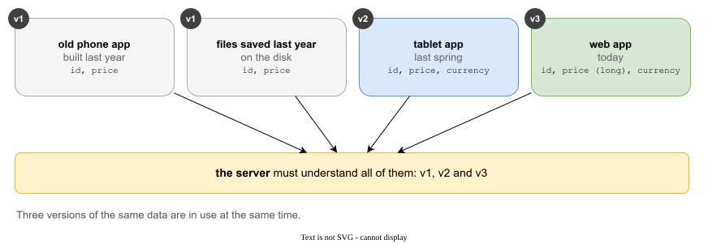
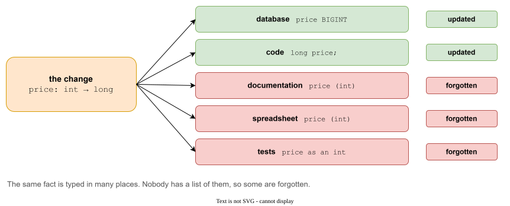
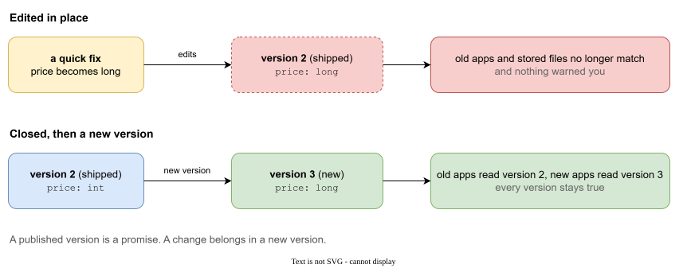
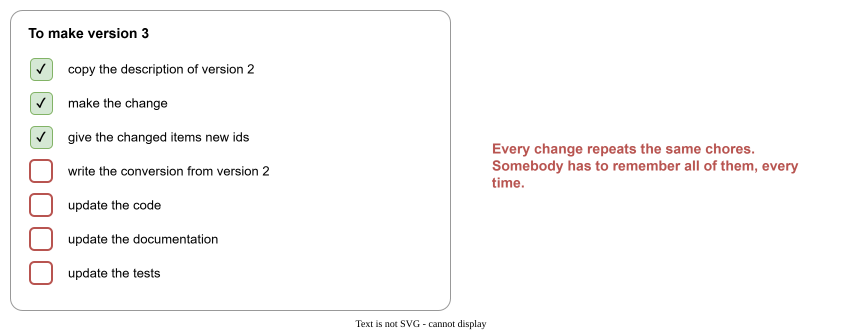

# The problem: data that changes

Think of any shape of data that other people or programs depend on: a file format, the messages between an app and a server, a table in a database, a configuration. You design it and publish it. Then it has to change.

This page is about what happens next. It has nothing to do with Galimatron yet: if you have ever kept a data format alive for more than a year, you already know it.

## Many versions live at the same time

A new shape does not replace the old one. An app built last year still sends the old shape. Files saved last year still hold it. The server speaks the newest shape and must read all of them.

So a version is not "yesterday's file". Every version that was published stays alive for as long as somebody uses it, and the data has to say which version it is.

## One fact, many places

A field is never written down once. `price` is a column in the database, a field in the code, a line in the documentation, a column in a spreadsheet, a value in the tests.

Change the type in one place and the others are wrong. Nobody has a list of all the places, so a few are forgotten, and you learn about them from a bug report.

## A published version must not change

Version 2 has shipped. Later somebody finds a mistake in it and fixes it in place. Nothing complains: the file is only text. But the apps in the field and the files on the disk still have the old shape, and now they do not match.

A published version is a promise. To change something that others rely on, you add a new version and leave the old one alone. The difficulty is that nothing stops you from breaking the promise by accident.

## The same chores every time

Adding a version is a routine, and a routine is easy to get wrong when it is done by hand.

## What would help

A short list of what you would want, whatever tool you use:

| You want | Because |
|---|---|
| **One place** where the fact is written | so that the copies cannot drift apart |
| **The history kept with the data** | so that version 2 can still be read next to version 3 |
| **Published versions that are locked** | so that a promise cannot be broken by accident |
| **New versions made for you** | so that the chores are done the same way every time |

Galimatron is a tool built for exactly this list. [Why Galimatron](why-galimatron.md) shows how it works, and [Getting started](getting-started.md) gets you running in a few minutes.
