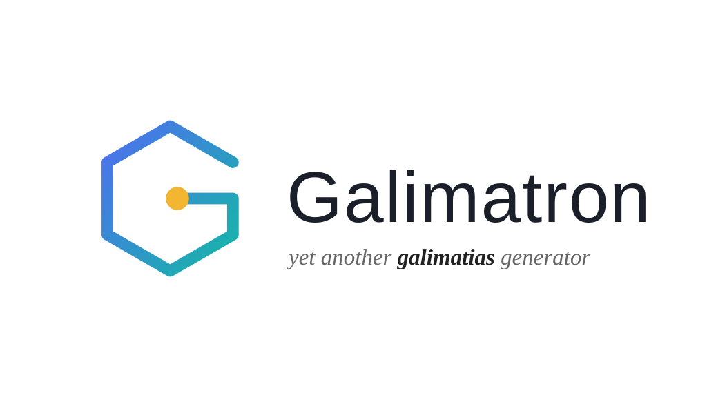
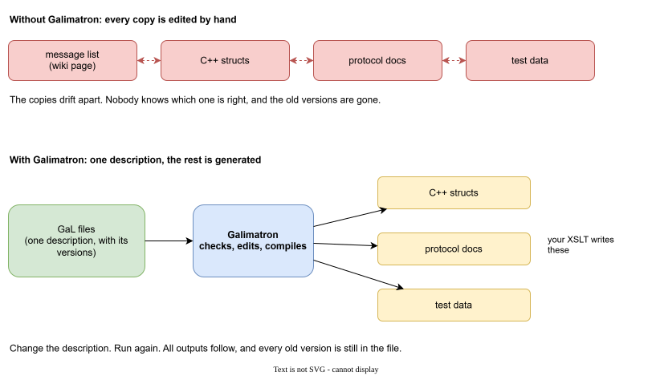
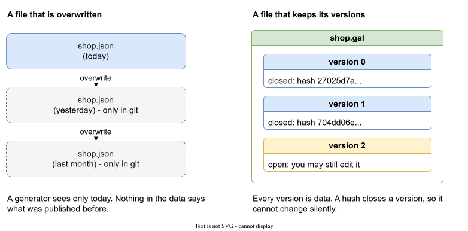

# Why Galimatron

Galimatron is a command line tool that keeps **one versioned description of your data** and lets you generate everything else from it.

You describe your data once, in text files called **GaL** files (Galimatron Language, `.gal`). Galimatron checks the description, edits it on your command, and turns it into **XML**. From that XML you make whatever you need: source code in the language of your choice, documentation, database schemas, test data, a web page.

## Key features

- **The primary output is XML.** Every run writes the compiled description, with the history of every version, as an ordinary XML file (`post-compiled.xml`). Running XSLT inside Galimatron is optional: Saxon is built in and it is the convenient way, but you may read the XML with any tool, or none. [More](how-it-works.md#the-primary-output-is-xml)
- **It is not tied to any language.** Galimatron has no C++, no Java, no JSON, no SQL in it. You can generate anything you like. What is generated is decided by what reads the XML. [More](how-it-works.md#not-tied-to-any-language)
- **The history lives inside the data.** Every `.gal` file holds all versions of a description, so a generator sees version 2 next to version 3, not only today's state. [More](aggregates-and-versions.md)
- **A closed version cannot change by accident.** A hash seals a version. A changed value is an error, and your XSLT cannot rewrite a sealed version: the seal moves the change into the first open one. [More](hashes.md)
- **The wizard edits the description for you.** One command creates a version, a tag, an aggregate or a hash, and a batch of commands does many at once. You do not copy and edit many files by hand. [More](wizard.md)
- **Declare once, inherit everywhere.** Tags written in the root flow into every aggregate. Labels name the values and give your XSLT something to read by name. [More](entities.md)
- **Values that must be new in every version.** A dynamic label asks your XSLT for the next id or counter, and a custom state remembers what your XSLT needs between runs. [More](labels.md)
- **Checked before it is written.** The run parses and validates the description, and checks the seal, before your `.gal` files are rewritten. A failing check stops the run there. [More](how-it-works.md#the-steps)
- **Deterministic.** The same `.gal` files and the same XSLT give the same result, so a run that has nothing to change leaves no diff in version control. [More](how-it-works.md#a-run-is-deterministic)
- **Easy to see what happened.** A log with the time and memory of every step, a summary, and XML dumps of every stage. [More](diagnostics.md)
- **Measured.** Up to 500 aggregates and 100 versions, with the numbers published. [More](benchmark.md)
- **One tool, no library.** Galimatron is one executable for Windows and Linux. You do not link it into your program. You run it, and it reads and writes the folders that you name in `gal.cfg`. There is an extension for Visual Studio Code. [More](getting-started.md)

## Where Galimatron stands

```
 .gal files  ──►  Galimatron  ──►  XML (the primary output)  ──►  anything you like
 (you write)      checks, edits,    the full, versioned picture      your XSLT, a Python script,
                  compiles                                           a program in any language, ...
```

Galimatron owns the part that is hard to get right and the same for everybody: a versioned description, its checks, its edits, the history. It does not own the part that is different for every project: what to make out of it.

## The problem

A description of data lives in many places at once.



A message list sits on a wiki page. The same messages are data types in the code. They are in the protocol documents and in the test data. Every copy is edited by hand, so the copies drift apart.

Then the data changes. Version 2 of the protocol must still be understood next to version 3. Where is version 2 now? It is in a git history, or in somebody's memory. A generator that reads today's file cannot see it.



Galimatron keeps the history **inside the data**. Every GaL file holds all versions of a description. A closed version is sealed with a hash, so it cannot change by accident.

## What Galimatron gives you

| Your problem | What Galimatron does | Read |
|---|---|---|
| The same data is typed in many places. | One description in GaL, compiled to XML. Your XSLT, or any tool that reads XML, generates every other copy, in any language. | [How a run works](how-it-works.md) |
| Old versions are lost. | Every version stays in the file, and a generator sees all of them. | [Aggregates and versions](aggregates-and-versions.md) |
| A published version was changed by mistake. | A hash closes a version. A changed value is an error. | [Hashes](hashes.md) |
| A new version means copying and editing many files. | The wizard creates versions, tags, aggregates and hashes for you. | [The wizard](wizard.md) |
| Every item repeats the same settings. | Tags written in the root flow into every aggregate. | [Entities](entities.md) |
| A value must be new in each version (an id, a counter). | A dynamic label asks your XSLT for the next value. | [Labels](labels.md) |
| Your XSLT has to remember something between runs. | A custom state: a file, or a tag, that your XSLT writes and reads. | [Custom states](custom-states.md) |
| Fixing an old version breaks its hash. | The seal moves a change from a closed version to the first open one. | [XSLT](xslt.md) |
| A run fails and nobody knows why. | Every step is checked, and a failing check stops the run before the files are rewritten. Logs and XML dumps show each step. | [Logs](diagnostics.md) |
| The tool is slow on a big project. | Measured numbers for up to 500 aggregates and 100 versions. | [Benchmark](benchmark.md) |

## The idea in one picture

You write a few lines.

```
root aggregate shop
{
    versions { 0; }
}

version 0
{
    currency = { "EUR" };
}
```

An aggregate says more.

```
aggregate Apple
{
    versions { 0; }
}

version 0
{
    price = { "3" };
}
```

Galimatron compiles the files. Every aggregate gets the root's `currency` and its own `price`, and the result is written as XML. Your XSLT (or any program that reads XML) turns that compiled picture into what you need.

## Two examples that run

This documentation uses two real projects from the Galimatron sources.

[UUID protocol](uuid-protocol.md)
:   A client and a server that talk through messages. A protocol and its messages are a useful example, because protocols almost always need versioning: old clients must still be understood, and every change must be tracked. The messages are described in GaL. The structs, the registration, and the conversion from every older protocol version are generated. Thirteen steps, from a hand-written protocol to a collapsed history. (The example happens to generate C++ because its client and server are written in C++; it could be any language.)

[Benchmark](benchmark.md)
:   A synthetic project of up to 500 aggregates and 100 versions. It shows how time and memory grow, and which step of the run costs what.

## Where to go next

New here? Read [Getting started](getting-started.md): install, run a small project, and see what changed on disk.

Want the model first? Read [Entities](entities.md).

Looking for a command or a file format? See the [Reference](reference.md).
