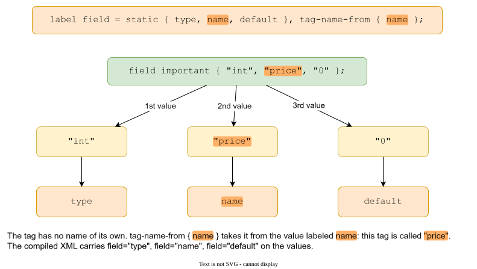
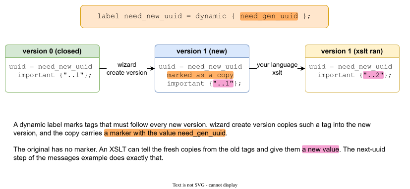

# Labels

A label gives meaning to a tag without adding anything to the language. There are two kinds: **static** and **dynamic**. A label is declared once, with a `label` statement, and used by name in front of the values of tags.

## Static labels: naming the values

A tag is a list of values. A static label says what each position means.



```
label field = static { type, name, default }, tag-name-from { name };

field important { "int", "price", "0" };
```

The label `field` has three parts: `type`, `name`, `default`. The tag lists three values, so the first is the type, the second is the name, the third is the default. In the compiled XML each value carries its part as an attribute:

```xml
<tag name="price">
    <values>
        <value index="0" field="type"><string>int</string></value>
        <value index="1" field="name"><string>price</string></value>
        <value index="2" field="default"><string>0</string></value>
    </values>
</tag>
```

A post XSLT can ask for a part by name, with `gal:labeled-string($tag, 'field', 'type')`, and need not count positions.

### Why it helps

Without labels, a tag is `price = { "int", "3", "0" }` and every generator must know "the third value is the default". With a label the meaning lives in the data. Adding a fourth part later changes the label, not every generator.

### tag-name-from

`tag-name-from { name }` says: the tag is called by its value labeled `name`. The tag above is `price`. You can find it with `//tag[@name='price']`, and you do not type the name twice.

If no name is declared this way, the tag has no name of its own and is found by its label. In the language XML the labels of a tag are listed in `label-refs`, and `gal:tags-labeled($version, 'field')` returns every tag that uses `field`. In the compiled XML a value carries its part as an attribute, so `gal:labeled-string` and `gal:tags-with-label` find it.

Two tags with the same name replace each other, so a name that comes from a value follows the same rule as any other name: a later version can write `field important { "long", "price" }` and the type of `price` changes.

!!! note
    A name that comes from a value competes with a name you typed. If `price = { ... }` and `field { "int", "price" }` are both in one version, one overrides the other. Keep the names apart.

### Several labels in one tag

A tag can have more than one label. They stack:

```
field important { "text", "message" };
```

`field` gives meaning to the values, and `important` is the built-in marker that puts the values into the [hash](hashes.md).

## Dynamic labels: values that must change with every version

Some values must be new in every version: an identifier of a message, a counter, a build number. Doing this by hand is how people forget.

```
label need_new_uuid = dynamic { need_gen_uuid };
```



A dynamic label marks tags to **follow every new version**. The command `wizard create version` copies each tag that has a dynamic label into the new version. The copy carries a marker: the value of the dynamic label, here `need_gen_uuid`. The original has no marker.

```
version 0 { uuid = need_new_uuid important { "6f1e0001-...-000000000001" }; }
version 1 { uuid = need_new_uuid important { "6f1e0001-...-000000000001" }; }   // just copied
```

Your language XSLT then finds the copies and gives them a new value:

```xml
<xsl:template match="tag[gal:tag-uses-dynamic(., 'need_gen_uuid')]/values/value/string/text()">
    <xsl:value-of select="gal:next-uuid(.)"/>
</xsl:template>
```

After the run version 1 has `...0002`. Old tags have no marker, so they keep their value. See [XSLT](xslt.md) and the step [02 of the messages example](example-messages.md).

### Why dynamic labels and not a script

- The rule "this tag is renewed with every version" is part of the data, next to the tag. Nobody has to remember it.
- Only the XSLT decides *how* to renew. A counter, a uuid, a date: the label just says that a value is due.
- A tag with a dynamic label is copied into every version, so the price is memory and time. The [benchmark](benchmark.md) measures it. A tag that does not change should have a static label or none.

## Where a label lives

A label is a statement of a version.

- Written in the root, it is visible to every aggregate.
- Written in an aggregate, it is visible to that aggregate.
- Once stated, it stays visible in later versions. A later statement of the same name replaces the earlier one.
- A label cannot be deleted. `delete name;` of a label name is an error.

A label is not part of the hash: you may add a part to a label in a closed version without breaking the hash of tags. This is how the [Example: messages that grow](example-messages.md) adds the dynamic label in step 2 while versions 0 and 1 stay closed.

`wizard create label shop field = static { type };` adds a label for you (the first word is the aggregate).
