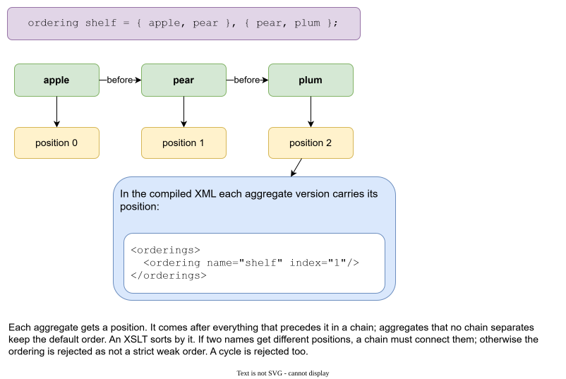

# Ordering

Files have no order. Aggregates are separate files, found by name. Generated output often needs an order anyway: a type declared before the types that use it, a base item before a derived one, a table before the tables that refer to it.

An **ordering** says it in the data.

```
ordering shelf = { apple, pear }, { pear, plum };
```

An ordering is a statement of the **root** aggregate. It has a name and one or more parts. A part is a chain: each name comes before the next one.



## From chains to positions

Galimatron turns the chains into an order of **all** aggregates, and writes the **position** of each one, counting from 0. Here `apple` has nothing before it, so it is at position 0. `pear` follows `apple`: position 1. `plum` follows `pear`: position 2.

- An aggregate comes after everything that precedes it in a chain.
- Aggregates that the ordering does not separate keep the **default order** (the order of the files).
- An aggregate that no part names goes after the named ones.

The position is written into the compiled XML. Each aggregate version carries it in an `orderings` element:

```xml
<orderings>
    <ordering name="shelf" index="1"/>
</orderings>
```

Your post XSLT sort by it:

```xml
<xsl:for-each select="$items">
    <xsl:sort select="xs:integer(orderings/ordering[@name = 'shelf']/@index)" data-type="number"/>
    ...
</xsl:for-each>
```

The [example with messages](example-messages.md) does exactly that: its ordering puts an enumeration before the type that uses it, so the generated code is in a valid order.

Your XSLT should decide what to do with an item that no part names. The example gives such an item a very large number, so a version without the ordering stays sorted by name.

## What is checked

An ordering must be a **strict weak order**:

- If two names get different positions, a chain must connect them. Otherwise the ordering says "A is before B" with nothing to support it, and Galimatron rejects it and names the pair.
- A cycle (`apple` before `pear` before `apple`) is rejected, and the message names it.

Names in an ordering must be aggregates that are present in that version. `wizard delete aggregate` refuses to remove an aggregate that a version's ordering still names. Remove the name from the ordering first.

## Writing an ordering

```
ordering shelf = { apple, pear };
```

in the root version, or

```
wizard create ordering shop shelf = { apple, pear };
```

(`shop` is the root aggregate here.) A later statement of the same ordering name in a later version replaces the earlier one. An ordering cannot be deleted.

!!! note
    The [benchmark](benchmark.md) rewrites the ordering of its root in every new version, with every aggregate named in it, to measure the cost.
