# Reference

## Command line

```
galimatron --gal-config-file gal.cfg --log-config-file log.cfg
galimatron --help
```

| Option | Meaning |
|---|---|
| `--gal-config-file PATH` | The configuration of the run. See [Configuration](configuration.md). |
| `--log-config-file PATH` | The configuration of the log. See [Logs](diagnostics.md#the-log-and-logcfg). |
| `--help` | Prints the options. |

A run that fails prints the exception and exits with a non-zero code.

## Grammar

```
file          = wizard-statement+ | root-file | aggregate-file
root-file     = "root" "aggregate" NAME "{" versions "}"  root-version*
aggregate-file= "aggregate" NAME "{" versions "}"         version*

versions      = "versions" "{" (INDEX [ "=" [ "deleted" ] [ "{" header "}" ] ] ";")* "}"
header        = "comment" "=" STRING | "hash" "=" STRING     // at most one of each, comma separated

version       = "version" [ "once" | "local" | "own" ] ( INDEX | "before" INDEX ) "{" statement* "}"
statement     = tag ";" | label ";" | ordering ";"   // an ordering is only in a root version
              | "delete" [ NAME ] ";"

tag           = [ NAME "=" ] [ "once" | "local" ] LABEL* values
values        = "{" [ value ("," value)* ] "}"
value         = STRING [ "_te" ] | record | array
record        = "{" [ STRING ":" ] value ("," [ STRING ":" ] value)* "}"
array         = "[" [ value ("," value)* ] "]"

label         = "label" NAME "=" ( "static" [ "{" NAME ("," NAME)* "}" [ "," "tag-name-from" "{" NAME "}" ] ]
                                 | "dynamic" "{" NAME "}" )
ordering      = "ordering" NAME "=" part ("," part)*
part          = "{" NAME "," NAME ("," NAME)* "}"
```

Names are `[A-Za-z][A-Za-z0-9_]*`. A string is `"..."`, `'...'`, or a raw string `R"(...)"` (with dashes, `R"-(...)-"`, to allow `)"` in the text). Comments are `// ...` and `/* ... */`.

A version of the root may hold tags, labels, orderings and `delete`. A version of an aggregate holds tags, labels and `delete`.

`delete;` ends the aggregate from this version. `delete NAME;` removes a tag.

## Keywords

These words are reserved. Do not use them as a name.

```
root aggregate versions version before label static dynamic tag tag-name-from
once local own ordering comment hash deleted delete
wizard create in copy to continue physically force collapse
```

`important` is not reserved: it is a built-in label name.

## Wizard commands

All commands start with `wizard`. Use `wizard { cmd; cmd; }` for several. One Wizard statement per run.

```
create root aggregate NAME
create aggregate [once|local|own] A [, B]* [in DIR]
copy aggregate SRC to A [, B]* [in DIR]
continue aggregate SRC to A [, B]* [in DIR]
delete aggregate [A [, B]* [physically]]

create version [once|local|own]
delete version [N [, M]*]
collapse version FIRST-LAST

create hash [N [, M]*] [force]
delete hash [N [, M]*] [force]

create tag [AGG] [NAME =] [once|local] LABEL* { values }
delete tag [AGG] NAME
create label [AGG] NAME = static|dynamic ...
create ordering [AGG] NAME = { A, B [, C]* } [, { ... }]*
```

Details are in [The Wizard](wizard.md).

## gal.cfg keys

| Key | Where |
|---|---|
| `galimatron.input-gal-dir`, `output-gal-dir`, `intermediate-xml-dir`, `intermediate-log-dir`, `intermediate-summary-dir`, `committed-report` | [folders](configuration.md#galimatron-folders) |
| `saxon-processor.working-dir`, `config-file` | [saxon-processor](configuration.md#saxon-processor) |
| `transforms.language-transforms.user-transforms.transforms[]` | [transforms](configuration.md#transforms) |
| `transforms.post-language-transforms.user-transforms.transforms[]` | [transforms](configuration.md#transforms) |
| a transform: `name`, `enable`, `user-data-for-info`, `input.principal-xsl.file`, `parameters[]`, `output.principal-xml.file`, `output.other-files[]` | [transforms](configuration.md#transforms) |
| a store: `store-dir`, `store-dir-string-alias`, `extentions`, `replace-escaped-form-to-original-symbols`, `delete-if-not-rewrited` | [aliases](configuration.md#where-your-xslt-may-write) |

`buildin-transforms` is present and empty in every file.

## Parameters given to every XSLT

`input_gal_dir`, `output_gal_dir`, `intermediate_xml_dir`, `intermediate_log_dir`, `intermediate_summary_dir`, `saxon_working_dir`. Absolute paths with `/`.

## Files that a run writes

| File | Where | What |
|---|---|---|
| `*.gal` | `output-gal-dir` | the rewritten description |
| files of your XSLT | the stores of `other-files` | what you generate |
| `galimatron.log` | as set in `log.cfg` | the log |
| `galimatron_summary.xml` | `intermediate-summary-dir` | the result of every step |
| `galimatron.crash.log` | `intermediate-log-dir` | empty unless Galimatron crashed |
| `lang-parsed.xml`, `lang-wizard.xml`, `lang-xslt.xml`, `lang-final.xml` | `intermediate-xml-dir` | the language after each stage |
| `post-compiled.xml` | `intermediate-xml-dir` | the compiled XML |
| `taskflow.dot` | the intermediate folders | the graph of steps and checks |
| the file of a `principal-xml` | `intermediate-xml-dir` | the principal result of that transform |

See [Logs and diagnostics](diagnostics.md).

## Versions: what each state allows

| | open | closed | deleted |
|---|---|---|---|
| Stored as | `N;` | `N = { hash = '...' };` | `N = deleted;` |
| Tags may change | yes | only unimportant ones | no body |
| `delete version` | yes | refused | – |
| `collapse version` | yes | yes | – |
| `create hash` | yes | – | – |
| `delete hash` | – | yes | – |

## Error names

The message of a failed run names a rule. The names are grouped by what failed.

### The description

| Name | Meaning |
|---|---|
| `ROOT_AGGREGATE_MISSED`, `ROOT_AGGREGATE_MUST_BE_ONE_ONLY` | There must be exactly one root aggregate. |
| `ROOT_AGGREGATE_VERSION_DECLARATIONS_MUST_START_WITH_ZERO`, `..._MUST_BE_CONTINUOUS` | The version list runs from 0 without gaps. |
| `ROOT_AGGREGATE_VERSION_DEFINITIONS_MUST_REPEAT_DECLARATIONS` | A version body exists only for a declared version. |
| `ROOT_AGGREGATE_VERSION_CANNOT_BE_LOCAL`, `..._CANNOT_BE_OWN` | `local` and `own` are only for aggregates. |
| `AGGREGATE_VERSION_DECLARATIONS_MUST_MATCH_ROOT` | An aggregate repeats the version list of the root. |
| `AGGREGATE_VERSION_DECLARATIONS_DELETED_MUST_BE_CONTINUOUS` | `deleted` is a prefix, a suffix, or a span owned by the next live version. |
| `AGGREGATE_VERSION_DEFINITIONS_MUST_REPEAT_DECLARATIONS`, `..._MUST_NOT_BE_DELETED` | A body only for a live declared version. |
| `AGGREGATE_NAMES_MUST_BE_UNIQUE`, `AGGREGATE_INDICES_MUST_BE_UNIQUE_CONTINUOUS` | Names are unique, ignoring case. |
| `ANONYMOUS_VERSION_MUST_HAVE_OWNER`, `..._MUST_PRECEDE_OWNER`, `..._MUST_BE_DELETED` | The rules of `version before N`. |

### Hashes

| Name | Meaning |
|---|---|
| `HASH_DOES_NOT_MATCH` | The stored hash differs from the one computed now. |
| `HASH_MUST_BE_ON_EVERY_AGGREGATE` | A hashed version has a hash on the root and on every live aggregate. |

### The Wizard

The names follow the pattern `WIZARD_<COMMAND>_<RULE>`.

| Rule | Meaning |
|---|---|
| `WIZARD_COMMAND_MUST_BE_ONE` | One Wizard statement per run. |
| `WIZARD_BATCH_COMMAND_MUST_BE_CREATE` | A batch holds create commands, `create hash`, `delete tag`, `delete version`, `collapse version`. |
| `..._ROOT_AGGREGATE_MUST_EXIST` | The command needs the root aggregate. |
| `..._ROOT_AGGREGATE_MUST_BE_ABSENT` | `create root aggregate` and a root exists already. |
| `..._NAMES_MUST_BE_UNIQUE`, `..._AGGREGATE_MUST_BE_ABSENT`, `..._CHUNK_MUST_BE_ABSENT` | The new name or file exists. |
| `..._COMMAND_FILE_IS_THE_AGGREGATE` | The command file would be overwritten by the new aggregate. |
| `..._SOURCE_MUST_EXIST`, `..._AGGREGATE_MUST_EXIST` | The named aggregate is not there. |
| `..._CANNOT_COPY_ROOT_AGGREGATE`, `..._CANNOT_CONTINUE_ROOT_AGGREGATE`, `..._CANNOT_DELETE_ROOT_AGGREGATE` | The root is not a target. |
| `WIZARD_COPY_AGGREGATE_SOURCE_IN_CLOSED_VERSION` | A copy would change a closed version. |
| `WIZARD_CONTINUE_AGGREGATE_LAST_VERSION_IS_ALREADY_DELETED`, `WIZARD_DELETE_AGGREGATE_LAST_VERSION_IS_ALREADY_DELETED` | The aggregate is already deleted. |
| `WIZARD_DELETE_AGGREGATE_CANNOT_DELETE_CLOSED_VERSION` | The aggregate is part of a closed version. |
| `WIZARD_DELETE_AGGREGATE_ORDERING_NAMES_AGGREGATE` | An ordering still names it. |
| `WIZARD_DELETE_VERSION_CANNOT_DELETE_CLOSED_VERSION` | The version is closed. |
| `WIZARD_DELETE_VERSION_MUST_STAY_CONTINUOUS` | The versions that remain would have a gap. |
| `WIZARD_COLLAPSE_VERSION_RANGE_MUST_ASCEND`, `..._VERSION_MUST_EXIST`, `..._OWNER_MUST_BE_PRESENT` | The range is wrong. |
| `WIZARD_VERSION_STATEMENT_LAST_VERSION_MUST_EXIST` | `create tag`, `label`, `ordering`, `delete tag` need a version. |
| `WIZARD_VERSION_STATEMENT_VERSION_MUST_BE_OPEN`, `..._VERSION_IS_DELETED` | The last version of the aggregate must be open and live. |
| `WIZARD_VERSION_STATEMENT_AGGREGATE_MUST_BE_NAMED`, `..._AGGREGATE_MUST_EXIST`, `..._AGGREGATE_MUST_BE_ROOT` | The aggregate of the statement. An ordering is only for the root. |
| `WIZARD_CREATE_HASH_VERSION_MUST_EXIST`, `WIZARD_DELETE_HASH_VERSION_MUST_EXIST` | A hash command names a version that is not there. |

## Diagrams of the internals

These diagrams were drawn for the developer guide. They are kept here for later use. The sources are in `drawio/`, and the `.svg` files are in `source/images/`.

### The libraries

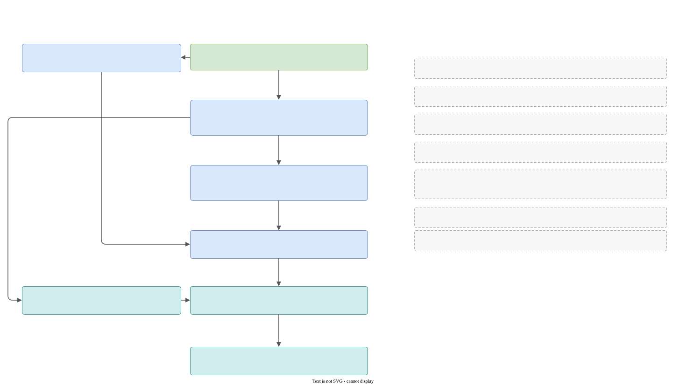

### One run, step by step

<div class="big-diagram" markdown="0">
<a href="../images/31_dev_pipeline_map.svg" target="_blank" title="Open the map at full size">

</a>
</div>

The map is large on purpose. [Open it in its own tab](images/31_dev_pipeline_map.svg) and zoom: it is a vector image.

### The state of the translator

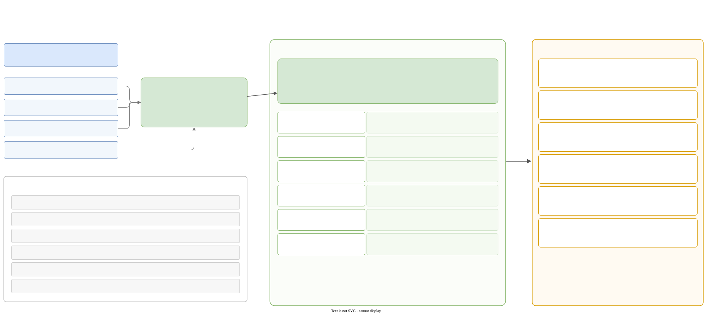

### The seal

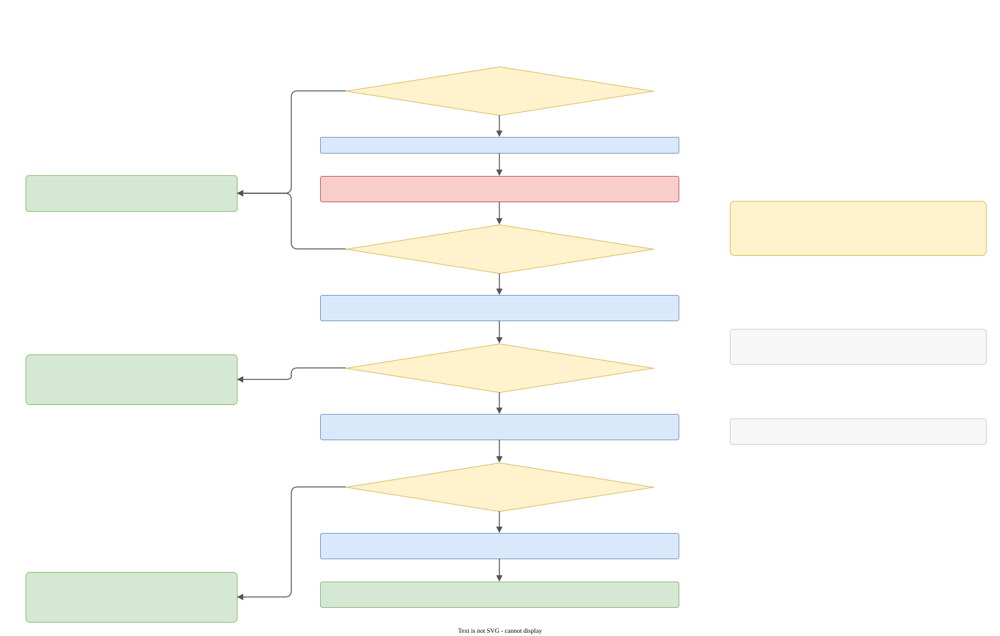

### The path of an error

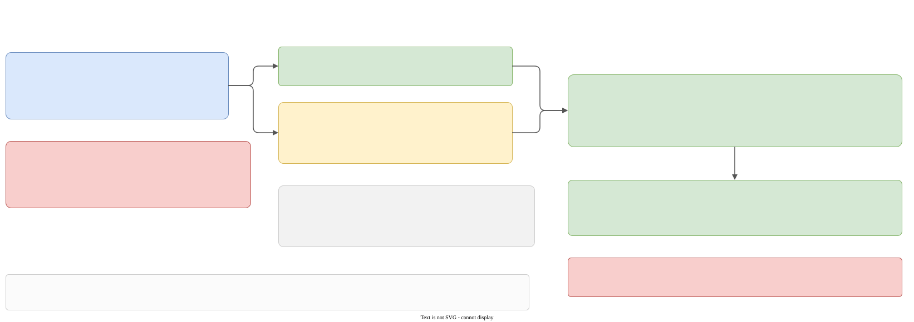

### How a run is built

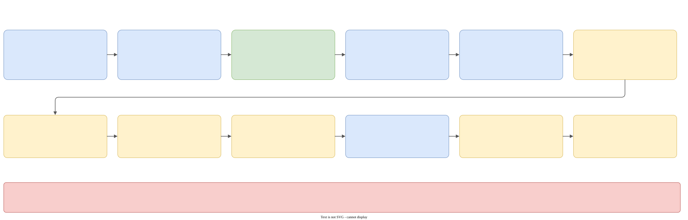

### The list of steps

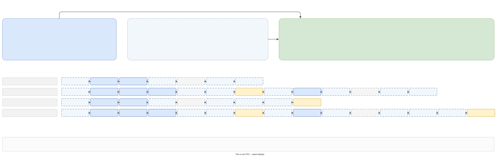

### The twelve checks of the validator

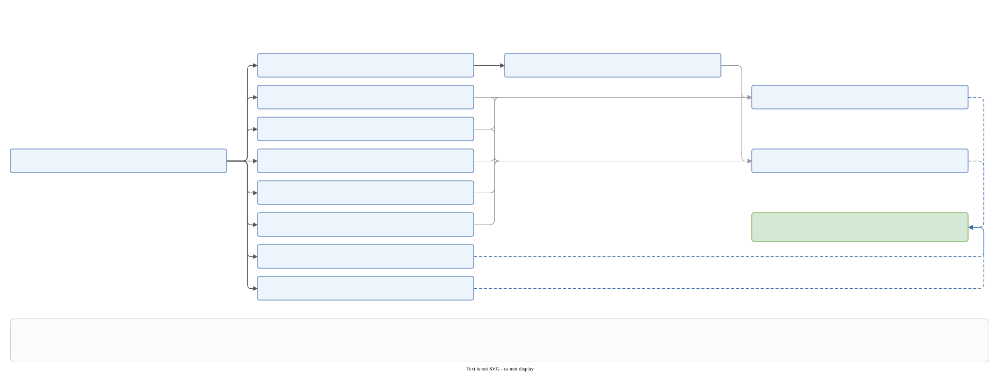

### The Wizard step


### The compile step


### The XML round trip


### The places of the filesystem decorator


### How a product test runs


### From source to installer

