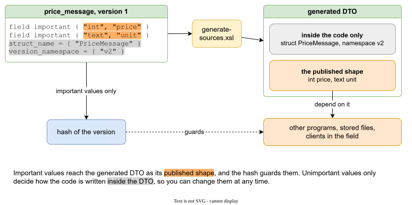
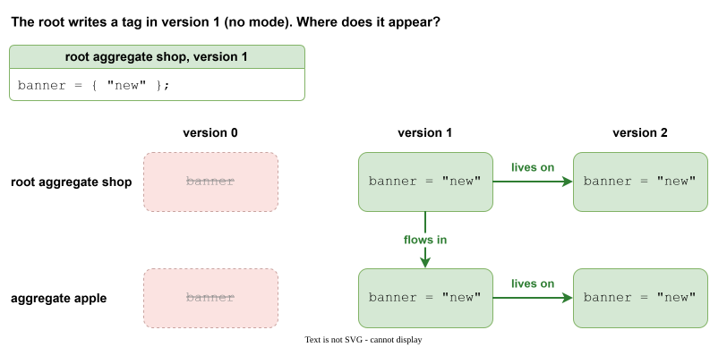
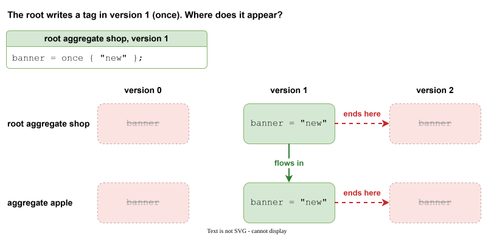
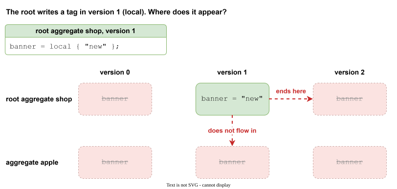
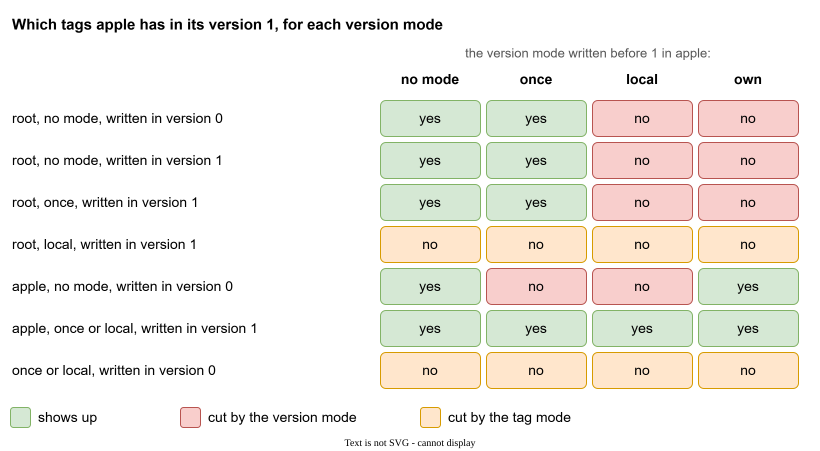

# Tags

A tag is a piece of data: a list of values, and usually a name. The name is data too, but a special part of it, because it is the **key**. Galimatron uses the name to tell which tag is meant: a later version that writes the same name replaces the earlier tag, `delete price;` removes a tag by its name, and a generator finds a tag by it. The values have none of these powers. You may leave the name out of the text and let a label supply it (see [A tag with no name of its own](#a-tag-with-no-name-of-its-own)). A tag that never receives a name is refused.

Everything you describe is a tag. The language does not know "integer", "message" or "price". It knows names and values, and your XSLT decide what they mean.

```
price = { "3" };
```

The tag `price` has one value, the string `3`. All values are text, even a number. Your XSLT convert it when they need a number.

## Values

A tag has a list of values in `{ }`. Each value is a string, a record, or an array.

```
empty      = { };
currency   = { "EUR" };
two        = { "int", "price" };
shape      = { { "k": "v", "n": ["a", "b"] }, "plain" };
```

| Value | Written as | In the compiled XML |
|---|---|---|
| string | `"text"`, `'text'`, `R"(text)"` | `<string>` |
| record | `{ "key": value, ... }` | `<record>` with `<key>` |
| array | `[ value, ... ]` | `<array>` |

A raw string `R"(...)"` takes every character as it is, including quotes and new lines, so it fits a block of code or markup. `R"--(...)--"` allows `)"` inside.

## A tag with no name of its own

A name is optional. A tag can be written with labels only:

```
field important { "int", "price" };
```

This tag has no name that you typed. A [label](labels.md) must name it from one of its values (`tag-name-from`). Here the value labeled `name` is `price`, so the tag is called `price`. Without that, the run stops.

The reason: a generator wants a list of *fields*, and wants to find a field by its name. You do not want to invent a tag name for each field, and you do not want the name to be written twice.

## Labels in front of the values

Words before the values are labels:

```
version_number = important { "2" };
field important { "text", "message" };
```

`important` is built in. It marks the values that [hashes](hashes.md) cover. `field` is a label that you declared (see [Labels](labels.md)). A tag may have several.

## Important

Not all data in a description is equal. Some of it other things depend on, and some of it is only yours.

**Important data** is data that something outside the description relies on, so changing it after it was published breaks that thing. The fields of a message that other programs send and read are important: a client in the field was built with them, and files written with them are still in use. So is a version number, or an identifier that must stay stable.

**Unimportant data** is data that lives only inside your project. The name of a structure in the generated code is a good example: it is written once in the code and nobody outside ever sees it. Rename it tomorrow and no one else notices. A note for a reader, a comment text, a name that only the code uses, a switch for a generator: all of these are unimportant.

A short way to decide: ask *who else depends on this value?* If the answer is "a program, a file or a person outside this project", mark it `important`. If the answer is "only the code that this project generates", leave it unmarked.

```
uuid = need_new_uuid important { "6f1e0001-0000-4000-8000-000000000001" };
field important { "int", "price" };
struct_name = { "PriceMessage" };
version_namespace = { "v2" };
```

Here `uuid` and the field are important: they are what is published. `struct_name` and `version_namespace` are not marked. They stay out of the hash, so they may be fixed or renamed at any time, even in a closed version, and nothing breaks.



The generator writes both kinds into the same DTO. The important values become its published shape, which other programs and files depend on, and the hash guards them. The unimportant values only shape the code inside the DTO.

### What the mark does

The label `important` puts the values of the tag into the [hash](hashes.md) that closes a version. That is the whole mechanism. The difference shows when a closed version is touched:

| | Important tag | Tag without `important` |
|---|---|---|
| Part of the hash | yes (the values) | no |
| Change in an open version | allowed | allowed |
| Change in a closed version | the run fails: the hash does not match | allowed, the hash does not change |

To change something important that was already published, do not edit the closed version. Create a new version (`wizard create version`) and write the new value there. The old version stays true to what was shipped, and the new one says what is true now.

### Do not mark too much, or too little

- **Too much** and every small edit needs a new version, because the hash fails on each change. Mark what you publish, and nothing else.
- **Too little** and a change that breaks others goes in silently, because nothing guards it.

In the [messages example](example-messages.md#the-steps) both kinds sit side by side. The fields and the uuid of a message are important. The mark that moves the system messages into their own namespace (step 4) is not: it only decides how the code is laid out, so moving the messages did not break a single hash.
## Tag modes: once and local

By default a tag stays: version 1 sees what version 0 wrote. A **tag mode** limits where one tag lives.

```
published = once important { };
```

| Mode | Lives in | Flows from the root to the aggregates |
|---|---|---|
| (none) | its version and all later versions | yes |
| `once` | its version only | yes, in the same version |
| `local` | its version only | no |

The three pictures below use the same case. The root writes the tag `banner` in version 1, and the pictures show where `banner` shows up in the root and in the aggregate `apple`, in versions 0, 1 and 2. A green box has the tag, a struck-out box does not.

**No mode.** The tag stays. It appears in the version where it was written and in every later one, and it flows from the root into the aggregate. A version before it does not have it.



**`once`.** The tag is for one version only. It still flows from the root into the aggregate in that version, but the next version no longer has it. This is the right mode for a fact about one version: this version is published. Written in the root, it marks every aggregate of that version and does not leak into the next one. In the [Example: messages that grow](example-messages.md) every version restates `published = once important { }`.



**`local`.** The tag is for one version, and for the file it is written in. It does not flow from the root into the aggregates, so only the root has it, and only in that version. `local` is for a fact about this file: a note for the person who reads the aggregate, a switch that the other aggregates must not inherit.



### Tag modes and version modes together

A tag mode (`once`, `local`) belongs to one tag. A [version mode](aggregates-and-versions.md#version-modes) (`once`, `local`, `own`) belongs to the version of an aggregate. They are two separate filters, and a tag shows up in a version only if **both** let it through:

1. The version mode decides which statements may reach this version: the earlier versions of the aggregate, and the statements of the root.
2. The tag mode decides how long the tag lives: a tag with `once` or `local` is visible only in the version where it was written, and `local` never flows from the root into an aggregate.

The picture shows the result for one aggregate, `apple`, in its version 1. The columns are the version mode written before `1`. The rows are the tags and where they were written. Red is a tag that the version mode cuts off. Orange is a tag that the tag mode cuts off, whatever the version mode is.



Three things follow from it:

- A `once` tag of the root flows into `apple` in its own version only when `apple` takes the root in that version. In a `local` or `own` version it does not arrive, because those versions are cut off from the root.
- A version mode never brings a tag back that its tag mode has ended. A `once` or `local` tag written in version 0 is gone in version 1 in all four columns.
- What `apple` writes in a version itself is always there in that version, in every version mode and for every tag mode.
## Deleting a tag

```
delete price;
```

The tag is absent from this version on. An earlier version still has it, and a later version may write it again. `wizard delete tag apple price` writes this for you. See [The Wizard](wizard.md).

## Template strings

A string followed by `_te` is a template. The compiled value is the string with `{{name}}` replaced by the value of the tag `name` in the same version:

```
station = { "North Light" };
greeting = { "{{station}} on watch"_te };
```

The `.gal` file keeps `{{station}}`. The compiled XML holds `North Light on watch`. Use it for a text that quotes another value, so the value is written once.

!!! note
    `_te` renders a string inside the data. A template for a whole generated file is another feature: see [Generating text](templates.md).
