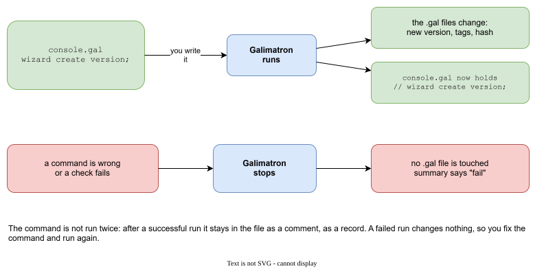
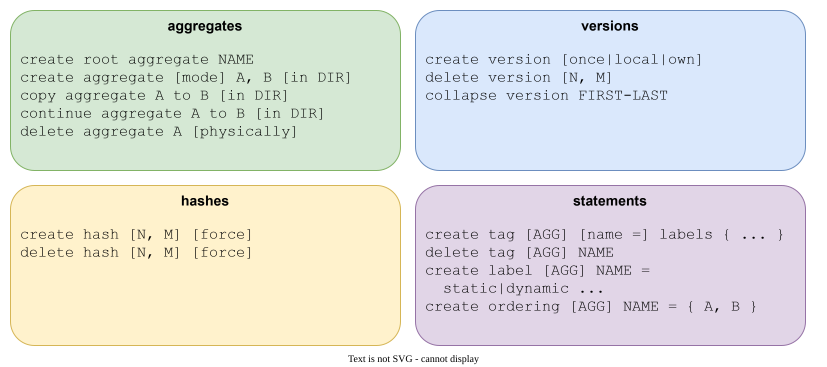

# The Wizard

The Wizard is a part of Galimatron that edits your `.gal` files for you. You write what you want in a few words, and Galimatron makes the same change in every file that it touches.

Nothing the Wizard does is magic: every change is an ordinary edit of `.gal` text, and you could make it by hand. The Wizard makes it faster, makes it in all the files at once, and checks it before anything is written. That is why it is a concept of its own and not just a command.

## The problem

A new version of a project means many small edits: add a version to the root, add it to every aggregate, copy the tags that must follow, add a tag here and there, compute the hash. Done by hand, one aggregate is forgotten, one index is wrong, and the next run fails. Worse, it is boring, so people avoid new versions.

The Wizard does these edits as one step, and checks the result before it writes anything.

## A command file

A Wizard command is written in a `.gal` file that has no aggregates. By habit it is called `console.gal`. It sits in the input folder next to the other files.

```
// version 0 is closed. this opens the next version.
wizard create version;
```

A run reads the file, runs the command, and writes the changed files. After a successful run the command is **commented out**:

```
// version 0 is closed. this opens the next version.
//
// wizard create version;
```



The comment is a record, and it prevents the command from running twice. A command that is refused changes no file, so you fix the command and run again.

Rules:

- Exactly one Wizard statement per run. For several commands, use a batch.
- The file that holds the Wizard holds nothing else (no aggregates).
- Write a comment above the command to say *why*. It stays in the file as the history of the change.

## A batch

```
wizard {
    create root aggregate shop;
    create version;
    create tag shop currency = { "EUR" };
    create tag shop published = once important { };
    create aggregate apple, pear, plum;
    create tag apple price = important { "3" };
    create hash;
}
```

One batch makes the root, version 0, two tags in the root, three aggregates, a tag in one of them and the hash. The [example with messages](example-messages.md) starts like this. The commands run in order, so the batch can use what an earlier command made. A batch holds create commands, `create hash`, `delete tag`, `delete version` and `collapse version`.

The commands are checked before each file is written. If the third command fails, no file changes.

## Commands



### Aggregates

| Command | Result |
|---|---|
| `create root aggregate NAME;` | Writes `NAME.gal` next to the command file. |
| `create aggregate [once\|local\|own] A, B [in DIR];` | Writes `A.gal`, `B.gal`, in the folder `DIR` below the command file when `in` is used. |
| `copy aggregate A to B [, C] [in DIR];` | A new aggregate with the declarations and bodies of `A`. `A` stays. |
| `continue aggregate A to B [, C] [in DIR];` | Ends `A` in a new version and continues it as `B`. |
| `delete aggregate A [, B] [physically];` | Writes `delete;` into the last version. With `physically` the file goes. |
| `delete aggregate;` | Removes every aggregate whose versions are all deleted. |

**copy** is for an aggregate that is a variant of another. **continue** is for an aggregate that is *replaced*: `A` ends in the new version, `B` starts there with the same statements, and the dynamic tags are carried over. Neither changes a closed version: copy refuses a source that is still present in a closed version.

**delete aggregate** is refused when the aggregate is present in a closed version, or when an ordering still names it.

### Versions

| Command | Result |
|---|---|
| `create version [once\|local\|own];` | Adds the next version to the root and to every live aggregate, and copies the tags that have a dynamic label. |
| `delete version [N, M];` | Removes open versions. Without a number, the last one. The rest are renumbered from 0. |
| `collapse version FIRST-LAST;` | Retires a range of versions, closed ones too. See [collapse](aggregates-and-versions.md#collapsing-history). |

A root version that has a hash is closed, and so is every version before it. `delete version` refuses those.

### Hashes

| Command | Result |
|---|---|
| `create hash [N, M] [force];` | Closes versions. Without a number, the last one. |
| `delete hash [N, M] [force];` | Opens versions again. |

See [Hashes and closed versions](hashes.md).

### Statements

| Command | Result |
|---|---|
| `create tag [AGG] [name =] labels { values };` | Writes a tag into the last version of `AGG`. |
| `delete tag [AGG] NAME;` | Writes `delete NAME;` into that version. |
| `create label [AGG] NAME = static\|dynamic ...;` | Writes a label. |
| `create ordering [AGG] NAME = { A, B } [, { ... }];` | Writes an ordering into the root. |

The version that receives the statement is the **last version of that aggregate**, and it must be open. So a version must exist: in a new project run `create version` before the first `create tag`, as the batch above does. When the aggregate is not named, the statement goes to the root.

```
wizard create tag shop currency = { "EUR" };
wizard create tag apple field important { "int", "weight" };
wizard create tag glossary entry { "price", "what a customer pays" };
wizard create ordering shop shelf = { apple, pear };
wizard create label shop field = static { type, name };
```

The unnamed form writes no name of its own. One label is enough for `tag-name-from` to name the tag. Further words in front of the values are more labels, not a name, and the tag still needs a name from `tag-name-from`.

## Examples

**Open the next version.**

```
// version 0 is closed. this opens the next version.
wizard create version;
```

The root and every aggregate get version 1. The tags with a dynamic label are copied. The [XSLT](xslt.md) then gives the copies new ids.

**Remove a version that was only a trial, and publish again.**

```
wizard {
    delete version;
    create version;
    create label shop field = static { type, name }, tag-name-from { name };
    create tag apple field important { "int", "weight" };
    create tag shop published = once important { };
    create hash;
}
```

**Add an aggregate in a folder.**

```
wizard {
    create version;
    create aggregate cherry in fruit;
    create tag cherry price = important { "5" };
    create hash;
}
```

`in fruit` writes `fruit/cherry.gal`.

The [example with messages](example-messages.md) uses every one of these commands on a real project, step by step.

## When a command is refused

Every refusal says which rule failed. These are the common ones:

| Message contains | What to do |
|---|---|
| `LAST_VERSION_MUST_EXIST` | Run `create version` first. |
| `CANNOT_DELETE_CLOSED_VERSION`, `VERSION_MUST_BE_OPEN` | The version has a hash. Delete the hash first, on purpose. |
| `SOURCE_IN_CLOSED_VERSION` | A copy would change a published version. Use `continue aggregate`. |
| `ORDERING_NAMES_AGGREGATE` | Remove the aggregate from the ordering first. |
| `COMMAND_FILE_IS_THE_AGGREGATE` | The command file cannot be one of the aggregates it creates. Rename one. |
| `WIZARD_COMMAND_MUST_BE_ONE` | Two Wizard statements in the files. Join them into a batch. |

See the [Reference](reference.md#error-names) for the full list.
