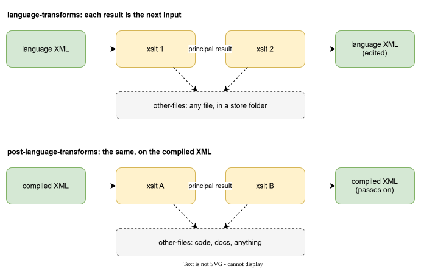
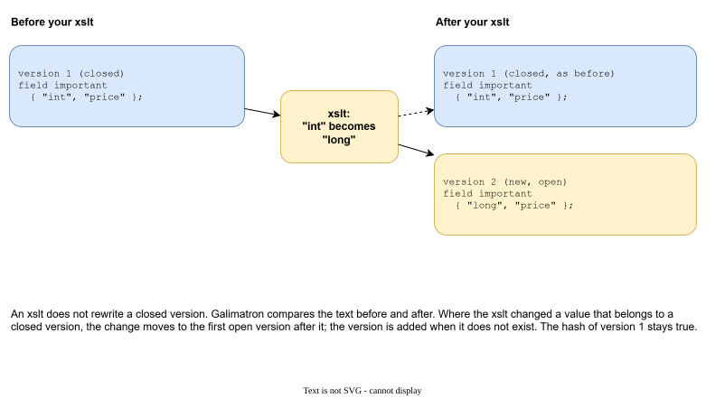

# XSLT

Galimatron has no built-in generator, because what you generate is yours. Its primary output is XML, and XSLT is the way to turn that XML into something else *inside* the run. Galimatron hands the data to your **XSLT 3.0** programs, run by SaxonC-HE, and takes the result back. This page is about writing those programs.

!!! important
    Using XSLT here is **optional**. The compiled XML (`post-compiled.xml`) is written on every run. If you prefer Python or any other tool, leave `transforms` empty and read that file. XSLT inside Galimatron adds three things: Saxon is already there, the output is confined to the folders of `gal.cfg`, and a *language* XSLT can edit the data safely (see the seal below).

    And nothing here is tied to a language: your XSLT can write source code in any language, JSON, SQL, Markdown, anything.

You need XSLT for two different jobs:

| Job | Kind of transform | Input | Output |
|---|---|---|---|
| change the data | **language** transform | the language XML | the changed language XML, written back into `.gal` |
| make files | **post-language** transform | the compiled XML | files in the folders named by `gal.cfg` |



Each list runs in order, and the result of one transform is the input of the next. Both lists are in [gal.cfg](configuration.md#transforms). Either list may be empty.

## Why XSLT

- The data already is a tree, and XSLT is made for trees.
- XSLT is declarative: "when you see this tag, write that". It fits "for every aggregate of every published version".
- You do not need a build of your own, a language runtime or a library. A text file is the generator.
- It is replaceable. Two projects with different generators use the same Galimatron.
- It is not a fashion. XSLT 1.0 became a W3C standard in 1999, so the language is more than 25 years old, and version 3.0 (the one Galimatron uses) dates from 2017. A generator you write today will still be readable and runnable years from now.
- It is a full programming language (Turing-complete), with variables, functions and recursion. Whatever you need to compute, you can compute inside the template. It is the shape of the code, not its power, that is different from other languages.

### What SaxonC-HE does not do

Saxon comes in editions, and Galimatron carries the free one, SaxonC-HE (Home Edition). Three things from the paid editions are missing. Know them before you plan a generator:

- **No schema awareness.** Your XSLT cannot validate the XML against an XSD (no `xsl:import-schema`, no `validation="strict"`, no `schema-element()`). Galimatron checks its own data itself, before and after your XSLT. A check on the data that you add yourself is written in XSLT, with `xsl:if` and `xsl:message terminate="yes"`.
- **No streaming.** The whole document is held in memory while your XSLT runs. This is fine for the sizes in the [benchmark](benchmark.md), and a reason not to dump a huge data set through one transform.
- **No parallel execution.** The edition does not spread one transform over several threads. This costs little here, because Galimatron runs the transforms of a list one after another anyway.

Ordinary XSLT 3.0 (functions, maps, arrays, `xsl:iterate`, `xsl:result-document`, regular expressions) works.

## The first XSLT: change the data

A language XSLT copies everything and changes only what it matches.

```xml
<xsl:transform
    xmlns:xsl="http://www.w3.org/1999/XSL/Transform"
    xmlns:xs="http://www.w3.org/2001/XMLSchema"
    exclude-result-prefixes="xs"
    version="3.0"
>
    <xsl:mode on-no-match="shallow-copy"/>

    <!-- counter = { "0" } becomes { "1" }, then { "2" }, and so on -->
    <xsl:template match="tag[@name='counter']/values/value/string/text()">
        <xsl:value-of select="xs:integer(.) + 1"/>
    </xsl:template>
</xsl:transform>
```

`<xsl:mode on-no-match="shallow-copy"/>` is the line to remember. Without it, everything you do not match is dropped, and the data disappears. With it, the XSLT is a *patch*.

## The language XML

Galimatron writes the language as XML. These are the elements you will use:

```xml
<galimatron>
  <language>
    <chunk>                                  <!-- one .gal file -->
      <aggregate name="apple" index="0">
        <aggregate-version-declarations>
          <aggregate-version-declaration index="0" status="deleted"/>
          <aggregate-version-declaration index="1"/>
        </aggregate-version-declarations>
        <aggregate-version-definitions>
          <aggregate-version-definition index="1">
            <tag index="0" name="price">
              <label-refs/>
              <values>
                <value index="0"><string delimiter="0">3</string></value>
              </values>
            </tag>
          </aggregate-version-definition>
        </aggregate-version-definitions>
      </aggregate>
    </chunk>
  </language>
  <history>...</history>
</galimatron>
```

| Element | Is |
|---|---|
| `root-aggregate`, `aggregate` | the aggregates, with `name` |
| `*-version-declaration` | the version list: `index`, `status="deleted"`, hash |
| `*-version-definition` | the body of a version, with `index` |
| `tag` | a tag, with `name` when it has one |
| `label-refs` | the labels the tag uses |
| `label` | a label statement |
| `values/value/string` | a value. Records and arrays have `record` and `array`. |

The simplest way to learn the shape is to open `intermediate/lang-wizard.xml` of your project: that is the exact input of your first language XSLT. See [Logs and diagnostics](diagnostics.md).

## The compiled XML

A post XSLT reads the merged picture. There the version definitions are complete: the root's tags are in the aggregates, and earlier versions are folded in.

```xml
<galimatron>
  <compiled>
    <chunk>
      <aggregate name="dictionary" index="0">
        <aggregate-version-definitions>
          <aggregate-version-definition index="6" mode="own">
            <orderings>
              <ordering name="shelf" index="4"/>
            </orderings>
            <tag index="1" name="uuid">
              <values>
                <value index="0" entry="name"><string>uuid</string></value>
                <value index="1" entry="introduced"><string>0</string></value>
              </values>
            </tag>
```

Differences from the language XML:

- A value carries the part of its static label as an attribute (`entry="name"`). No `label-refs`.
- Tags are merged and deleted tags are gone.
- Each version definition carries its `orderings` (the positions, see [Ordering](ordering.md)).
- Template strings (`_te`) are already rendered.
- The aggregates of a version are not nested under the root. Use `//aggregate-version-definition[@index = 3]` to find all of them.

See `intermediate/post-compiled.xml` for the real thing.

## gal-functions.xsl

Galimatron ships `gal-functions.xsl`, a library of functions for these two XMLs. Include it by its address:

```xml
<xsl:include href="https://github.com/goloveshin/galimatron/xslt/gal-functions.xsl"/>
```

An installed Galimatron maps this address to the file on disk (the `catalog.xml` described in [Getting started](getting-started.md#install)), so it needs no network. Declare `xmlns:gal="https://github.com/goloveshin/galimatron"`.

| Function | Returns |
|---|---|
| `gal:tagvalue($version, 'name')` | The first string of the tag `name` in that version, or empty. |
| `gal:has-tag($version, 'name')` | Whether the version has that tag. |
| `gal:labeled-string($tag, 'label', 'part')` | The string of the value marked by that part of a static label. (compiled) |
| `gal:tags-with-label($version, 'label')` | Direct tags of a version that carry a value of that label. (compiled) |
| `gal:tags-labeled($parent, 'label')` | Tags that use that label. (language) |
| `gal:versions-with-tag($anchor, $index, 'name')` | Every aggregate version of one index that has that tag. |
| `gal:version-definition($node)` | The version definition that contains the node. |
| `gal:version-index($node)` | Its index. |
| `gal:is-open-version($definition)` | Whether the version is live and no later version of that aggregate exists. |
| `gal:next-statement-index($version)` | The next free `index` for a new statement in that version. |
| `gal:tag-uses-dynamic($tag, 'id')` | Whether the tag is a Wizard copy marked by that dynamic label. |
| `gal:next-uuid($uuid)` | The uuid with its last group increased by one. |
| `gal:history($anchor)` | The `history` element. |
| `gal:dictionary-entry($index, $name, $introduced, $text)` | A new `tag` for a dictionary, written in the language XML. |
| `gal:ctx($version, $names)` | A map of tag values for a template. Hyphens in names are underscores in tags. |
| `gal:directory-uri($path)`, `gal:file-uri($path)` | A file URI for a path, for `doc()`. |

Several of these (`next-uuid`, `dictionary-entry`, and the helpers that find messages and enums) are written for the [example with messages](example-messages.md). The rest are general. Read the file: it is short, and a good model for functions of your own.

## A language XSLT with state: the next uuid

This is the one from the messages example. `wizard create version` copies each tag with a dynamic label and marks the copy. The XSLT gives the copies a new value:

```xml
<xsl:mode on-no-match="shallow-copy"/>

    <!-- a Wizard copy of a tag labeled need_new_uuid. the original tag has no dynamic child -->
<xsl:template match="tag[gal:tag-uses-dynamic(., 'need_gen_uuid')]/values/value/string/text()">
    <xsl:value-of select="gal:next-uuid(.)"/>
</xsl:template>
```

Four lines, and every message in every new version gets a new id. See [Labels](labels.md#dynamic-labels-values-that-must-change-with-every-version).

## A post XSLT: a dictionary

This one reads the compiled XML and writes a Markdown file with an alias (see [aliases](configuration.md#where-your-xslt-may-write)):

```xml
<xsl:mode on-no-match="shallow-copy"/>

<xsl:template match="galimatron">
    <xsl:copy>
        <xsl:apply-templates select="@* | node()"/>
    </xsl:copy>
    <xsl:result-document href="@@dictionary@@dictionary.md@@" method="text">
        <xsl:text># Dictionary&#10;&#10;</xsl:text>
        <xsl:for-each-group select="//aggregate[@name = 'dictionary']//tag[values/value/@entry]"
                            group-by="string(gal:labeled-string(., 'entry', 'introduced'))">
            <xsl:sort select="xs:integer(current-grouping-key())" data-type="number"/>
            <xsl:text>## Version </xsl:text>
            <xsl:value-of select="current-grouping-key()"/>
            <xsl:text>&#10;&#10;</xsl:text>
            <xsl:for-each select="current-group()">
                <xsl:sort select="@name"/>
                <xsl:text>- `</xsl:text><xsl:value-of select="@name"/><xsl:text>`</xsl:text>
                ...
            </xsl:for-each>
        </xsl:for-each-group>
    </xsl:result-document>
</xsl:template>
```

The template matches the document element, copies it through (so the next transform gets the same document), and **also** writes a file. This is the common shape of a post transform.

## Your XSLT and closed versions: the seal

A language XSLT may change a value in a version that a hash has closed. Galimatron does not fail, and it does not rewrite history. It moves the change to the first open version.



See [Hashes and closed versions](hashes.md#the-hash-and-your-xslt). The effect for you: write the XSLT as if it edits the whole description. Published versions stay what they were, and the change shows up in the open version.

## Working with an XSLT

- **Start from `shallow-copy`.** An XSLT that forgets it destroys the document.
- **Look at the dump.** Open `lang-wizard.xml` or `post-compiled.xml`, find the element, and write the template from what you see.
- **Test one transform at a time.** Give its `principal-xml` a `file` and read the result.
- **Parameters, not paths.** Pass options with `parameters` in `gal.cfg`, and use `input_gal_dir` and friends for folders.
- **Say why.** `name` and `user-data-for-info` in `gal.cfg` are read by the next person.
- **`xsl:message` shows in the console.** Use it to print a progress line, like the title in the example.
- **Keep generated text in templates.** See [Generating text](templates.md).
